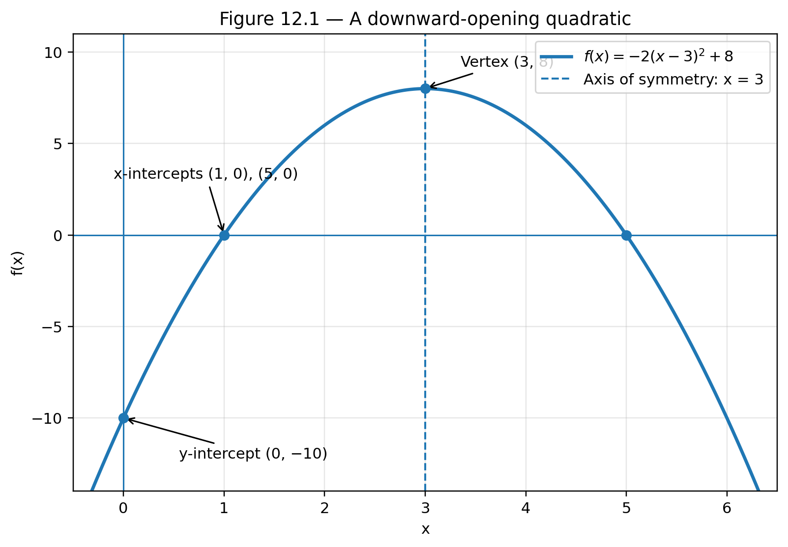
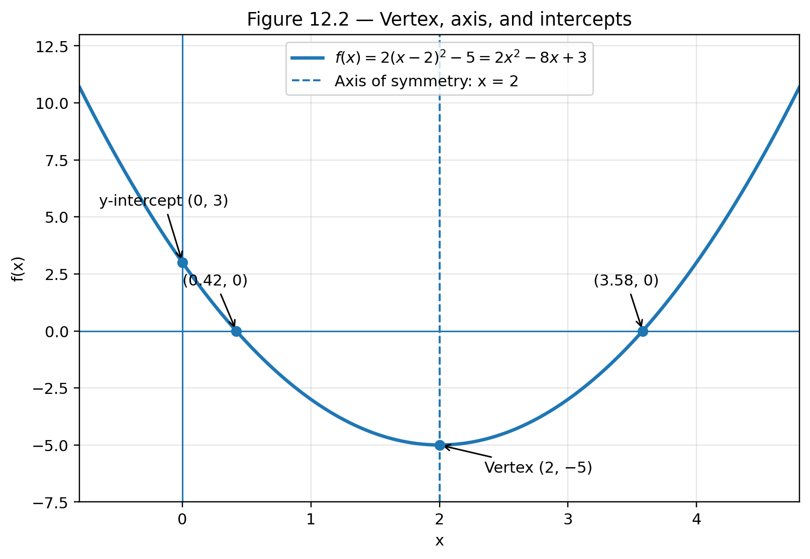
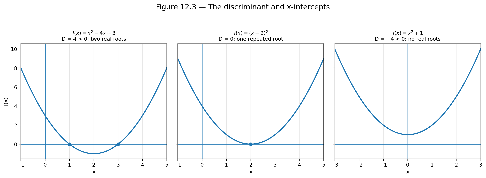
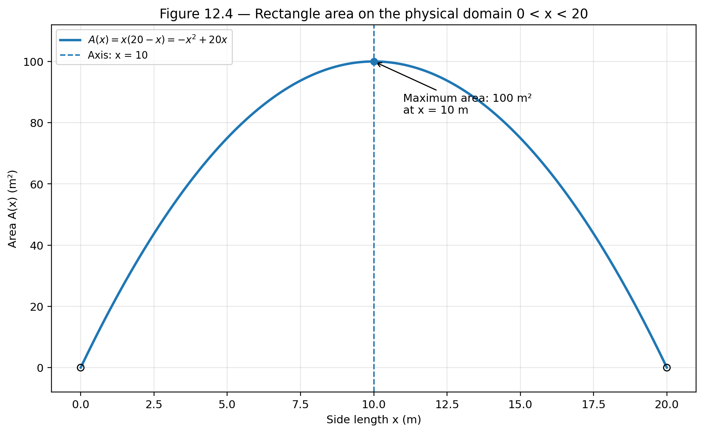
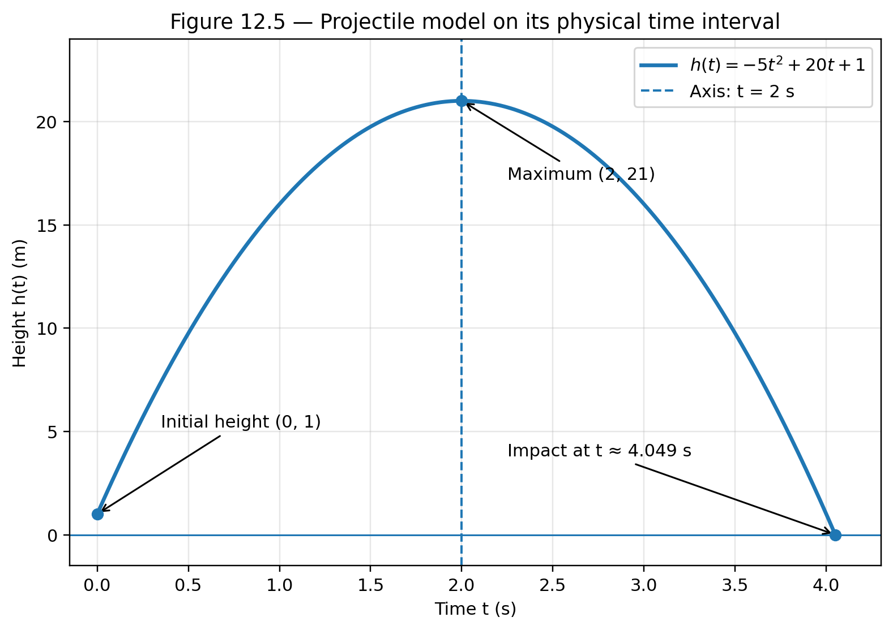

# Algebra 12 — Quadratic Equations and Quadratic Models

## 1. Introduction

A quadratic expression is built from a squared variable, a linear term, and a constant. Quadratic equations arise when a quantity depends on a square, when two linear factors are multiplied, or when a model has a constant second difference. Their graphs are parabolas, whose symmetry and vertex make many applications of maximum and minimum values accessible.

Chapters 08 and 09 introduced polynomial operations and factoring. Chapter 05 introduced coordinate graphs and slope. This chapter brings those ideas together around degree-two equations and functions. It emphasizes several complementary solution methods and explains when each method is useful.

Unless stated otherwise, this chapter solves equations over the real numbers. When an equation has no real solution, Chapter 13 will extend the discussion to complex numbers.

### Learning objectives

After completing this chapter, you should be able to:

- Recognize a quadratic polynomial and distinguish it from a degenerate linear or constant expression.
- Move among standard, vertex, and factored forms when the required information is available.
- Solve quadratic equations by the square-root method, completing the square, the quadratic formula, and factoring.
- Derive the quadratic formula and explain the role of the discriminant.
- Classify the number of distinct real roots and relate roots to graph intercepts.
- Find the vertex, axis of symmetry, opening direction, and range of a quadratic function.
- Build and interpret quadratic models, including constrained maximum and minimum problems.
- Use exact rational computation when possible and distinguish exact roots from decimal approximations.

## 2. Quadratic expressions, equations, and functions

A **quadratic polynomial in one variable** has the form

$$
ax^2+bx+c,
$$

where $a,b,c\in\mathbb R$ and $a\ne0$. The condition $a\ne0$ is essential: if $a=0$, the expression is linear when $b\ne0$ and constant when $b=0$.

The equation

$$
ax^2+bx+c=0
$$

is a **quadratic equation**. A real number $r$ is a **root** or **solution** if substitution makes the equation true. For the associated function

$$
f(x)=ax^2+bx+c,
$$

such a number is also called a **zero** of the function because $f(r)=0$.

The leading coefficient is $a$, the linear coefficient is $b$, and the constant term is $c$. The polynomial is in **standard form** when its terms are ordered by descending powers.

### 2.1 Three useful forms

| Form | Expression | Information it makes visible |
|---|---|---|
| Standard form | $f(x)=ax^2+bx+c$ | Coefficients and the $y$-intercept $c$ |
| Vertex form | $f(x)=a(x-h)^2+k$ | Vertex $(h,k)$ and axis $x=h$ |
| Factored form | $f(x)=a(x-r_1)(x-r_2)$ | Real roots $r_1,r_2$, when this factorization exists over the stated coefficient domain |

The three forms describe the same quadratic function when they are obtained by valid algebraic transformations. Not every quadratic factors into real linear factors. Vertex form is always available over the reals, because completing the square is possible whenever $a\ne0$.

A repeated root may be represented as $a(x-r)^2$. If the discriminant is negative, there is no real factored form into linear factors, although a factorization over the complex numbers will be studied in Chapter 13.

## 3. The graph of a quadratic function

The graph of $f(x)=ax^2+bx+c$ is a **parabola**. Its essential geometric features follow from vertex form:

$$
f(x)=a(x-h)^2+k.
$$

- The **vertex** is $(h,k)$.
- The **axis of symmetry** is the vertical line $x=h$.
- If $a>0$, the parabola opens upward and the vertex is its global minimum on $\mathbb R$.
- If $a<0$, the parabola opens downward and the vertex is its global maximum on $\mathbb R$.
- The $y$-intercept is $(0,c)$ because $f(0)=c$.
- The $x$-intercepts, when they exist, are the points $(r,0)$ where $r$ is a real root.

The range on the full real domain is $[k,\infty)$ when $a>0$ and $(-\infty,k]$ when $a<0$. A restricted contextual domain can change the range and can move the maximum or minimum to an endpoint; do not apply the unrestricted range statement blindly to a restricted model.

### 3.1 Symmetry

For vertex form,

$$
f(h+t)=at^2+k=f(h-t)
$$

for every real $t$. Thus points equally far to the left and right of the axis have the same height. This proves symmetry about $x=h$.

### Example 1 — Read information from vertex form

Let

$$
f(x)=-2(x-3)^2+8.
$$

The vertex is $(3,8)$, the axis is $x=3$, and the graph opens downward because $a=-2<0$. Its maximum value on $\mathbb R$ is $8$, attained at $x=3$. Its range is $(-\infty,8]$.

The $y$-intercept is $f(0)=-2(9)+8=-10$, so it is $(0,-10)$. To find the $x$-intercepts, solve $-2(x-3)^2+8=0$; this gives $(x-3)^2=4$, hence $x=1$ or $x=5$.

The graph in **Figure 12.1** shows the downward-opening parabola, its vertex $(3,8)$, its axis of symmetry $x=3$, and its two $x$-intercepts. The intercepts are equally spaced from the axis, illustrating the symmetry described above.



## 4. Completing the square and vertex form

Completing the square rewrites a quadratic so that a perfect-square expression appears. For $x^2+px$, add $(p/2)^2$:

$$
x^2+px+\left(\frac p2\right)^2=\left(x+\frac p2\right)^2.
$$

For $f(x)=ax^2+bx+c$ with $a\ne0$, first factor $a$ from the two variable terms and then complete the square:

$$
\begin{aligned}
f(x)
&=a\left(x^2+\frac ba x\right)+c\\
&=a\left[\left(x+\frac{b}{2a}\right)^2-\frac{b^2}{4a^2}\right]+c\\
&=a\left(x+\frac{b}{2a}\right)^2-\frac{b^2-4ac}{4a}.
\end{aligned}
$$

This identity gives the vertex form directly. The vertex coordinates are therefore

$$
h=-\frac{b}{2a},\qquad k=-\frac{b^2-4ac}{4a}.
$$

Completing the square is valid for every real $a,b,c$ with $a\ne0$; it does not require $b$ or $c$ to be integers.

### Example 2 — Convert standard form to vertex form

Write $f(x)=2x^2-8x+3$ in vertex form.

$$
\begin{aligned}
f(x)&=2(x^2-4x)+3\\
&=2[(x-2)^2-4]+3\\
&=2(x-2)^2-5.
\end{aligned}
$$

The vertex is $(2,-5)$, the axis is $x=2$, and the graph has a minimum value of $-5$ on $\mathbb R$.

**Figure 12.2** graphs this same function. It makes the vertex $(2,-5)$, the symmetry axis $x=2$, and the two real $x$-intercepts visible. The figure will also be useful in Example 9, which analyzes the graph from its standard form.



## 5. Solving by the square-root method

The **square-root method** is useful when an equation can be written as

$$
(x-h)^2=q.
$$

Over the real numbers:

- If $q<0$, there are no real solutions.
- If $q=0$, there is one distinct solution, $x=h$.
- If $q>0$, there are two distinct solutions, $x=h\pm\sqrt q$.

The symbol $\sqrt q$ is the principal nonnegative square root. The plus/minus sign records both equation solutions; it does not mean the radical itself has two values. See Chapter 11 for the principal-root convention and the identity $\sqrt{x^2}=\lvert x\rvert$.

### Example 3 — Solve using square roots

Solve $3(x-2)^2=27$ over $\mathbb R$.

Divide by the nonzero number $3$:

$$
(x-2)^2=9.
$$

Thus $x-2=\pm3$, so

$$
x=5\quad\text{or}\quad x=-1.
$$

Both values satisfy the original equation.

### Example 4 — A negative right-hand side

Solve $(x+1)^2=-4$ over $\mathbb R$. A real square cannot be negative, so there is no real solution. This statement does not say that there are no complex solutions; those are developed in Chapter 13.

## 6. Solving by completing the square

Completing the square can solve any real quadratic equation, even when it does not factor over the rationals.

### Example 5 — Solve by completing the square

Solve $x^2-6x+2=0$.

Move the constant term:

$$
x^2-6x=-2.
$$

Add $( -6/2)^2=9$ to both sides:

$$
x^2-6x+9=7.
$$

Therefore

$$
(x-3)^2=7,
$$
so

$$
x=3\pm\sqrt7.
$$

The result is exact. Decimal approximations are optional and do not replace the exact form.

### 6.1 Why the method always works

For every $a\ne0$, the expression $ax^2+bx+c$ can be rewritten by the identity in Section 4. Setting it equal to zero produces a squared expression equal to a real constant. The sign of that constant determines whether there are zero, one, or two real solutions. Thus completing the square is not a trick for selected examples; it is a general method for all real quadratic equations.

## 7. The quadratic formula

The **quadratic formula** solves every quadratic equation $ax^2+bx+c=0$ with real coefficients and $a\ne0$:

$$
x=\frac{-b\pm\sqrt{b^2-4ac}}{2a},
$$

when the square root is interpreted over the reals. Let $D=b^2-4ac$ be the discriminant. If $D<0$, the formula has no real value and the equation has no real solution.

### 7.1 Derivation

Start with

$$
ax^2+bx+c=0,\qquad a\ne0.
$$

Divide by $a$ and move the constant:

$$
x^2+\frac ba x=-\frac ca.
$$

Add $(b/2a)^2$ to both sides:

$$
\left(x+\frac{b}{2a}\right)^2
=\frac{b^2-4ac}{4a^2}.
$$

If the right-hand side is nonnegative, take both square-root branches and simplify. The resulting set of solutions is

$$
x=\frac{-b\pm\sqrt{b^2-4ac}}{2a}.
$$

The denominator $2a$ is nonzero because $a\ne0$. This derivation also explains why the discriminant controls the number of real roots.

### Example 6 — Use the quadratic formula

Solve $2x^2+3x-2=0$.

Here $a=2$, $b=3$, and $c=-2$. The discriminant is

$$
D=3^2-4(2)(-2)=25.
$$

Therefore

$$
x=\frac{-3\pm5}{4},
$$
which gives

$$
x=\frac12\quad\text{or}\quad x=-2.
$$

### Example 7 — Irrational real roots

Solve $x^2-2=0$. The formula gives $D=8$ and

$$
x=\frac{\pm\sqrt8}{2}=\pm\sqrt2.
$$

The roots are real but irrational. A decimal approximation may be useful for a graph, but the exact answer is $\pm\sqrt2$.

## 8. The discriminant and the number of real roots

For a quadratic equation with real coefficients, define

$$
D=b^2-4ac.
$$

| Discriminant | Number of distinct real roots | Graph interpretation |
|---|---:|---|
| $D>0$ | 2 | The parabola crosses the $x$-axis at two points. |
| $D=0$ | 1 | The parabola touches the $x$-axis at its vertex; the root is repeated. |
| $D<0$ | 0 | The parabola does not meet the $x$-axis. |

**Figure 12.3** compares the three possibilities in the table: a parabola crossing the $x$-axis twice when $D>0$, touching it at the vertex when $D=0$, and not meeting it when $D<0$.



The discriminant counts **distinct real** roots, not roots counted with multiplicity. When $D=0$, the equation has one distinct real root of multiplicity two.

### Example 8 — A parameter changes the number of roots

For real parameter $m$, classify the real solutions of

$$
x^2-4x+m=0.
$$

The discriminant is $D=16-4m=4(4-m)$.

- If $m<4$, then $D>0$: two distinct real roots.
- If $m=4$, then $D=0$: one distinct repeated root, $x=2$.
- If $m>4$, then $D<0$: no real roots.

A parameter can change the number of intersections of the graph with the horizontal axis.

## 9. Choosing a solution method

No single method is best for every quadratic. Use the structure of the equation:

| Form or feature | Efficient method | Caution |
|---|---|---|
| $a(x-h)^2=q$ | Square-root method | Check the sign of $q$. |
| Easy integer or rational factors | Factoring (Chapter 09) | The zero-product property applies only after the equation is set equal to zero. |
| A perfect-square pattern appears | Completing the square | Add the same quantity to both sides. |
| Any quadratic with $a\ne0$ | Quadratic formula | Use the discriminant and preserve exact radicals. |
| Need vertex or maximum/minimum | Complete the square or use vertex formulas | Check whether the model's domain is restricted. |

Factoring is often the fastest when it is available. Completing the square reveals the vertex and derives the formula. The quadratic formula is a reliable general-purpose procedure.

## 10. Connecting roots and graphs

For $f(x)=ax^2+bx+c$, the real roots solve $f(x)=0$ and are exactly the $x$-coordinates of the graph's $x$-intercepts. The discriminant therefore tells how many times the parabola meets the horizontal axis.

The vertex form also gives the axis and extremum. When standard form is known, the coordinates are

$$
h=-\frac{b}{2a},\qquad k=f(h)=-\frac{D}{4a}.
$$

The $y$-intercept is $(0,c)$. These features are enough to sketch the basic shape accurately, although a scale and several plotted points may still be needed for a careful graph.

### Example 9 — Analyze a quadratic graph

Let $f(x)=2x^2-8x+3$.

From Example 2,

$$
f(x)=2(x-2)^2-5.
$$

Therefore:

- Vertex: $(2,-5)$.
- Axis of symmetry: $x=2$.
- Opening: upward.
- Minimum value: $-5$.
- Range on $\mathbb R$: $[-5,\infty)$.
- $y$-intercept: $(0,3)$.

To find the $x$-intercepts, solve $2(x-2)^2-5=0$:

$$
(x-2)^2=\frac52,
\qquad
x=2\pm\frac{\sqrt{10}}2.
$$

The two intercepts are symmetric about $x=2$, as required by the axis of symmetry.

## 11. Quadratic models and optimization

A quadratic model is useful when a quantity changes nonlinearly but can be represented by a degree-two formula. The model must include its units, assumptions, and contextual domain. A mathematically valid vertex outside the feasible domain may not be an attainable optimum.

### Example 10 — Maximum area with a fixed perimeter

A rectangle has perimeter $40$ metres. Let one side be $x$ metres. The other side is $20-x$, so the area is

$$
A(x)=x(20-x)=-x^2+20x.
$$

The physical domain is $0<x<20$. Completing the square gives

$$
A(x)=-(x-10)^2+100.
$$

The vertex occurs at $x=10$, which lies in the feasible domain. The maximum area is $100\text{ m}^2$, attained by a square of side $10$ metres.

**Figure 12.4** shows the area function over its physical domain $0<x<20$. The highest point of the curve occurs at $x=10$, confirming the maximum-area rectangle found above.



### Example 11 — Height of an idealized projectile

In an idealized vertical-motion model with constant gravitational acceleration approximated as $10\text{ m/s}^2$, suppose height in metres is

$$
h(t)=-5t^2+20t+1,
$$

where $t$ is time in seconds and the physical domain begins at $t\geq0$. Completing the square:

$$
h(t)=-5(t-2)^2+21.
$$

The maximum height is $21$ metres at $t=2$ seconds. To find when the object reaches ground level, solve $h(t)=0$:

$$
t=2\pm\frac{\sqrt{105}}5.
$$

Only the positive time is physically relevant, so the modeled impact time is $2+\sqrt{105}/5\approx4.049$ seconds. The negative root is an algebraic root but lies outside the physical time domain.

**Figure 12.5** shows the projectile model from launch at $t=0$ until it reaches the ground. The graph highlights the maximum height at $t=2$ seconds and the positive impact time.



### 11.1 Optimization on a restricted domain

For a quadratic function on a closed interval $[L,U]$, a global maximum or minimum must occur at the vertex if the vertex lies in the interval, or at an endpoint. A reliable method is:

1. Find the vertex.
2. Keep it only if its input lies in the allowed interval.
3. Evaluate the function at both endpoints.
4. Compare all eligible values.

For an open interval, an endpoint value may be a limiting value that is not attained. State whether an optimum exists rather than assuming it does.

## 12. Exact quadratic analysis with Python

The self-contained Python implementation in the example below uses `int` and `Fraction` coefficients so that the discriminant and vertex are exact. It rejects `float` and `bool` inputs rather than silently treating approximate values as exact. It reports rational roots only when the discriminant has an exact rational square root; irrational roots remain represented by the formula and are not rounded inside the exact helper.

```python
from __future__ import annotations

# --- Inlined implementation: quadratic_core ---
"""Exact helpers for real quadratic polynomials with rational coefficients.

This module deliberately does not approximate irrational roots.  It reports
whether real roots exist and returns exact Fraction roots only when the
square root of the discriminant is rational.
"""


from dataclasses import dataclass
from fractions import Fraction
from math import isqrt
from typing import Optional


RationalInput = int | Fraction


def _as_fraction(value: RationalInput, name: str) -> Fraction:
    if isinstance(value, bool) or isinstance(value, float):
        raise TypeError(f"{name} must be an int or Fraction; bool and float are not accepted")
    if isinstance(value, Fraction):
        return value
    if isinstance(value, int):
        return Fraction(value)
    raise TypeError(f"{name} must be an int or Fraction")


def _exact_fraction_sqrt(value: Fraction) -> Optional[Fraction]:
    """Return the exact nonnegative rational square root, or None."""
    if value < 0:
        return None
    numerator_root = isqrt(value.numerator)
    denominator_root = isqrt(value.denominator)
    if numerator_root * numerator_root != value.numerator:
        return None
    if denominator_root * denominator_root != value.denominator:
        return None
    return Fraction(numerator_root, denominator_root)


@dataclass(frozen=True)
class QuadraticAnalysis:
    a: Fraction
    b: Fraction
    c: Fraction
    discriminant: Fraction
    vertex_x: Fraction
    vertex_y: Fraction
    axis_of_symmetry: Fraction
    opening: str
    extremum: str
    distinct_real_roots: int
    # None means real roots exist but are irrational; () means no real roots.
    rational_roots: Optional[tuple[Fraction, ...]]


def analyze_quadratic(a: RationalInput, b: RationalInput, c: RationalInput) -> QuadraticAnalysis:
    """Analyze ax^2+bx+c over R with exact rational coefficients.

    Raises ValueError when a=0 because the input is not quadratic.
    """
    aa = _as_fraction(a, "a")
    bb = _as_fraction(b, "b")
    cc = _as_fraction(c, "c")
    if aa == 0:
        raise ValueError("a must be nonzero for a quadratic polynomial")

    discriminant = bb * bb - 4 * aa * cc
    vertex_x = -bb / (2 * aa)
    vertex_y = -discriminant / (4 * aa)
    opening = "upward" if aa > 0 else "downward"
    extremum = "minimum" if aa > 0 else "maximum"

    if discriminant < 0:
        distinct_real_roots = 0
        rational_roots: Optional[tuple[Fraction, ...]] = ()
    elif discriminant == 0:
        distinct_real_roots = 1
        rational_roots = (vertex_x,)
    else:
        distinct_real_roots = 2
        square_root = _exact_fraction_sqrt(discriminant)
        if square_root is None:
            rational_roots = None
        else:
            root_a = (-bb - square_root) / (2 * aa)
            root_b = (-bb + square_root) / (2 * aa)
            rational_roots = tuple(sorted((root_a, root_b)))

    return QuadraticAnalysis(
        a=aa,
        b=bb,
        c=cc,
        discriminant=discriminant,
        vertex_x=vertex_x,
        vertex_y=vertex_y,
        axis_of_symmetry=vertex_x,
        opening=opening,
        extremum=extremum,
        distinct_real_roots=distinct_real_roots,
        rational_roots=rational_roots,
    )


def evaluate_quadratic(
    a: RationalInput, b: RationalInput, c: RationalInput, x: RationalInput
) -> Fraction:
    """Evaluate ax^2+bx+c exactly at an integer or Fraction input."""
    aa = _as_fraction(a, "a")
    bb = _as_fraction(b, "b")
    cc = _as_fraction(c, "c")
    xx = _as_fraction(x, "x")
    return aa * xx * xx + bb * xx + cc


def vertex_form_coefficients(
    a: RationalInput, b: RationalInput, c: RationalInput
) -> tuple[Fraction, Fraction, Fraction]:
    """Return (A, h, k) for ax^2+bx+c = A*(x-h)^2+k, exactly."""
    result = analyze_quadratic(a, b, c)
    return result.a, result.vertex_x, result.vertex_y

# --- Chapter example ---
analyze_quadratic = analyze_quadratic

from fractions import Fraction


result = analyze_quadratic(2, -8, 3)
print(result.discriminant)       # 40
print(result.vertex_x)          # 2
print(result.vertex_y)          # -5
print(result.opening)            # upward
print(result.distinct_real_roots)  # 2
print(result.rational_roots)     # None: the roots are irrational

rational = analyze_quadratic(2, 3, -2)
print(rational.discriminant)    # 25
print(rational.rational_roots)  # (Fraction(-2, 1), Fraction(1, 2))
```

`rational_roots is None` means the real roots exist but are not rational; an empty tuple means there are no real roots. A one-element tuple represents one distinct repeated rational root.

### Example 12 — Exact model coefficients

```python
from __future__ import annotations

# --- Inlined implementation: quadratic_core ---
"""Exact helpers for real quadratic polynomials with rational coefficients.

This module deliberately does not approximate irrational roots.  It reports
whether real roots exist and returns exact Fraction roots only when the
square root of the discriminant is rational.
"""


from dataclasses import dataclass
from fractions import Fraction
from math import isqrt
from typing import Optional


RationalInput = int | Fraction


def _as_fraction(value: RationalInput, name: str) -> Fraction:
    if isinstance(value, bool) or isinstance(value, float):
        raise TypeError(f"{name} must be an int or Fraction; bool and float are not accepted")
    if isinstance(value, Fraction):
        return value
    if isinstance(value, int):
        return Fraction(value)
    raise TypeError(f"{name} must be an int or Fraction")


def _exact_fraction_sqrt(value: Fraction) -> Optional[Fraction]:
    """Return the exact nonnegative rational square root, or None."""
    if value < 0:
        return None
    numerator_root = isqrt(value.numerator)
    denominator_root = isqrt(value.denominator)
    if numerator_root * numerator_root != value.numerator:
        return None
    if denominator_root * denominator_root != value.denominator:
        return None
    return Fraction(numerator_root, denominator_root)


@dataclass(frozen=True)
class QuadraticAnalysis:
    a: Fraction
    b: Fraction
    c: Fraction
    discriminant: Fraction
    vertex_x: Fraction
    vertex_y: Fraction
    axis_of_symmetry: Fraction
    opening: str
    extremum: str
    distinct_real_roots: int
    # None means real roots exist but are irrational; () means no real roots.
    rational_roots: Optional[tuple[Fraction, ...]]


def analyze_quadratic(a: RationalInput, b: RationalInput, c: RationalInput) -> QuadraticAnalysis:
    """Analyze ax^2+bx+c over R with exact rational coefficients.

    Raises ValueError when a=0 because the input is not quadratic.
    """
    aa = _as_fraction(a, "a")
    bb = _as_fraction(b, "b")
    cc = _as_fraction(c, "c")
    if aa == 0:
        raise ValueError("a must be nonzero for a quadratic polynomial")

    discriminant = bb * bb - 4 * aa * cc
    vertex_x = -bb / (2 * aa)
    vertex_y = -discriminant / (4 * aa)
    opening = "upward" if aa > 0 else "downward"
    extremum = "minimum" if aa > 0 else "maximum"

    if discriminant < 0:
        distinct_real_roots = 0
        rational_roots: Optional[tuple[Fraction, ...]] = ()
    elif discriminant == 0:
        distinct_real_roots = 1
        rational_roots = (vertex_x,)
    else:
        distinct_real_roots = 2
        square_root = _exact_fraction_sqrt(discriminant)
        if square_root is None:
            rational_roots = None
        else:
            root_a = (-bb - square_root) / (2 * aa)
            root_b = (-bb + square_root) / (2 * aa)
            rational_roots = tuple(sorted((root_a, root_b)))

    return QuadraticAnalysis(
        a=aa,
        b=bb,
        c=cc,
        discriminant=discriminant,
        vertex_x=vertex_x,
        vertex_y=vertex_y,
        axis_of_symmetry=vertex_x,
        opening=opening,
        extremum=extremum,
        distinct_real_roots=distinct_real_roots,
        rational_roots=rational_roots,
    )


def evaluate_quadratic(
    a: RationalInput, b: RationalInput, c: RationalInput, x: RationalInput
) -> Fraction:
    """Evaluate ax^2+bx+c exactly at an integer or Fraction input."""
    aa = _as_fraction(a, "a")
    bb = _as_fraction(b, "b")
    cc = _as_fraction(c, "c")
    xx = _as_fraction(x, "x")
    return aa * xx * xx + bb * xx + cc


def vertex_form_coefficients(
    a: RationalInput, b: RationalInput, c: RationalInput
) -> tuple[Fraction, Fraction, Fraction]:
    """Return (A, h, k) for ax^2+bx+c = A*(x-h)^2+k, exactly."""
    result = analyze_quadratic(a, b, c)
    return result.a, result.vertex_x, result.vertex_y

# --- Chapter example ---
analyze_quadratic = analyze_quadratic

from fractions import Fraction


# A(x) = x(20 - x) = -x^2 + 20x
area = analyze_quadratic(-1, 20, 0)
assert area.vertex_x == Fraction(10)
assert area.vertex_y == Fraction(100)
assert area.extremum == "maximum"
```

The computer verifies these exact coefficient calculations. The proof that the vertex is a maximum comes from the negative leading coefficient and the completed-square form, not from the program output alone.

## 13. Common errors and how to avoid them

| Error | Better reasoning |
|---|---|
| Calling an expression quadratic when $a=0$ | A quadratic requires $a\ne0$. Handle the resulting linear or constant equation separately. |
| Taking only the principal square root when solving $u^2=q$ | For $q>0$, include both $u=\sqrt q$ and $u=-\sqrt q$. |
| Writing $\sqrt{x^2}=x$ for unrestricted real $x$ | Use $\sqrt{x^2}=\lvert x\rvert$ (Chapter 11). |
| Dividing by $a$ without checking it | State $a\ne0$ before dividing. |
| Miscomputing $b^2-4ac$ | Keep parentheses around negative coefficients and calculate the product $-4ac$ carefully. |
| Saying $D<0$ means no roots of any kind | It means no real roots; complex roots are introduced in Chapter 13. |
| Treating a repeated root as two distinct solutions | $D=0$ gives one distinct real root with multiplicity two. |
| Assuming the vertex is always a feasible contextual optimum | Check the model's domain and compare endpoints when required. |
| Rounding an exact irrational root too early | Keep the radical exact until a decimal approximation is needed. |
| Assuming a model remains valid for all real inputs | Apply the contextual domain and interpret only physically meaningful values. |

## 14. Exercises

### A. Identify forms and graph features

1. For $f(x)=-3x^2+12x-7$, identify $a,b,c$, the opening direction, and the $y$-intercept.
2. Convert $f(x)=x^2+8x+3$ to vertex form. State the vertex and axis of symmetry.
3. For $g(x)=4(x+2)^2-9$, state the vertex, axis, opening direction, and minimum/maximum value.
4. Find the range of $f(x)=-2(x-1)^2+5$ on the full real domain.

### B. Solve quadratic equations

5. Solve $(x-4)^2=25$ over $\mathbb R$.
6. Solve $5(x+1)^2=0$.
7. Solve $x^2-10x+18=0$ by completing the square.
8. Solve $3x^2-5x-2=0$ using the quadratic formula.
9. Solve $x^2+6x+13=0$ over the reals.
10. Solve $4x^2+4x+1=0$ and state the multiplicity of the root.
11. Solve $x^2-7x+12=0$ by factoring, and explain the connection to Chapter 09.
12. Explain why $0x^2+3x-6=0$ is not a quadratic equation and solve it.

### C. Discriminant and graph interpretation

13. Classify the number of distinct real roots of $2x^2+x+5=0$ without solving it.
14. Find all real values of $m$ for which $x^2-2x+m=0$ has two distinct real roots, one repeated real root, or no real roots.
15. For $f(x)=x^2-4x+1$, find the vertex, axis, $y$-intercept, and $x$-intercepts.
16. A parabola opens downward and has vertex $(3,7)$. State its maximum value and range if its domain is all real numbers.
17. Explain why a quadratic with $D=0$ is tangent to the $x$-axis at its vertex.

### D. Models and optimization

18. A rectangle has perimeter $32$ cm. Express its area as a quadratic function of one side $x$, state the physical domain, and find the maximum area.
19. A ball's height is modeled by $h(t)=-5t^2+30t+2$ metres. Find the time and height of its maximum.
20. For the model in Exercise 19, find the positive time at which the ball reaches ground level. Give an exact expression and an approximate value to three decimal places.
21. A company models daily revenue by $R(q)=-2q^2+80q$ currency units, where $q$ is the number of items sold and $0\leq q\leq40$. Find the quantity that maximizes revenue and the maximum revenue.
22. A quadratic function has vertex $(4,-3)$ and passes through $(2,5)$. Find its vertex form and standard form.

### E. Reasoning and method selection

23. Derive the quadratic formula by completing the square, stating why division by $a$ is valid.
24. Explain the difference between the number of distinct real roots and the number of roots counted with multiplicity when $D=0$.
25. Give an example of a quadratic equation with two irrational real roots and explain how the discriminant shows that the roots are real.
26. A quadratic model has its vertex outside the allowed input interval. Explain why the vertex alone does not determine the contextual maximum or minimum.

## 15. Selected answers and solution outlines

1. $a=-3$, $b=12$, $c=-7$; opens downward; $y$-intercept $(0,-7)$.
2. $x^2+8x+3=(x+4)^2-13$; vertex $(-4,-13)$; axis $x=-4$.
3. Vertex $(-2,-9)$; axis $x=-2$; opens upward; minimum $-9$.
4. $(-\infty,5]$.
5. $x=9$ or $x=-1$.
6. $x=-1$ (one distinct root, multiplicity two).
7. $(x-5)^2=7$, so $x=5\pm\sqrt7$.
8. $D=49$; $x=(5\pm7)/6$, so $x=2$ or $x=-1/3$.
9. $D=36-52=-16<0$; no real solution.
10. $(2x+1)^2=0$, so $x=-1/2$ with multiplicity two.
11. $(x-3)(x-4)=0$, so $x=3$ or $x=4$. The zero-product property from Chapter 09 applies because the equation is set equal to zero.
12. It is linear because the quadratic coefficient is zero. Solve $3x-6=0$, giving $x=2$.
13. $D=1-40=-39<0$; no real roots.
14. $D=4-4m=4(1-m)$. Two distinct roots if $m<1$; one repeated root if $m=1$; no real roots if $m>1$.
15. Vertex $(2,-3)$; axis $x=2$; $y$-intercept $(0,1)$; roots $x=2\pm\sqrt3$.
16. Maximum $7$; range $(-\infty,7]$.
17. When $D=0$, the quadratic formula gives the repeated root $-b/(2a)$; the vertex has $x$-coordinate $-b/(2a)$ and height $0$, so the parabola touches the axis there.
18. Sides $x$ and $16-x$, domain $0<x<16$; $A(x)=x(16-x)=-(x-8)^2+64$; maximum $64\text{ cm}^2$ at $x=8$.
19. Vertex time $t=-30/[2(-5)]=3$ seconds; maximum height $h(3)=47$ metres.
20. Solve $-5t^2+30t+2=0$: $t=3\pm\sqrt{47/5}=3\pm\sqrt{235}/5$. The positive time is $3+\sqrt{235}/5\approx6.066$ seconds.
21. $R(q)=-2(q-20)^2+800$. Maximum revenue is $800$ at $q=20$ items.
22. $f(x)=a(x-4)^2-3$. Using $(2,5)$ gives $5=4a-3$, so $a=2$. Thus $f(x)=2(x-4)^2-3=2x^2-16x+29$.
23. Divide by $a\ne0$, move the constant, add $(b/2a)^2$, and take both square-root branches; this yields $x=(-b\pm\sqrt{b^2-4ac})/(2a)$.
24. If $D=0$, the formula gives one distinct value twice. The root has multiplicity two, but the solution set contains only one number.
25. Example $x^2-2=0$: $D=8>0$, so two distinct real roots $\pm\sqrt2$, both irrational.
26. On a restricted interval, compare the function at the feasible endpoints and at the vertex only if the vertex lies inside the interval. An outside vertex is not an allowable input.

## 16. Chapter summary

- A quadratic has the form $ax^2+bx+c$ with $a\ne0$.
- Standard form shows coefficients; vertex form shows the axis and extremum; factored form shows roots when the factorization exists over the chosen domain.
- Completing the square gives the vertex form and derives the quadratic formula.
- The square-root method is efficient when a squared expression is isolated.
- The discriminant $D=b^2-4ac$ determines the number of distinct real roots: two, one repeated, or none.
- Real roots are the $x$-intercepts of the graph.
- On the full real domain, the vertex is a global minimum when $a>0$ and a global maximum when $a<0$.
- For contextual optimization, respect the feasible domain and check endpoints when necessary.
- Keep exact radical answers exact until an approximation is explicitly needed.

## 17. References and connections

- Math-Atlas Foundations, Chapter 03 — Relations and Functions.
- Math-Atlas Foundations, Chapter 04 — Number Systems and Mathematical Structures.
- Math-Atlas Foundations, Chapter 05 — Mathematical Proof Techniques.
- Math-Atlas Algebra, Chapter 05 — Coordinate Graphs and Linear Models.
- Math-Atlas Algebra, Chapter 08 — Polynomials and Polynomial Operations.
- Math-Atlas Algebra, Chapter 09 — Factoring and Polynomial Equations.
- Math-Atlas Algebra, Chapter 11 — Radicals and Rational Exponents.
- Math-Atlas Algebra, `ALGEBRA_CONVENTIONS.MD` — domains, exact computation, and quadratic conventions.

**Next chapter:** Chapter 13 — Complex Numbers.
