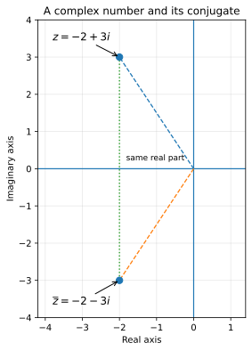
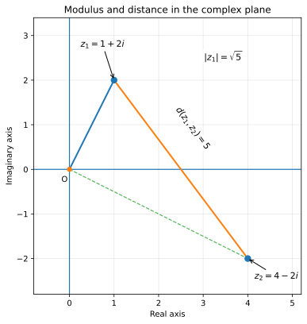
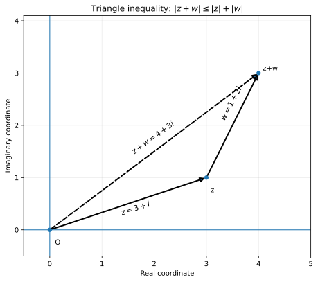
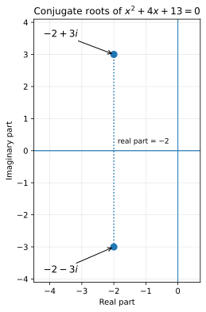

# Algebra 13 — Complex Numbers

## 1. Introduction

Chapter 12 showed that a quadratic equation with a negative discriminant has no **real** solutions. For example, no real number satisfies $x^2+1=0$, because the square of a real number is nonnegative. The complex number system extends the real numbers so that this equation can be solved.

Complex numbers are not merely a device for finishing a quadratic formula. They form a number system in which addition, subtraction, multiplication, and division (except division by zero) are all possible. They also have a useful geometric representation, and their conjugates and modulus make many calculations systematic.

This chapter uses the number-system and function language established in Foundations. It does not repeat the general construction of number systems or proof methods.

### Learning objectives

After completing this chapter, you should be able to:

- Define the imaginary unit and write a complex number in standard form.
- Identify the real and imaginary parts of a complex number.
- Add, subtract, multiply, and divide complex numbers.
- Simplify integer powers of $i$.
- Compute complex conjugates and use their algebraic properties.
- Find the modulus and distance between two complex numbers.
- Solve quadratic equations with negative discriminants over $\mathbb C$.
- Explain why nonreal roots of polynomials with real coefficients occur in conjugate pairs.
- Use exact rational arithmetic in Python without silently introducing floating-point approximations.

## 2. The imaginary unit and standard form

The **imaginary unit** is the number $i$ defined by

$i^2=-1.$

Equivalently, $i$ is a square root of $-1$ in the complex number system. The symbol $\sqrt{-1}$ is sometimes used informally to motivate $i$, but the principal real square-root function from Chapter 11 is defined only for nonnegative real radicands. Here, $i$ is introduced as a new number with the defining property $i^2=-1$.

A **complex number** is a number of the form

$z=a+bi,$
where $a,b\in\mathbb R$. This is called **standard form**. The set of all complex numbers is denoted by $\mathbb C$.

For $z=a+bi$:

- The **real part** is $\mathrm{Re}(z)=a$.
- The **imaginary part** is $\mathrm{Im}(z)=b$.

The imaginary part is the real coefficient of $i$, not the full term $bi$. For example, if $z=-3+5i$, then $\mathrm{Re}(z)=-3$ and $\mathrm{Im}(z)=5$.

Real numbers are included in $\mathbb C$ by identifying each real number $a$ with $a+0i$. A complex number $z=a+bi$ is called **purely imaginary** when $a=0$. Zero is both real and purely imaginary under this convention.

### 2.1 Equality of complex numbers

Two complex numbers are equal exactly when their real parts are equal and their imaginary parts are equal:

$a+bi=c+di\quad\Longleftrightarrow\quad a=c\text{ and }b=d.$

This follows because the standard-form representation is unique.

### Example 1 — Identify the components

Let $z=\frac{7}{3}-4i$. Then

$\mathrm{Re}(z)=\frac73,\qquad \mathrm{Im}(z)=-4.$

The imaginary part is $-4$, not $-4i$.

### Example 2 — Use equality

Suppose $3-2i=u+vi$, where $u,v\in\mathbb R$. Equality of real and imaginary parts gives $u=3$ and $v=-2$.

## 3. Powers of the imaginary unit

The powers of $i$ repeat every four exponents:

$$
\begin{aligned}
i^0&=1,\\
i^1&=i,\\
i^2&=-1,\\
i^3&=-i,\\
i^4&=1.
\end{aligned}
$$

For any integer $n$, reduce the exponent modulo $4$:

$$
i^n=
\begin{cases}
1,&n\equiv0\pmod4,\\
i,&n\equiv1\pmod4,\\
-1,&n\equiv2\pmod4,\\
-i,&n\equiv3\pmod4.
\end{cases}
$$

For negative integers this remains valid because $i\ne0$ and $i^{-1}=-i$.

### Example 3 — Simplify a large power

Since $2025=4(506)+1$,

$i^{2025}=i^{4(506)+1}=(i^4)^{506}i=i.$

### Example 4 — A negative exponent

Because $i^{-1}=1/i=-i$, we have

$i^{-7}=i^{1}=i,$
since $-7\equiv1\pmod4$.

## 4. Addition and subtraction

Let $z_1=a+bi$ and $z_2=c+di$. Add or subtract corresponding real and imaginary parts:

$z_1+z_2=(a+c)+(b+d)i,$

$z_1-z_2=(a-c)+(b-d)i.$

The rules follow by grouping like terms and using the distributive property.

### Example 5 — Add and subtract

For $z_1=4-3i$ and $z_2=-2+5i$,

$z_1+z_2=2+2i,$

$z_1-z_2=6-8i.$

Addition and subtraction are performed component by component. Do not combine a real term with an imaginary term as though they were like terms.

## 5. Multiplication

Multiply as with binomials, then use $i^2=-1$. For $z_1=a+bi$ and $z_2=c+di$:

$$
\begin{aligned}
(a+bi)(c+di)
&=ac+adi+bci+bd i^2\\
&=(ac-bd)+(ad+bc)i.
\end{aligned}
$$

Thus

$\boxed{(a+bi)(c+di)=(ac-bd)+(ad+bc)i.}$

### Example 6 — Multiply two complex numbers

$$
\begin{aligned}
(2+3i)(4-i)
&=8-2i+12i-3i^2\\
&=8+10i+3\\
&=11+10i.
\end{aligned}
$$

### Example 7 — Square a complex number

$(1-2i)^2=1-4i+4i^2=-3-4i.$

The sign in the last term is negative because $i^2=-1$.

## 6. Complex conjugates

If $z=a+bi$, its **complex conjugate** is

$\overline z=a-bi.$

The conjugate changes the sign of the imaginary part and leaves the real part unchanged.

### 6.1 Basic conjugate identities

For all $z,w\in\mathbb C$:

$\overline{\left(z+w\right)}=\overline{z}+\overline{w},$

$\overline{\left(zw\right)}=\overline{z}\overline{w},$

$\overline{\overline z}=z,$

and

$z+\overline z=2\mathrm{Re}(z).$

The product of a number and its conjugate is real:

$$
\begin{aligned}
z\overline z
&=(a+bi)(a-bi)\\
&=a^2-(bi)^2\\
&=a^2+b^2.
\end{aligned}
$$

Here $a^2+b^2\geq0$, and it is zero only when $a=b=0$.

### Example 8 — Conjugate and product

For $z=5-12i$,

$\overline z=5+12i,\qquad z\overline z=25+144=169.$

### 6.2 Why conjugates help with division

Multiplying a complex number by its conjugate removes the imaginary part of the product. This is the complex-number analogue of rationalizing a denominator in Chapter 11, and it produces a real denominator for division.

## 7. Division of complex numbers

Let $w=c+di\ne0$. Then $c^2+d^2>0$. Multiply the numerator and denominator by the conjugate $c-di$:

$$
\begin{aligned}
\frac{a+bi}{c+di}
&=\frac{(a+bi)(c-di)}{(c+di)(c-di)}\\
&=\frac{(ac+bd)+(bc-ad)i}{c^2+d^2}.
\end{aligned}
$$

Therefore,

$\boxed{\frac{a+bi}{c+di}=\frac{ac+bd}{c^2+d^2}+\frac{bc-ad}{c^2+d^2}i,\quad c+di\ne0.}$

The denominator is positive because $c+di\ne0$ means that $c$ and $d$ are not both zero.

### Example 9 — Divide using the conjugate

Compute $\dfrac{3+2i}{1-i}$.

$$
\begin{aligned}
\frac{3+2i}{1-i}
&=\frac{(3+2i)(1+i)}{(1-i)(1+i)}\\
&=\frac{3+3i+2i+2i^2}{2}\\
&=\frac{1+5i}{2}\\
&=\frac12+\frac52i.
\end{aligned}
$$

### Example 10 — A purely imaginary divisor

$$
\begin{aligned}
\frac{4-6i}{2i}
&=\frac{(4-6i)(-i)}{(2i)(-i)}\\
&=\frac{-4i+6i^2}{2}\\
&=\frac{-6-4i}{2}\\
&=-3-2i.
\end{aligned}
$$

A simpler route is to split the numerator and use $1/i=-i$, but the conjugate method works uniformly.

## 8. The complex plane

The **complex plane** represents $z=a+bi$ by the point $(a,b)$:

- The horizontal axis is the real axis.
- The vertical axis is the imaginary axis.
- The complex number $a+bi$ corresponds to the ordered pair $(a,b)$.

This is a geometric representation of the two real coordinates. It does not mean that a complex number is ordered like a real number.

The conjugate $a-bi$ is the reflection of $a+bi$ across the real axis. Addition of complex numbers corresponds to vector addition of their coordinate pairs.



*Figure 13.1 — A complex number and its conjugate are reflections across the real axis.*

### Example 11 — Plot and reflect

The number $z=-2+3i$ corresponds to $(-2,3)$. Its conjugate $-2-3i$ corresponds to $(-2,-3)$, the reflection across the horizontal real axis.

## 9. Modulus and distance

The **modulus** of $z=a+bi$ is

$|z|=\sqrt{a^2+b^2}.$

It is the distance from the origin to the point $(a,b)$ in the complex plane. The modulus is a nonnegative real number. It satisfies

$|z|^2=z\overline z=a^2+b^2.$

In particular, $|z|=0$ if and only if $z=0$.

For two complex numbers $z_1$ and $z_2$, their distance is

$d(z_1,z_2)=|z_1-z_2|.$



*Figure 13.2 — Modulus is distance from the origin; the distance between two complex numbers is the length of the segment joining their points.*

### 9.1 Useful modulus properties

For all $z,w\in\mathbb C$:

$|zw|=|z||w|,$

$|\overline z|=|z|,$

$|z+w|\leq|z|+|w|.$

The final inequality is the **triangle inequality**. It is consistent with the geometry of adding two vectors.



*Figure 13.3 — The vector sum forms the third side of a triangle, so its length cannot exceed the sum of the other two side lengths. The conjugate identity applies to the whole sum: $\overline{\left(z_1+z_2\right)}=\overline{z_1}+\overline{z_2}$.*

#### Proof of the product property

Using conjugation of a product,

$$
\begin{aligned}
|zw|^2
&=(zw)\overline{(zw)}\\
&=(zw)(\overline z\,\overline w)\\
&=(z\overline z)(w\overline w)\\
&=|z|^2|w|^2.
\end{aligned}
$$

Both $|zw|$ and $|z||w|$ are nonnegative, so equality of their squares implies $|zw|=|z||w|$.

#### Proof of the triangle inequality

For any complex number $u=x+yi$, its real part satisfies $\mathrm{Re}(u)=x\leq\lvert u\rvert$, because $x\leq\lvert x\rvert\leq\sqrt{x^2+y^2}$. Therefore,

$$
\begin{aligned}
|z+w|^2
&=(z+w)\overline{\left(z+w\right)}\\
&=(z+w)(\overline z+\overline w)\\
&=z\overline z+w\overline w+z\overline w+\overline{z}w\\
&=|z|^2+|w|^2+2\mathrm{Re}(z\overline w)\\
&\leq |z|^2+|w|^2+2|z\overline w|\\
&=|z|^2+|w|^2+2|z||w|\\
&=(|z|+|w|)^2.
\end{aligned}
$$

The cross terms combine because

$$
\begin{aligned}
\overline{\left(z\overline w\right)}
&=\overline z\overline{\left(\overline w\right)}\\
&=\overline{z}w.
\end{aligned}
$$

Thus $z\overline w$ and $\overline z w$ are conjugates. For any complex number $u$, $u+\overline u=2\mathrm{Re}(u)$; apply this with $u=z\overline w$. By commutativity of complex multiplication, $\overline{z}w=w\overline{z}$.

Both sides of $|z+w|\leq|z|+|w|$ are nonnegative, so taking nonnegative square roots proves the triangle inequality.

### Example 12 — Find a modulus

For $z=5-12i$,

$|z|=\sqrt{5^2+(-12)^2}=\sqrt{169}=13.$

### Example 13 — Find a distance

Let $z_1=1+2i$ and $z_2=4-2i$. Then

$$
\begin{aligned}
d(z_1,z_2)
&=|(1+2i)-(4-2i)|\\
&=|-3+4i|\\
&=\sqrt{9+16}=5.
\end{aligned}
$$

## 10. Solving quadratic equations over the complex numbers

The quadratic formula remains valid when the coefficients are real and the discriminant is negative, provided the square root is interpreted in $\mathbb C$.

For

$ax^2+bx+c=0,\qquad a,b,c\in\mathbb R,\ a\ne0,$
let $D=b^2-4ac$. If $D<0$, then

$\sqrt D=i\sqrt{-D},$
where $\sqrt{-D}$ is the nonnegative real square root. Hence

$\boxed{x=\frac{-b\pm i\sqrt{-D}}{2a}.}$

The two roots are nonreal complex conjugates. They are distinct because $D<0$ makes $\sqrt{-D}>0$.

### Example 14 — Solve a quadratic with no real roots

Solve $x^2+4x+13=0$ over $\mathbb C$.

Here $D=16-52=-36$. Therefore,

$x=\frac{-4\pm i\sqrt{36}}{2}=-2\pm3i.$

The two solutions are $-2+3i$ and $-2-3i$.

### Example 15 — A non-monic quadratic

Solve $2x^2+2x+5=0$ over $\mathbb C$.

The discriminant is $D=4-40=-36$, so

$x=\frac{-2\pm6i}{4}=-\frac12\pm\frac32i.$

### 10.1 Conjugate-pair property for real coefficients

**Theorem.** If a polynomial has real coefficients and a nonreal complex number $z$ is a root, then $\overline z$ is also a root.

**Proof.** Let

$P(x)=a_nx^n+\cdots+a_1x+a_0,$
where each coefficient $a_k$ is real. Since conjugation preserves sums and products,

$\overline{P(z)}=a_n\overline z^{\,n}+\cdots+a_1\overline z+a_0=P(\overline z).$

If $P(z)=0$, then $P(\overline z)=\overline0=0$. Thus the conjugate is also a root. This proof uses the fact that the coefficients are real; the result need not hold for a polynomial with nonreal coefficients. $\square$



*Figure 13.4 — The nonreal roots of a real-coefficient quadratic occur as conjugate points reflected across the real axis.*

### Example 16 — Build a real quadratic from conjugate roots

Suppose the roots are $2+3i$ and $2-3i$. The monic quadratic is

$$
\begin{aligned}
(x-(2+3i))(x-(2-3i))
&=((x-2)-3i)((x-2)+3i)\\
&=(x-2)^2+9\\
&=x^2-4x+13.
\end{aligned}
$$

The coefficients are real, as expected.

## 11. Algebraic structure and an important limitation

The complex numbers form a field: they are closed under addition, subtraction, and multiplication, and every nonzero complex number has a multiplicative inverse. The formulas in Sections 4–7 give these operations explicitly.

However, $\mathbb C$ cannot be made into an ordered field in a way that extends the usual order on $\mathbb R$. In an ordered field every square is nonnegative. If $i$ existed in such a field, then $i^2=-1$ would have to be nonnegative, contradicting $-1<0$. Therefore expressions such as $z_1<z_2$ are not defined as a compatible order on complex numbers. The modulus gives a meaningful nonnegative size, but it is not an order on $\mathbb C$.

The **Fundamental Theorem of Algebra** states that every nonconstant polynomial with complex coefficients has at least one complex root. Consequently, a degree-$n$ polynomial over $\mathbb C$ has exactly $n$ complex roots when counted with multiplicity. A proof is beyond the scope of this chapter; polynomial zeros, multiplicity, and factorization are developed further in Chapter 14.

## 12. Exact complex arithmetic with Python

Python's built-in `complex` type uses binary floating-point components. It is convenient for numerical work, but it is not an exact rational arithmetic system. The self-contained Python implementation in the example below represents numbers whose real and imaginary parts are rational using `Fraction`. It rejects `float` and `bool` inputs so that an approximate value is not silently treated as exact.

```python
from __future__ import annotations

# --- Inlined implementation: complex_core ---
"""Exact arithmetic for complex numbers with rational components.

This module intentionally supports Q + iQ rather than arbitrary real or
floating-point components.  Use Fraction or exact integers/strings to avoid
silently introducing binary floating-point approximations.
"""


from dataclasses import dataclass
from fractions import Fraction
from typing import TypeAlias

RationalInput: TypeAlias = int | Fraction | str


def _as_fraction(value: RationalInput) -> Fraction:
    if isinstance(value, bool):
        raise TypeError("bool is not accepted as an exact rational component")
    if isinstance(value, Fraction):
        return value
    if isinstance(value, int):
        return Fraction(value)
    if isinstance(value, str):
        return Fraction(value)
    raise TypeError("components must be int, Fraction, or an exact rational string")


@dataclass(frozen=True, slots=True, init=False)
class ComplexRational:
    """A complex number whose real and imaginary components are Fractions."""

    real: Fraction
    imag: Fraction

    def __init__(self, real: RationalInput = 0, imag: RationalInput = 0) -> None:
        object.__setattr__(self, "real", _as_fraction(real))
        object.__setattr__(self, "imag", _as_fraction(imag))

    @staticmethod
    def _coerce(value: object) -> "ComplexRational":
        if isinstance(value, ComplexRational):
            return value
        if isinstance(value, (int, Fraction, str)) and not isinstance(value, bool):
            return ComplexRational(value)
        raise TypeError("operand must be ComplexRational or an exact rational scalar")

    def __add__(self, other: object) -> "ComplexRational":
        rhs = self._coerce(other)
        return ComplexRational(self.real + rhs.real, self.imag + rhs.imag)

    def __radd__(self, other: object) -> "ComplexRational":
        return self + other

    def __sub__(self, other: object) -> "ComplexRational":
        rhs = self._coerce(other)
        return ComplexRational(self.real - rhs.real, self.imag - rhs.imag)

    def __rsub__(self, other: object) -> "ComplexRational":
        lhs = self._coerce(other)
        return lhs - self

    def __neg__(self) -> "ComplexRational":
        return ComplexRational(-self.real, -self.imag)

    def __mul__(self, other: object) -> "ComplexRational":
        rhs = self._coerce(other)
        a, b = self.real, self.imag
        c, d = rhs.real, rhs.imag
        return ComplexRational(a * c - b * d, a * d + b * c)

    def __rmul__(self, other: object) -> "ComplexRational":
        return self * other

    def modulus_squared(self) -> Fraction:
        """Return |z|^2 exactly; |z| itself may be irrational."""
        return self.real * self.real + self.imag * self.imag

    def conjugate(self) -> "ComplexRational":
        return ComplexRational(self.real, -self.imag)

    def reciprocal(self) -> "ComplexRational":
        norm_squared = self.modulus_squared()
        if norm_squared == 0:
            raise ZeroDivisionError("zero has no multiplicative inverse")
        return ComplexRational(self.real / norm_squared, -self.imag / norm_squared)

    def __truediv__(self, other: object) -> "ComplexRational":
        rhs = self._coerce(other)
        norm_squared = rhs.modulus_squared()
        if norm_squared == 0:
            raise ZeroDivisionError("division by the complex number zero")
        numerator = self * rhs.conjugate()
        return ComplexRational(
            numerator.real / norm_squared,
            numerator.imag / norm_squared,
        )

    def __rtruediv__(self, other: object) -> "ComplexRational":
        lhs = self._coerce(other)
        return lhs / self

    def __pow__(self, exponent: int) -> "ComplexRational":
        if isinstance(exponent, bool) or not isinstance(exponent, int):
            raise TypeError("the exponent must be an integer")
        if exponent == 0:
            if self == ComplexRational(0, 0):
                raise ValueError("0^0 is left undefined by this module's convention")
            return ComplexRational(1, 0)
        if exponent < 0:
            return self.reciprocal() ** (-exponent)

        result = ComplexRational(1, 0)
        base = self
        power = exponent
        while power:
            if power & 1:
                result = result * base
            base = base * base
            power >>= 1
        return result

    def __str__(self) -> str:
        a, b = self.real, self.imag
        if b == 0:
            return str(a)
        if b == 1:
            imag_text = "i"
        elif b == -1:
            imag_text = "-i"
        else:
            imag_text = f"{b}i"
        if a == 0:
            return imag_text
        sign = "+" if b > 0 else "-"
        magnitude = abs(b)
        if magnitude == 1:
            imag_magnitude = "i"
        else:
            imag_magnitude = f"{magnitude}i"
        return f"{a} {sign} {imag_magnitude}"


def i_power(exponent: int) -> ComplexRational:
    """Return i**exponent exactly for any integer exponent."""
    if isinstance(exponent, bool) or not isinstance(exponent, int):
        raise TypeError("the exponent must be an integer")
    cycle = (
        ComplexRational(1, 0),
        ComplexRational(0, 1),
        ComplexRational(-1, 0),
        ComplexRational(0, -1),
    )
    return cycle[exponent % 4]

# --- Chapter example ---


z = ComplexRational(Fraction(3, 2), Fraction(2))  # 3/2 + 2i
w = ComplexRational(1, -1)                        # 1 - i

print(z + w)                 # 5/2 + i
print(z * w)                 # 7/2 + 1/2 i
print(z / w)                 # -1/4 + 7/4 i
print(z.conjugate())         # 3/2 - 2i
print(z.modulus_squared())  # 25/4
print(i_power(2025))         # i
```

The module keeps the squared modulus exact. The modulus itself may be irrational, so the chapter expresses it as a radical unless the square root can be simplified exactly. The module is an educational helper for $\mathbb Q+i\mathbb Q$, not a general computer algebra system and not a replacement for proofs.

## 13. Common errors and how to avoid them

| Error | Better reasoning |
|---|---|
| Treating $i$ as a real number | $i$ is defined by $i^2=-1$ and is not real. |
| Saying $\mathrm{Im}(a+bi)=bi$ | The imaginary part is the real coefficient $b$. |
| Forgetting that $i^2=-1$ | Replace every $i^2$ by $-1$ during multiplication. |
| Using $\sqrt{-1}$ as a real square root | The real square-root function is not defined at $-1$; introduce $i$ in $\mathbb C$. |
| Dividing by $c+di$ without a condition | Require $c+di\ne0$, equivalently $c^2+d^2>0$. |
| Multiplying by the conjugate but not simplifying the denominator | $(c+di)(c-di)=c^2+d^2$. |
| Defining $\lvert a+bi\rvert$ as $a+b$ | Use $\sqrt{a^2+b^2}$, the distance from the origin. |
| Confusing modulus with real order | Modulus is a nonnegative size, not a comparison between complex numbers. |
| Forgetting the conjugate root | For real-coefficient polynomials, every nonreal root brings its conjugate. |
| Reporting no solution when $D<0$ without naming the domain | There is no real solution, but there are two complex solutions for a real quadratic with $a\ne0$. |
| Treating a numerical Python result as exact | Use the self-contained Python implementation in this chapter and `Fraction` for exact rational components. |

## 14. Exercises

### A. Standard form and powers of $i$

1. For $z=-\frac52+7i$, state $\mathrm{Re}(z)$ and $\mathrm{Im}(z)$.
2. If $a+bi=6-4i$ with $a,b\in\mathbb R$, find $a$ and $b$.
3. Simplify $i^{58}$.
4. Simplify $i^{-19}$.
5. Write $i^{4n+3}$ in simplest form for any integer $n$.

### B. Arithmetic

6. Compute $(3-2i)+(5+7i)$.
7. Compute $(4+i)-(1-3i)$.
8. Compute $(2+i)(3-4i)$.
9. Compute $(1-2i)^2$.
10. Compute $(2+3i)(2-3i)$.
11. Compute $\dfrac{3+2i}{1-i}$ and write the result in standard form.
12. Compute $\dfrac{5-i}{2i}$.

### C. Conjugates, modulus, and geometry

13. Find the conjugate and modulus of $z=-8+15i$.
14. Verify that $z\overline z=|z|^2$ for $z=3-4i$.
15. Find the distance between $z_1=-1+i$ and $z_2=2+5i$.
16. If $z=a+bi$ and $z+\overline z=10$, what is $a$?
17. Find $z^{-1}$ for $z=2-i$ and express it in standard form.

### D. Quadratic equations and reasoning

18. Solve $x^2+2x+5=0$ over $\mathbb C$.
19. Solve $2x^2-4x+10=0$ over $\mathbb C$.
20. A real-coefficient quadratic has one root $-3+2i$. Find its other root and the monic quadratic with these roots.
21. Explain why $\mathbb C$ cannot be an ordered field extending the usual real order.
22. Explain the difference between the statement “there is no real solution” and “there is no complex solution” for $x^2+9=0$.

## 15. Selected answers and solution outlines

1. $\mathrm{Re}(z)=-\frac52$ and $\mathrm{Im}(z)=7$.
2. $a=6$, $b=-4$.
3. $58\equiv2\pmod4$, so $i^{58}=-1$.
4. $-19\equiv1\pmod4$, so $i^{-19}=i$.
5. $i^{4n+3}=(i^4)^n i^3=-i$.
6. $8+5i$.
7. $3+4i$.
8. $10-5i$.
9. $-3-4i$.
10. $4+9=13$.
11. $\frac12+\frac52i$.
12. $\frac{5-i}{2i}= -\frac12-\frac52i$.
13. $\overline z=-8-15i$ and $|z|=\sqrt{64+225}=17$.
14. $z\overline z=(3-4i)(3+4i)=9+16=25=|z|^2$.
15. $|(-1+i)-(2+5i)|=|-3-4i|=5$.
16. Since $z+\overline z=2a=10$, $a=5$.
17. $z^{-1}=\overline z/|z|^2=(2+i)/5=\frac25+\frac15i$.
18. $D=4-20=-16$, so $x=-1\pm2i$.
19. $D=16-80=-64$, so $x=1\pm2i$.
20. The other root is $-3-2i$. The monic quadratic is $(x+3-2i)(x+3+2i)=(x+3)^2+4=x^2+6x+13$.
21. In an ordered field every square is nonnegative, but $i^2=-1<0$, a contradiction.
22. There is no real solution because a real square cannot equal $-9$. Over $\mathbb C$, the solutions are $x=3i$ and $x=-3i$.

## 16. Chapter summary

- Every complex number has a unique standard form $a+bi$ with real $a,b$ and $i^2=-1$.
- The real and imaginary parts are the real coefficients $a$ and $b$.
- The powers of $i$ repeat with period four.
- Addition and subtraction combine corresponding components; multiplication uses $i^2=-1$.
- Division by a nonzero complex number is performed by multiplying by its conjugate.
- The conjugate of $a+bi$ is $a-bi$, and $z\overline z=|z|^2$.
- The modulus $|a+bi|=\sqrt{a^2+b^2}$ is the distance from the origin in the complex plane.
- A real quadratic with negative discriminant has two nonreal conjugate roots.
- Complex numbers form a field but do not admit an order compatible with the real order and field operations.
- The Fundamental Theorem of Algebra guarantees complex roots for nonconstant complex polynomials; Chapter 14 develops polynomial roots and multiplicity further.

## 17. References and connections

- Math-Atlas Foundations, Chapter 03 — Relations and Functions.
- Math-Atlas Foundations, Chapter 04 — Number Systems and Mathematical Structures.
- Math-Atlas Foundations, Chapter 05 — Mathematical Proof Techniques.
- Math-Atlas Foundations, Chapter 07 — Mathematical Notation and Symbols.
- Math-Atlas Algebra, Chapter 07 — Exponents and Scientific Notation.
- Math-Atlas Algebra, Chapter 09 — Factoring and Polynomial Equations.
- Math-Atlas Algebra, Chapter 11 — Radicals and Rational Exponents.
- Math-Atlas Algebra, Chapter 12 — Quadratic Equations and Quadratic Models.
- Math-Atlas Algebra, `ALGEBRA_CONVENTIONS.MD` — complex-number conventions.

**Next chapter:** Chapter 14 — Polynomial Functions and Equations.
