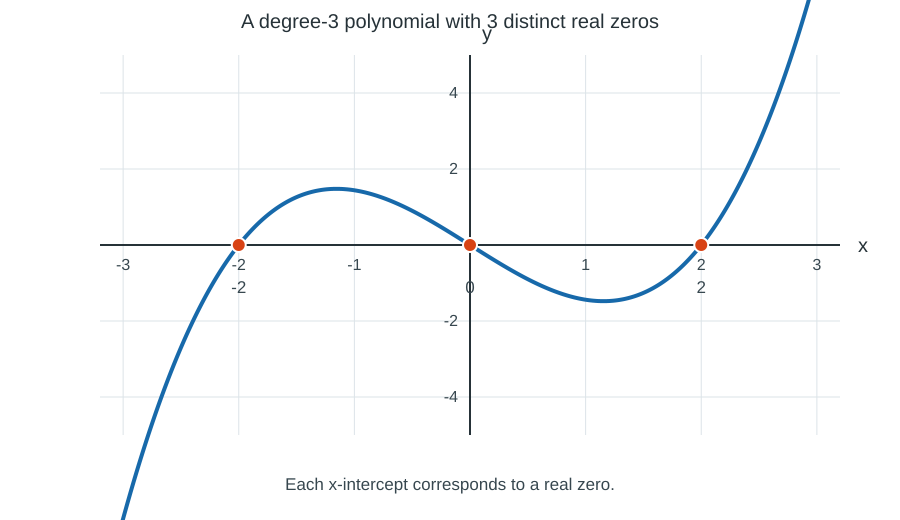
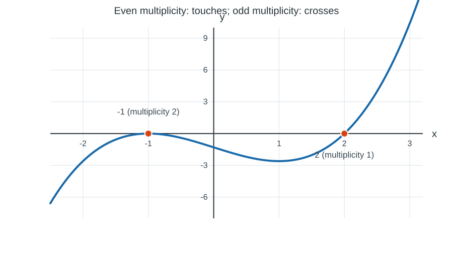
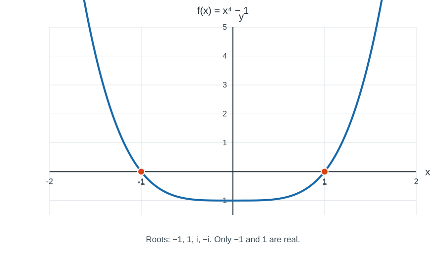
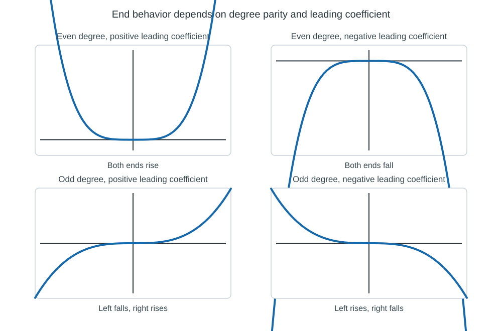

# Chapter 14 — Polynomial Functions and Equations
## Zeros, x-Intercepts, and the Fundamental Theorem of Algebra

An **x-intercept** is a point where the graph of a function intersects the x-axis. If \(f(a)=0\), then \(a\) is a zero of the function, and \((a,0)\) is an x-intercept of its graph.

*Figure 14.1. A cubic polynomial with three distinct real zeros.*

A zero can occur more than once as a factor. This repetition is called its **multiplicity**. A zero with even multiplicity makes the graph touch the x-axis and turn around; a zero with odd multiplicity makes the graph cross the x-axis.

*Figure 14.2. A zero of even multiplicity and a zero of odd multiplicity.*

A degree-\(n\) nonzero polynomial has at most \(n\) distinct real zeros. However, the Fundamental Theorem of Algebra tells us that every degree-\(n\) nonzero polynomial has exactly \(n\) complex roots when counted with multiplicity.

For example, a degree-7 polynomial has exactly **7 complex roots**, counted with multiplicity. Some of these roots may be real, and the rest may be nonreal complex numbers. Nonreal roots of a polynomial with real coefficients occur in conjugate pairs.

*Figure 14.3. The graph of \(f(x)=x^4-1\) shows its two real zeros; its other two roots are nonreal.*

### Check Your Understanding

1. How many distinct real zeros can a degree-7 nonzero polynomial have at most?
2. How many complex roots does a degree-7 polynomial have when counted with multiplicity?
3. What is the difference between a zero's multiplicity and the number of distinct zeros?

## End Behavior of Polynomial Functions

The end behavior of a polynomial graph is determined by its degree (even or odd) and the sign of its leading coefficient.

*Figure 14.4. The four possible end-behavior patterns for polynomial functions.*
