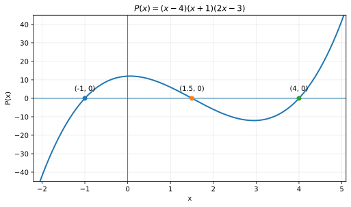
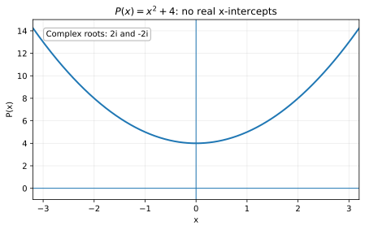
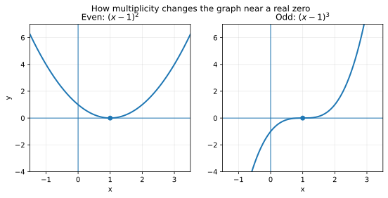
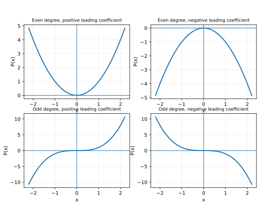
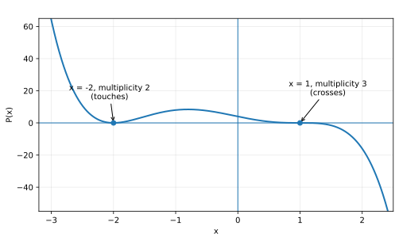

# Algebra 14 — Polynomial Functions and Equations

## 1. Introduction

Chapter 08 introduced polynomials as algebraic expressions, Chapter 09 developed factoring, and Chapter 13 introduced complex numbers. This chapter connects those ideas to functions and equations. We study where a polynomial function is zero, how repeated zeros affect its graph, how its leading term controls its end behavior, and how division gives the factor and remainder theorems.

The chapter uses the function language established in Foundations, Chapter 03. It does not repeat the general theory of functions. Unless stated otherwise, polynomial functions in the first part of the chapter have real coefficients and real input values. Complex roots are considered when solving polynomial equations over $\mathbb C$.

### Learning objectives

After completing this chapter, you should be able to:

- Define a polynomial function and identify its degree and leading coefficient.
- Distinguish a zero of a function from a solution of an equation and from an $x$-intercept.
- Define the multiplicity of a polynomial zero and describe its effect on a real graph.
- State and prove the Remainder Theorem and Factor Theorem.
- Divide a polynomial by a linear factor using synthetic division.
- Use the Rational Root Theorem to generate candidates, not to assume that candidates are roots.
- Determine polynomial end behavior from degree and leading coefficient.
- Use complex conjugate roots to obtain real quadratic factors.
- Solve polynomial equations by combining factoring, division, and substitution checks.
- Build and evaluate simple polynomial models while respecting contextual domains.
- Use exact rational arithmetic in Python to verify polynomial calculations.

## 2. Polynomial functions, degree, and leading coefficient

A **real polynomial in one variable** is an expression of the form

$$
P(x)=a_nx^n+a_{n-1}x^{n-1}+\cdots+a_1x+a_0,
$$

where each coefficient $a_k$ is real, each exponent is a nonnegative integer, and only finitely many coefficients are nonzero. The polynomial function associated with $P$ is the map $f:\mathbb R\to\mathbb R$ defined by $f(x)=P(x)$.

If $P$ is not the zero polynomial, its **degree** is the greatest exponent with a nonzero coefficient. The coefficient of that highest power is the **leading coefficient**. The coefficient $a_0$ is the constant term. The zero polynomial is treated separately: under the convention of this volume, it has no degree.

For example,

$$
P(x)=-3x^5+2x^2-7
$$

has degree $5$, leading coefficient $-3$, and constant term $-7$. The missing terms $x^4$, $x^3$, and $x$ have coefficient zero.

A polynomial function is defined for every real input, so its natural real domain is $\mathbb R$. Its range depends on the polynomial. For example, $f(x)=x^2$ has range $[0,\infty)$, while $g(x)=x^3$ has range $\mathbb R$.

### 2.1 Equality and the zero polynomial

Two polynomials are equal when all corresponding coefficients are equal after like powers have been combined. A nonzero polynomial of degree $n$ has at most $n$ distinct roots in a field. The zero polynomial is exceptional: every input is a zero, and it has no finite degree under the convention used here.

### Example 1 — Identify degree and leading coefficient

For

$$
P(x)=4-2x^3+\frac12x^7,
$$

write the polynomial in standard descending order:

$$
P(x)=\frac12x^7-2x^3+4.
$$

Its degree is $7$, and its leading coefficient is $\frac12$.

### Example 2 — Domain is not the same as range

For $f(x)=(x-3)^2+2$, every real $x$ is allowed, so the domain is $\mathbb R$. Since a square is nonnegative, $f(x)\ge2$, and equality occurs at $x=3$. The range is therefore $[2,\infty)$.

## 3. Zeros, roots, and intercepts

A **zero** of a polynomial function $f$ is an input $r$ for which $f(r)=0$. The same number $r$ is called a **root** or **solution** of the polynomial equation $P(x)=0$. When $r$ is real, the point $(r,0)$ is an $x$-intercept of the graph.

These terms refer to closely related but distinct viewpoints:

- “Zero” emphasizes the function value $f(r)=0$.
- “Root” emphasizes a number solving the equation $P(x)=0$.
- “$x$-intercept” is a point on a real-coordinate graph.

A nonreal complex root is a root of the polynomial equation over $\mathbb C$, but it is not an $x$-intercept of a graph drawn in the real $xy$-plane.

### Example 3 — Find zeros from factored form

Let

$$
P(x)=(x-4)(x+1)(2x-3).
$$

A product is zero exactly when at least one factor is zero. Thus the zeros are

$$
x=4,\qquad x=-1,\qquad x=\frac32.
$$

The graph has $x$-intercepts $(4,0)$, $(-1,0)$, and $(\frac32,0)$.



### Example 4 — A polynomial with no real zero

The polynomial $P(x)=x^2+4$ has no real zero because $x^2\ge0$ for every real $x$, so $x^2+4>0$. Over $\mathbb C$, however, its roots are $2i$ and $-2i$.



## 4. Multiplicity of a zero

Let $P$ be a nonzero polynomial and let $r$ be a root. The **multiplicity** of $r$ is the largest positive integer $m$ for which $(x-r)^m$ divides $P(x)$. Equivalently,

$$
P(x)=(x-r)^mQ(x),\qquad Q(r)\ne0.
$$

The factor $Q$ contains the part of the polynomial that does not vanish at $r$. A root with multiplicity $1$ is called **simple**. A root with multiplicity greater than $1$ is called **repeated**.

If a degree-$n$ polynomial is factored completely into linear factors over $\mathbb C$, the sum of the multiplicities is $n$. This is the “counted with multiplicity” language in the Fundamental Theorem of Algebra from Chapter 13.

### Example 5 — List zeros with multiplicities

Let

$$
P(x)=(x-2)^3(x+1)^2.
$$

The zero $2$ has multiplicity $3$, and the zero $-1$ has multiplicity $2$. The degree is $3+2=5$. There are two distinct zeros, but five roots when counted with multiplicity.

### 4.1 How multiplicity affects a real graph

Suppose $r$ is a real zero of multiplicity $m$, so $P(x)=(x-r)^mQ(x)$ with $Q(r)\ne0$. By continuity, $Q$ keeps the same sign sufficiently close to $r$. The sign of $(x-r)^m$ then determines the local behavior:

- If $m$ is odd, $(x-r)^m$ changes sign as $x$ passes through $r$. The graph crosses the $x$-axis.
- If $m$ is even, $(x-r)^m$ does not change sign. The graph touches the axis and turns back to the same side.
- Larger multiplicities generally make the graph flatter near the zero. For $m\ge2$, the tangent is horizontal when the derivative is considered.

The parity rule describes crossing versus touching; it does not determine the entire shape of the graph away from the root.



### Example 6 — Compare odd and even multiplicity

For $f(x)=(x-1)^3$, the graph crosses the axis at $x=1$ and is relatively flat there. For $g(x)=(x-1)^2$, the graph touches the axis at $x=1$ and remains nonnegative on both sides.

## 5. The Remainder Theorem

Polynomial division by a nonzero polynomial $D(x)$ gives unique polynomials $Q(x)$ and $R(x)$ such that

$$
P(x)=D(x)Q(x)+R(x),
$$

where either $R(x)=0$ or $\deg R<\deg D$.

When the divisor is linear, $D(x)=x-a$, the remainder must be a constant because its degree is less than $1$. Write that constant as $c$. Substituting $x=a$ gives

$$
P(a)=(a-a)Q(a)+c=c.
$$

**Remainder Theorem.** When a polynomial $P(x)$ is divided by $x-a$, the remainder is $P(a)$.

The theorem works over $\mathbb R$ or $\mathbb C$; the chosen coefficient field should be stated when it matters.

### Example 7 — Find a remainder without division

Find the remainder when $P(x)=2x^3-3x^2+4x-5$ is divided by $x-2$.

By the Remainder Theorem,

$$
P(2)=2(8)-3(4)+4(2)-5=16-12+8-5=7.
$$

The remainder is $7$.

### Example 8 — A divisor written as $x+a$

The divisor $x+3$ is $x-(-3)$. Therefore the remainder is $P(-3)$, not $P(3)$.

## 6. The Factor Theorem

**Factor Theorem.** For a polynomial $P$ and a number $a$ in its coefficient field,

$$
P(a)=0\quad\Longleftrightarrow\quad (x-a)\text{ is a factor of }P(x).
$$

**Proof.** Divide $P(x)$ by $x-a$. The division algorithm gives

$$
P(x)=(x-a)Q(x)+r,
$$

where $r$ is a constant. By the Remainder Theorem, $r=P(a)$. If $P(a)=0$, then $r=0$ and $P(x)=(x-a)Q(x)$, so $x-a$ is a factor. Conversely, if $P(x)=(x-a)Q(x)$, substituting $x=a$ gives $P(a)=0$. $\square$

The theorem links three tasks: checking a proposed root, checking a proposed linear factor, and finding a remainder. It does not say that every tested number is a root; direct substitution decides that.

### Example 9 — Check a proposed factor

Let $P(x)=x^3-2x^2-5x+6$. Test $x-1$:

$$
P(1)=1-2-5+6=0.
$$

Therefore $x-1$ is a factor. Testing $x-3$ gives $P(3)=27-18-15+6=0$, so $x-3$ is also a factor. The remaining factor is $x+2$, and

$$
P(x)=(x-1)(x-3)(x+2).
$$

## 7. Synthetic division by a linear factor

Synthetic division is a compact form of polynomial division by $x-a$. It uses the number $a$, not the constant term written in the divisor. Coefficients for missing powers must be included as zeros.

### Example 10 — Divide by $x-2$

Divide $P(x)=2x^3-3x^2-8x+12$ by $x-2$. Use the coefficients $2,-3,-8,12$ and the number $2$:

```text
2 |  2   -3   -8   12
  |       4    2  -12
  --------------------
     2    1   -6    0
```

The quotient is $2x^2+x-6$ and the remainder is $0$. Hence

$$
2x^3-3x^2-8x+12=(x-2)(2x^2+x-6).
$$

Factoring the quotient gives $(x-2)(2x-3)(x+2)$.

### Example 11 — Keep the missing term

For $P(x)=x^4-5x^2+4$, the coefficient list is $1,0,-5,0,4$. Omitting the zero coefficients shifts powers and produces an incorrect quotient.

## 8. The Rational Root Theorem

Let

$$
P(x)=a_nx^n+\cdots+a_1x+a_0
$$

have integer coefficients, with $a_n\ne0$ and $a_0\ne0$. If $p/q$ is a rational root written in lowest terms with $q>0$, then

$$
p\mid a_0,\qquad q\mid a_n.
$$

Thus every rational root must appear among the finite candidates

$$
\pm\frac{\text{positive divisor of }a_0}{\text{positive divisor of }a_n}.
$$

The theorem generates candidates; it does not say that every candidate is a root. Each candidate must be tested by substitution or synthetic division. If $a_0=0$, then $x$ is already a factor; factor out the largest power of $x$ first and apply the theorem to the remaining polynomial with nonzero constant term.

### Example 12 — Generate and test rational roots

For

$$
P(x)=2x^3-3x^2-8x+12,
$$

the possible rational roots are $\pm1,\pm2,\pm3,\pm4,\pm6,\pm12,\pm\frac12,\pm\frac32$. Testing gives roots $2$, $-2$, and $\frac32$. Therefore

$$
P(x)=(x-2)(x+2)(2x-3).
$$

### 8.1 Why the theorem is useful

For a polynomial with integer coefficients, the candidate set is finite. The theorem can make a search manageable, especially after the polynomial is simplified by factoring out a common factor or a power of $x$. If no candidate is a root, this only tells us that there is no rational root; irrational real or nonreal complex roots may still exist.

## 9. End behavior and the leading term

The **end behavior** of a polynomial function describes what happens to $P(x)$ as $x\to\infty$ and $x\to-\infty$. For a nonzero polynomial

$$
P(x)=a_nx^n+\text{lower-degree terms},
$$

the leading term controls the end behavior. To see why, divide by $x^n$:

$$
\frac{P(x)}{x^n}=a_n+\frac{a_{n-1}}x+\cdots+\frac{a_0}{x^n}\longrightarrow a_n
$$

as $x\to\pm\infty$. Thus, far from the origin, the polynomial behaves like $a_nx^n$.

| Degree parity | Leading coefficient | Left end as $x\to-\infty$ | Right end as $x\to+\infty$ |
|---|---|---|---|
| Even | Positive | $P(x)\to+\infty$ | $P(x)\to+\infty$ |
| Even | Negative | $P(x)\to-\infty$ | $P(x)\to-\infty$ |
| Odd | Positive | $P(x)\to-\infty$ | $P(x)\to+\infty$ |
| Odd | Negative | $P(x)\to+\infty$ | $P(x)\to-\infty$ |



### Example 13 — Determine end behavior

For $P(x)=-2x^6+5x^2-1$, the degree is even and the leading coefficient is negative. Both ends go downward:

$$
\lim_{x\to-\infty}P(x)=-\infty,\qquad \lim_{x\to+\infty}P(x)=-\infty.
$$

For $Q(x)=3x^5-x+8$, the degree is odd and the leading coefficient is positive. The left end goes down and the right end goes up.

## 10. Real graphs, roots, and multiplicity

A polynomial function is continuous on $\mathbb R$. Its graph has no holes, jumps, or vertical asymptotes. The zeros give its real-axis intersections, multiplicity describes the local crossing behavior, and the leading term determines the two ends.

For a real root $r$ of multiplicity $m$, write $P(x)=(x-r)^mQ(x)$ with $Q(r)\ne0$:

- Odd $m$: the graph crosses the axis at $r$.
- Even $m$: the graph touches the axis and stays on the same side locally.
- Larger $m$: the graph is generally flatter at the intercept.

A degree-$n$ nonzero polynomial has at most $n$ distinct real zeros. Its graph can therefore have at most $n$ distinct $x$-intercepts. A degree-$n$ polynomial also has at most $n-1$ turning points; a proof of this fact uses calculus and is outside the scope of this chapter.

### Example 14 — Combine roots, multiplicity, and end behavior

Let

$$
P(x)=-(x+2)^2(x-1)^3.
$$

The degree is $5$ and the leading coefficient is negative. Its zeros are $-2$ with multiplicity $2$, and $1$ with multiplicity $3$. The graph touches the axis at $x=-2$ and crosses at $x=1$. Since the degree is odd with negative leading coefficient, the left end goes up and the right end goes down.



## 11. Complex zeros and real polynomial factors

Chapter 13 proved the conjugate-pair property: if a polynomial has real coefficients and $a+bi$ is a nonreal root, then $a-bi$ is also a root. Consequently, a nonreal conjugate pair gives a real quadratic factor:

$$
(x-(a+bi))(x-(a-bi))=(x-a)^2+b^2.
$$

This quadratic has no real zero when $b\ne0$, but it has real coefficients. It is irreducible over $\mathbb R$ as a product of real linear factors, while it splits into two linear factors over $\mathbb C$.

### Example 15 — Convert a conjugate pair into a real factor

If $2+3i$ is a root of a real-coefficient polynomial, then $2-3i$ is also a root. The corresponding real quadratic factor is

$$
(x-(2+3i))(x-(2-3i))=(x-2)^2+9=x^2-4x+13.
$$

### Example 16 — Count roots over different fields

For $P(x)=(x-1)(x^2+4)$, the real roots consist only of $1$. Over $\mathbb C$, the roots are $1,2i,-2i$. The degree is $3$, and the total number of complex roots counted with multiplicity is $3$, as guaranteed by the Fundamental Theorem of Algebra.

## 12. A practical strategy for solving polynomial equations

To solve $P(x)=0$:

1. State the coefficient field: real or complex.
2. Move all terms to one side and combine like powers.
3. Factor out a greatest common factor, especially a power of $x$ when the constant term is zero.
4. Use familiar identities or grouping where possible.
5. If integer coefficients remain, use the Rational Root Theorem to generate candidates.
6. Test a candidate with the Factor Theorem and divide out the corresponding linear factor.
7. Continue factoring the quotient; for a real polynomial, use conjugate pairs when nonreal roots occur.
8. Check the factorization by multiplying the factors and check each reported root in the original equation.

The method may stop at an irreducible quadratic over $\mathbb R$. If the equation is to be solved over $\mathbb C$, use Chapter 13 to solve that quadratic and include its complex roots.

### Example 17 — Solve a cubic over $\mathbb R$ and $\mathbb C$

Solve

$$
2x^3-3x^2-8x+12=0.
$$

The Rational Root Theorem suggests testing $x=2$. Since $P(2)=0$, divide by $x-2$:

$$
P(x)=(x-2)(2x^2+x-6)=(x-2)(2x-3)(x+2).
$$

The real solutions are $x=2$, $x=\frac32$, and $x=-2$. These are also all the complex solutions because the three linear factors already account for the degree.

### Example 18 — Solve a real polynomial with nonreal roots

Solve $x^3-x^2+4x-4=0$ over $\mathbb C$.

Group terms:

$$
\begin{aligned}
x^3-x^2+4x-4&=x^2(x-1)+4(x-1)\\
&=(x-1)(x^2+4).
\end{aligned}
$$

The roots are $1$, $2i$, and $-2i$. Only $1$ is a real zero and a real-graph intercept.

## 13. Polynomial models and interpretation

A polynomial model may describe a quantity that changes with an input, such as height, cost, volume, or a designed engineering relationship. The formula alone is not the entire model. A useful model also states:

- what the input and output represent;
- the feasible input domain and units;
- whether the coefficients are exact or estimated;
- what a zero means in the context;
- whether a mathematically possible root is meaningful in the real situation.

### Example 19 — A volume model

An open-top box is made by cutting squares of side length $x$ from the corners of a $20$-cm by $12$-cm sheet and folding up the sides. Its volume is

$$
V(x)=x(20-2x)(12-2x)=4x^3-64x^2+240x.
$$

The physical constraints are $x>0$, $20-2x>0$, and $12-2x>0$, so the feasible domain is

$$
0<x<6.
$$

The algebraic zeros are $x=0$, $x=6$, and $x=10$. Only the boundary values $0$ and $6$ are limits of the feasible interval, and neither produces a usable positive-volume box. The root $10$ is outside the feasible domain and has no physical meaning for this model.

### Example 20 — Interpret a zero in a cost model

Suppose a simplified net-value model is $N(q)=-q^2+8q-12$, where $q$ is a nonnegative production level. Solving $N(q)=0$ identifies break-even levels. Factoring gives

$$
N(q)=-(q-2)(q-6),
$$

so the break-even levels are $q=2$ and $q=6$. If the business context restricts production to $0\le q\le5$, only $q=2$ is feasible. Algebraic roots must always be filtered through the model's domain.

## 14. Exact polynomial analysis with Python

The self-contained Python implementation in the example below extends the sparse exact-polynomial representation from Chapter 08. Coefficients are integers or `Fraction` values; floats and booleans are rejected. It provides exact evaluation, derivatives, division by a linear factor, remainders, root multiplicity for rational roots, rational-root candidates for integer-coefficient polynomials, and end-behavior classification. It does not attempt to calculate arbitrary irrational or complex roots.

```python
from __future__ import annotations

# --- Inlined implementation: polynomial_core ---
"""Exact arithmetic helpers for univariate polynomials.

Representation: {exponent: coefficient}, with nonnegative integer exponents.
Coefficients are integers or fractions.Fraction values. The empty dictionary
represents the zero polynomial. Floating-point coefficients are rejected so
that exact rational arithmetic is not silently weakened.
"""


from fractions import Fraction
from typing import Mapping

Polynomial = dict[int, Fraction]


def _coerce_coefficient(value: object) -> Fraction:
    if isinstance(value, bool):
        raise TypeError("Boolean values are not polynomial coefficients")
    if isinstance(value, Fraction):
        return value
    if isinstance(value, int):
        return Fraction(value, 1)
    raise TypeError("coefficients must be integers or fractions.Fraction values")


def normalize(poly: Mapping[int, object]) -> Polynomial:
    """Validate a sparse polynomial and remove zero coefficients."""
    if not isinstance(poly, Mapping):
        raise TypeError("a polynomial must be supplied as a mapping")

    result: Polynomial = {}
    for exponent, raw_coefficient in poly.items():
        if isinstance(exponent, bool) or not isinstance(exponent, int):
            raise TypeError("exponents must be integers, not Booleans")
        if exponent < 0:
            raise ValueError("polynomial exponents must be nonnegative")
        coefficient = _coerce_coefficient(raw_coefficient)
        if coefficient:
            result[exponent] = result.get(exponent, Fraction(0)) + coefficient
    return dict(sorted(
        ((power, coeff) for power, coeff in result.items() if coeff),
        key=lambda item: item[0],
    ))


def add(left: Mapping[int, object], right: Mapping[int, object]) -> Polynomial:
    """Return the sum of two exact sparse polynomials."""
    a = normalize(left)
    b = normalize(right)
    result = dict(a)
    for exponent, coefficient in b.items():
        result[exponent] = result.get(exponent, Fraction(0)) + coefficient
    return normalize(result)


def subtract(left: Mapping[int, object], right: Mapping[int, object]) -> Polynomial:
    """Return left minus right."""
    a = normalize(left)
    b = normalize(right)
    result = dict(a)
    for exponent, coefficient in b.items():
        result[exponent] = result.get(exponent, Fraction(0)) - coefficient
    return normalize(result)


def multiply(left: Mapping[int, object], right: Mapping[int, object]) -> Polynomial:
    """Return the product using coefficient convolution."""
    a = normalize(left)
    b = normalize(right)
    result: Polynomial = {}
    for exp_a, coeff_a in a.items():
        for exp_b, coeff_b in b.items():
            exponent = exp_a + exp_b
            result[exponent] = (
                result.get(exponent, Fraction(0)) + coeff_a * coeff_b
            )
    return normalize(result)


def degree(poly: Mapping[int, object]) -> int:
    """Return the degree; the zero polynomial has no degree."""
    normalized = normalize(poly)
    if not normalized:
        raise ValueError("the zero polynomial has no degree in this convention")
    return max(normalized)


def leading_coefficient(poly: Mapping[int, object]) -> Fraction:
    """Return the coefficient of the highest nonzero power."""
    normalized = normalize(poly)
    if not normalized:
        raise ValueError("the zero polynomial has no leading coefficient")
    return normalized[max(normalized)]


def evaluate(poly: Mapping[int, object], value: object) -> Fraction:
    """Evaluate by Horner's method at an exact integer or Fraction input."""
    normalized = normalize(poly)
    x = _coerce_coefficient(value)
    if not normalized:
        return Fraction(0)

    highest = max(normalized)
    result = Fraction(0)
    for exponent in range(highest, -1, -1):
        result = result * x + normalized.get(exponent, Fraction(0))
    return result

# Bind imported names from prerequisite implementations.
normalize = normalize
evaluate = evaluate

# --- Inlined implementation: polynomial_functions_core ---
"""Exact helper functions for Math-Atlas Algebra Chapter 14.

Polynomials use the sparse representation {exponent: coefficient} from
the corresponding chapter implementation. Coefficients must be integers or fractions.Fraction.
The module handles rational roots exactly; it does not numerically find all
irrational or complex roots.
"""


from fractions import Fraction
from math import gcd
from typing import Mapping


Polynomial = dict[int, Fraction]


def derivative(poly: Mapping[int, object]) -> Polynomial:
    """Return the formal derivative of a polynomial."""
    p = normalize(poly)
    return normalize({power - 1: coefficient * power
                      for power, coefficient in p.items() if power > 0})


def synthetic_division(poly: Mapping[int, object], root: object) -> tuple[Polynomial, Fraction]:
    """Divide exactly by x-root; return (quotient, remainder)."""
    p = normalize(poly)
    if isinstance(root, bool) or not isinstance(root, (int, Fraction)):
        raise TypeError("root must be an integer or fractions.Fraction")
    r = Fraction(root)
    if not p:
        return {}, Fraction(0)

    n = max(p)
    descending = [p.get(power, Fraction(0)) for power in range(n, -1, -1)]
    if n == 0:
        return {}, descending[0]

    result = [descending[0]]
    for coefficient in descending[1:]:
        result.append(coefficient + r * result[-1])
    quotient_coefficients = result[:-1]
    quotient = {n - 1 - index: coefficient
                for index, coefficient in enumerate(quotient_coefficients)
                if coefficient}
    return normalize(quotient), result[-1]


def remainder_at(poly: Mapping[int, object], value: object) -> Fraction:
    """Return the remainder on division by x-value, equal to P(value)."""
    return evaluate(poly, value)


def root_multiplicity(poly: Mapping[int, object], root: object) -> int:
    """Return the multiplicity of an exact rational root; zero if not a root."""
    p = normalize(poly)
    if not p:
        raise ValueError("the zero polynomial has no finite root multiplicity")
    if isinstance(root, bool) or not isinstance(root, (int, Fraction)):
        raise TypeError("root must be an integer or fractions.Fraction")
    r = Fraction(root)
    if max(p) == 0:
        return 0

    multiplicity = 0
    while p:
        quotient, remainder = synthetic_division(p, r)
        if remainder != 0:
            break
        multiplicity += 1
        p = quotient
        if not p:
            break
    return multiplicity


def _positive_divisors(value: int) -> tuple[int, ...]:
    value = abs(value)
    if value == 0:
        raise ValueError("positive divisors are undefined for zero")
    low, high = [], []
    candidate = 1
    while candidate * candidate <= value:
        if value % candidate == 0:
            low.append(candidate)
            if candidate * candidate != value:
                high.append(value // candidate)
        candidate += 1
    return tuple(low + high[::-1])


def rational_root_candidates(poly: Mapping[int, object]) -> tuple[Fraction, ...]:
    """Return sorted unique rational-root candidates for integer-coefficient P.

    Zero is included when P has a factor x. If the polynomial is a nonzero
    monomial, its only rational root candidate is zero. The zero polynomial
    has every rational number as a root and therefore has no finite candidate
    tuple under this convention.
    """
    p = normalize(poly)
    if not p:
        raise ValueError("the zero polynomial has no finite rational-root candidate list")
    if any(c.denominator != 1 for c in p.values()):
        raise TypeError("Rational Root Theorem candidates require integer coefficients")
    if max(p) == 0:
        return ()

    zero_is_root = 0 not in p
    lowest_power = min(p)
    shifted = {power - lowest_power: coefficient for power, coefficient in p.items()}
    candidates: set[Fraction] = set()
    if zero_is_root:
        candidates.add(Fraction(0))

    # After extracting the largest power of x, a monomial has no nonzero roots.
    if len(shifted) == 1:
        return tuple(sorted(candidates))
    constant = int(shifted[0])
    leading = int(shifted[max(shifted)])
    for numerator in _positive_divisors(constant):
        for denominator in _positive_divisors(leading):
            value = Fraction(numerator, denominator)
            candidates.add(value)
            candidates.add(-value)
    return tuple(sorted(candidates))


def end_behavior(poly: Mapping[int, object]) -> tuple[str, str]:
    """Return (left_end, right_end) as '+infinity' or '-infinity'."""
    p = normalize(poly)
    if not p:
        raise ValueError("the zero polynomial has no end behavior by degree")
    degree = max(p)
    leading = p[degree]
    positive = leading > 0
    if degree % 2 == 0:
        result = "+infinity" if positive else "-infinity"
        return result, result
    return ("-infinity", "+infinity") if positive else ("+infinity", "-infinity")

# --- Chapter example ---
derivative = derivative
end_behavior = end_behavior
evaluate = evaluate
rational_root_candidates = rational_root_candidates
root_multiplicity = root_multiplicity
synthetic_division = synthetic_division

from fractions import Fraction


# P(x) = 2x^3 - 3x^2 - 8x + 12
p = {3: 2, 2: -3, 1: -8, 0: 12}

print(evaluate(p, 2))                         # 0
print(synthetic_division(p, 2))               # (quotient, Fraction(0))
print(rational_root_candidates(p))             # finite candidate tuple
print(root_multiplicity({3: 1, 2: -1, 1: -4, 0: 4}, 2))
print(derivative(p))
print(end_behavior(p))                         # left down, right up
```

The code is an exact educational helper for rational-coefficient polynomials. Numerical root-finding for arbitrary real or complex roots is intentionally outside this module; a numerical approximation must state its method and tolerance.

## 15. Common errors and how to avoid them

| Error | Better reasoning |
|---|---|
| Calling a nonreal root an $x$-intercept | Only real roots appear on the real $xy$-graph. |
| Counting distinct roots instead of multiplicity | A degree-$n$ polynomial has $n$ complex roots when counted with multiplicity. |
| Assuming every rational-root candidate works | The Rational Root Theorem gives candidates; test each one. |
| Using $P(a)$ as the remainder for divisor $x+a$ | Use $P(-a)$ because $x+a=x-(-a)$. |
| Omitting zero coefficients in synthetic division | Include a coefficient for every power, even when it is zero. |
| Claiming even multiplicity crosses the axis | Even multiplicity keeps the same local sign; odd multiplicity changes sign. |
| Inferring the entire graph from end behavior | The leading term describes only the two ends. Use roots and multiplicities for intercept behavior. |
| Treating a complex pair as two real intercepts | A nonreal conjugate pair gives a real quadratic factor but no real $x$-intercepts. |
| Keeping roots outside a contextual domain | Filter mathematical roots through the model's feasible domain. |
| Treating numerical root approximations as exact | State the numerical method, error tolerance, and whether roots have been verified. |

## 16. Exercises

### A. Degree, zeros, and multiplicity

1. State the degree, leading coefficient, and constant term of $P(x)=-5x^8+3x^4-2x+9$.
2. Find the real zeros and their multiplicities for $P(x)=(x+3)^2(x-1)^4$.
3. How many complex roots does a degree-$7$ polynomial have when counted with multiplicity, assuming it is nonzero and viewed over $\mathbb C$?
4. Explain why $x=2i$ is not an $x$-intercept of a real graph.
5. A real zero has multiplicity $5$. Does the graph cross or touch the axis there? Explain.

### B. Remainder and factor theorems

6. Find the remainder when $P(x)=x^3-4x+1$ is divided by $x-2$.
7. Find the remainder when $Q(x)=2x^4+x^2-7$ is divided by $x+1$.
8. Determine whether $x+2$ is a factor of $P(x)=x^3+3x^2-4$.
9. Find $k$ so that $x-3$ is a factor of $P(x)=x^3+kx^2-5x+3$.
10. Divide $2x^3-3x^2-8x+12$ by $x-2$ using synthetic division.

### C. Rational roots and polynomial equations

11. List the possible rational roots of $P(x)=3x^3-5x^2-12x+20$.
12. Factor $P(x)=x^3-4x^2+x+6$ completely over the integers.
13. Solve $2x^3-3x^2-8x+12=0$ over $\mathbb R$.
14. Solve $x^3-x^2+4x-4=0$ over $\mathbb C$.
15. Determine the real roots and multiplicities of $P(x)=(x-2)^4(x+1)^3$.

### D. End behavior, graph interpretation, and models

16. Describe the end behavior of $P(x)=5x^6-2x^3+1$.
17. Describe the end behavior of $Q(x)=-3x^5+x^2-7$.
18. A polynomial has degree $6$ and leading coefficient $-2$. What are its two end behaviors?
19. A real polynomial has a nonreal root $1-4i$. State another root and the real quadratic factor associated with the pair.
20. Explain why a polynomial graph has no vertical asymptotes.
21. For $P(x)=(x+1)^2(x-3)$, state each real zero, its multiplicity, and whether the graph crosses or touches at that zero.
22. For the box model $V(x)=x(20-2x)(12-2x)$, state the feasible domain and explain why the algebraic root $x=10$ is not physically admissible.
23. A real polynomial has degree $5$ and has four distinct real zeros. What can be said about the multiplicities of these zeros and any remaining complex roots?
24. Explain the difference between “no rational roots” and “no real roots.”

## 17. Selected answers and solution outlines

1. Degree $8$, leading coefficient $-5$, constant term $9$.
2. $-3$ has multiplicity $2$; $1$ has multiplicity $4$.
3. Seven complex roots counted with multiplicity.
4. An $x$-intercept is a point whose coordinates are real; $2i$ is not real.
5. It crosses, because multiplicity $5$ is odd.
6. $P(2)=8-8+1=1$.
7. $Q(-1)=2+1-7=-4$.
8. $P(-2)=-8+12-4=0$, so yes.
9. $P(3)=27+9k-15+3=15+9k=0$, so $k=-\frac53$.
10. Quotient $2x^2+x-6$, remainder $0$.
11. $\pm1,\pm2,\pm4,\pm5,\pm10,\pm20,\pm\frac13,\pm\frac23,\pm\frac43,\pm\frac53,\pm\frac{10}3,\pm\frac{20}3$.
12. $(x-2)(x-3)(x+1)$.
13. $x=2,-2,\frac32$.
14. $x=1,2i,-2i$.
15. $2$ has multiplicity $4$; $-1$ has multiplicity $3$.
16. Both ends go to $+\infty$.
17. Left end goes to $+\infty$; right end goes to $-\infty$.
18. Both ends go to $-\infty$.
19. The conjugate root is $1+4i$; the real factor is $(x-1)^2+16=x^2-2x+17$.
20. Polynomials are defined and continuous at every real input; a vertical asymptote would require unbounded behavior near a finite input.
21. $x=-1$ has multiplicity $2$ and the graph touches; $x=3$ has multiplicity $1$ and the graph crosses.
22. $0<x<6$. At $x=10$, the side length $12-2x$ is negative, so it is outside the physical domain.
23. The sum of multiplicities of the four distinct real zeros is at least $4$ and at most $5$. If the sum is $5$, there is no remaining root; if it is $4$, one degree remains and, because coefficients are real, that remaining root cannot be a single nonreal root, so it must be a real root already among the four with increased multiplicity. Therefore all five roots counted with multiplicity are real: the remaining degree must contribute one additional real root, either as a fifth distinct root or as one extra unit of multiplicity for one of the four known roots. There can be no nonreal root left over, because nonreal roots of a real polynomial occur in conjugate pairs and would require two degrees.
24. A polynomial may have irrational real roots or nonreal complex roots even when it has no rational roots. “No rational roots” is weaker than “no real roots.”

## 18. Chapter summary

- A nonzero polynomial's degree and leading coefficient describe its highest-power term; the zero polynomial has no degree under this volume's convention.
- A zero of a polynomial function is a root of its equation; only real roots give real-graph $x$-intercepts.
- Multiplicity counts repeated factors and determines local crossing behavior: odd multiplicity crosses, even multiplicity touches.
- The Remainder Theorem gives the remainder on division by $x-a$ as $P(a)$.
- The Factor Theorem states that $P(a)=0$ exactly when $x-a$ is a factor.
- Synthetic division is a compact way to divide by a linear factor; missing coefficients must be written as zero.
- The Rational Root Theorem supplies a finite set of candidates for rational roots of integer-coefficient polynomials.
- The leading term controls end behavior.
- Nonreal roots of real-coefficient polynomials occur in conjugate pairs and produce real quadratic factors.
- Contextual polynomial models require feasible-domain checks in addition to solving the equation.

## 19. Next chapter
## References and connections

- Math-Atlas Foundations, Chapter 03 — Relations and Functions.
- Math-Atlas Foundations, Chapter 04 — Number Systems and Mathematical Structures.
- Math-Atlas Foundations, Chapter 05 — Mathematical Proof Techniques.
- Math-Atlas Foundations, Chapter 07 — Mathematical Notation and Symbols.
- Math-Atlas Algebra, Chapter 08 — Polynomials and Polynomial Operations.
- Math-Atlas Algebra, Chapter 09 — Factoring and Polynomial Equations.
- Math-Atlas Algebra, Chapter 12 — Quadratic Equations and Quadratic Models.
- Math-Atlas Algebra, Chapter 13 — Complex Numbers.
- Math-Atlas Algebra, `ALGEBRA_CONVENTIONS.MD` — polynomial and complex-number conventions.

**Next chapter:** Chapter 15 — Rational Functions and Equations.
