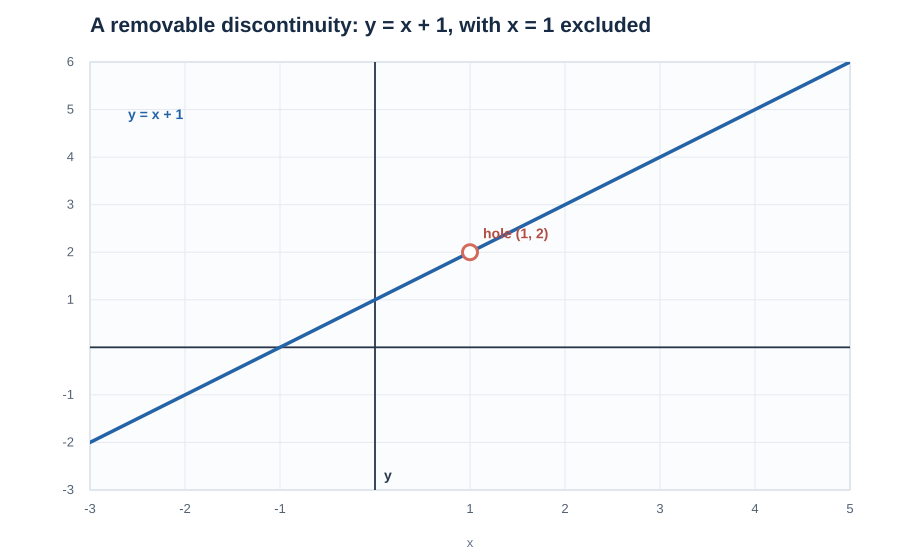
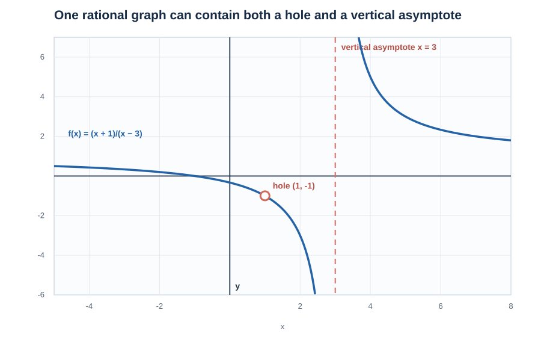
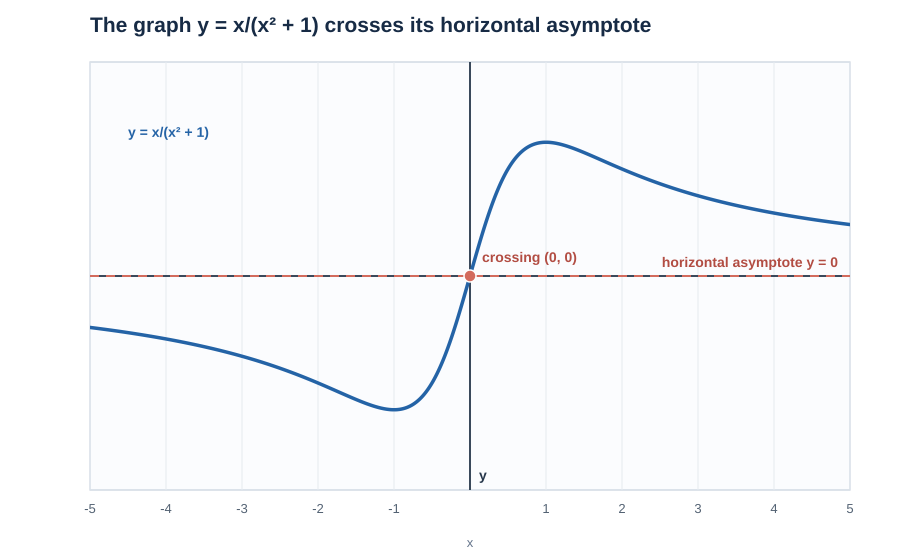
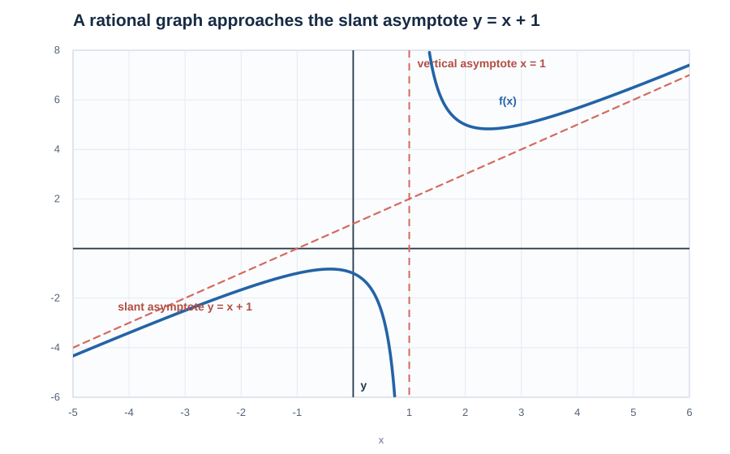
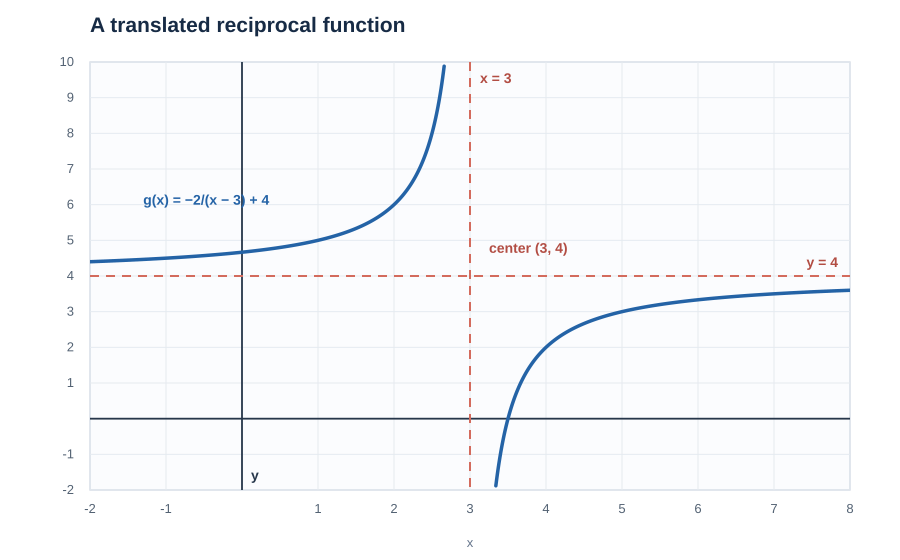
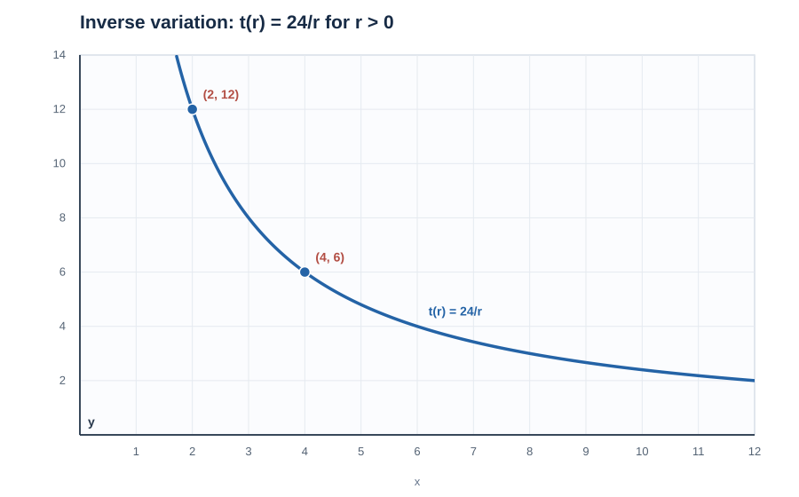

# Algebra 15 — Rational Functions and Equations

## 1. Introduction

Chapter 10 studied **rational expressions** and the algebra of their quotients. This chapter treats a quotient as a **function**: we study its domain, graph, intercepts, discontinuities, asymptotes, transformations, and equations or inequalities involving its values. The distinction matters because simplifying a quotient can produce a formula that is defined at an input excluded from the original function.

For example,

$$
f(x)=\frac{x^2-1}{x-1}
$$

has natural real domain $\mathbb R\setminus\lbrace1\rbrace$. On that domain its values are given by $x+1$, but the original function still has a missing point at $(1,2)$. The graph is the line $y=x+1$ with that point removed.

This volume uses a **domain-sensitive real-function convention**: a rational function is the quotient formula together with the natural domain determined by its original denominator. Two simplified formulas that agree where both are defined need not describe the same real function if their domains differ.

### Learning objectives

By the end of this chapter, a learner should be able to:

- Define a rational function and determine its natural real domain.
- Reduce a rational formula without losing original denominator restrictions.
- Distinguish a removable discontinuity (hole) from a vertical asymptote.
- Find real zeros, intercepts, and sign intervals where the relevant polynomial roots are known.
- Determine horizontal, oblique, and higher-degree polynomial asymptotes by polynomial division.
- Interpret transformations of the reciprocal function.
- Solve rational-function equations and inequalities while preserving domain restrictions.
- Build and interpret simple rational models, including inverse-variation and average-cost models.
- Use exact rational arithmetic to verify calculations without claiming that a finite list of tests proves a general theorem.

## 2. Rational functions and their natural domains

A **rational function** is represented by

$$
f(x)=\frac{P(x)}{Q(x)},
$$

where $P$ and $Q$ are real polynomials and $Q$ is not the zero polynomial. Its natural real domain is

$$
D_f=\lbracex\in\mathbb R:Q(x)\ne0\rbrace.
$$

The domain is determined by the denominator in the original representation. A zero of the numerator is allowed unless it is also a zero of the denominator. A real zero of the denominator is always excluded, even if a common factor later cancels.

The general language of functions and domains is established in Foundations, Chapter 03. Chapter 10 develops the algebraic rules for rational expressions; here we use those rules to analyze functions and their graphs.

### Example 1 — Determine a domain

Find the natural real domain of

$$
f(x)=\frac{2x+1}{x^2-x-6}.
$$

Factor the denominator:

$$
x^2-x-6=(x-3)(x+2).
$$

Thus $x\ne3$ and $x\ne-2$, so

$$
D_f=\mathbb R\setminus\lbrace-2,3\rbrace.
$$

The numerator may equal zero; the denominator may not.

### Example 2 — A denominator with no real zero

For

$$
g(x)=\frac{x+2}{x^2+1},
$$

we have $x^2+1>0$ for every real $x$. Therefore $D_g=\mathbb R$. A denominator polynomial can be nonzero as a polynomial and still have no real zeros.

## 3. Reduction and the difference between expressions and functions

Suppose $P$ and $Q$ have a common polynomial factor $G$. On inputs where the original denominator is nonzero, cancellation gives

$$
\frac{G(x)A(x)}{G(x)B(x)}=\frac{A(x)}{B(x)}.
$$

The reduced formula is useful, but the original restrictions remain. This is exactly the domain-preservation rule established in Chapter 10.

### Example 3 — A removable discontinuity

Let

$$
f(x)=\frac{x^2-1}{x-1}.
$$

The original domain excludes $x=1$. Factoring gives

$$
f(x)=\frac{(x-1)(x+1)}{x-1}=x+1,\qquad x\ne1.
$$

The reduced formula has the finite value $2$ at $x=1$, but the original function is undefined there. Its graph has a **hole** at $(1,2)$.



*Figure 15.1 — The graph follows the line y = x + 1 but omits the point at x = 1, leaving a hole at (1, 2).*

### Example 4 — Cancellation does not always produce a hole

Consider

$$
g(x)=\frac{(x-2)^2}{(x-2)^3}.
$$

After cancelling the common factor,

$$
g(x)=\frac{1}{x-2},\qquad x\ne2.
$$

The denominator still vanishes at $x=2$. The graph has a vertical asymptote, not a hole. A common factor creates a hole only when cancellation removes the entire denominator zero at that input.

### 3.1 Reduced form and discontinuity classification

Let $f=P/Q$ and let $P_r/Q_r$ be the fully reduced quotient over the real coefficient field. At a real number $a$ excluded by the original denominator:

- If $Q_r(a)\ne0$, the reduced formula has a finite value. The original graph has a **removable discontinuity**, or hole, at $(a,P_r(a)/Q_r(a))$.
- If $Q_r(a)=0$, then, after full cancellation, $P_r(a)\ne0$. The function has a **vertical asymptote** at $x=a$.

For real polynomials, rational functions are continuous at every point of their natural domain. Their finite real discontinuities occur only at excluded denominator zeros, and each is removable or a vertical asymptote as described above.

## 4. Zeros and intercepts

A real zero of $f$ is an input $r$ in the domain such that $f(r)=0$. Therefore the numerator must be zero while the original denominator is nonzero:

$$
P(r)=0\quad\text{and}\quad Q(r)\ne0.
$$

A real zero $r$ gives an $x$-intercept $(r,0)$. The $y$-intercept exists only if $0$ belongs to the domain; then it is $(0,f(0))$.

### Example 5 — A common factor is not an intercept

Let

$$
f(x)=\frac{(x-1)(x+2)}{(x-1)(x-3)}.
$$

The original domain excludes $x=1$ and $x=3$. The reduced formula is $(x+2)/(x-3)$. Its numerator is zero at $x=-2$, so the only $x$-intercept is $(-2,0)$. The value $x=1$ is not an intercept: it is a hole. Since $0$ is in the domain,

$$
f(0)=\frac{2}{-3}=-\frac23,
$$

so the $y$-intercept is $(0,-2/3)$.

## 5. Vertical asymptotes and holes

A vertical asymptote occurs at a real zero $a$ of the **reduced denominator** when the reduced numerator is nonzero there. Informally, the function's magnitude grows without bound as $x$ approaches $a$ from one or both sides. A hole occurs when the original denominator is zero but the reduced denominator is not.

### Example 6 — Identify a hole and a vertical asymptote

For

$$
f(x)=\frac{x^2-1}{x^2-4x+3},
$$

factor numerator and denominator:

$$
f(x)=\frac{(x-1)(x+1)}{(x-1)(x-3)}=\frac{x+1}{x-3},\qquad x\ne1,3.
$$

At $x=1$, the reduced formula has value $-1$, so there is a hole at $(1,-1)$. At $x=3$, the reduced denominator is zero while the numerator is not, so $x=3$ is a vertical asymptote.



*Figure 15.2 — A single rational graph can have a removable hole at (1, −1) and a vertical asymptote at x = 3.*

### Example 7 — A vertical asymptote with one-sided signs

For $h(x)=1/(x-2)$, values are negative to the left of $2$ and positive to the right. The function is undefined at $2$, and its magnitude grows without bound near that input. The vertical asymptote is $x=2$.

The signs on the two sides depend on the factors and their multiplicities; a vertical asymptote does not always have opposite signs on its two sides. For example, $1/(x-2)^2$ is positive on both sides.

## 6. Horizontal and polynomial asymptotes

End behavior can be analyzed by comparing the degrees of the **reduced** numerator and denominator. Let

$$
f(x)=\frac{P(x)}{Q(x)},\qquad Q\ne0.
$$

If $\deg P<\deg Q$, the horizontal asymptote is $y=0$. If the degrees are equal, the horizontal asymptote is the ratio of leading coefficients:

$$
y=\frac{\text{leading coefficient of }P}{\text{leading coefficient of }Q}.
$$

If $\deg P>\deg Q$, there is no horizontal asymptote. Instead, use polynomial division:

$$
P(x)=Q(x)S(x)+R(x),\qquad \deg R<\deg Q.
$$

Then

$$
f(x)=S(x)+\frac{R(x)}{Q(x)}.
$$

The fraction term approaches zero for large positive or negative $x$, so the graph approaches the polynomial curve $y=S(x)$. If $S$ is linear, this is an **oblique (slant) asymptote**. If its degree is at least two, it is a higher-degree polynomial asymptote. If the remainder is zero, the function agrees with the polynomial quotient everywhere in its domain; any original excluded inputs remain holes.

### Example 8 — Horizontal asymptote from degree comparison

For

$$
f(x)=\frac{2x^2+3}{x^2+1},
$$

the degrees are equal and the leading-coefficient ratio is $2$. Thus $y=2$ is the horizontal asymptote. Indeed,

$$
f(x)=2+\frac{1}{x^2+1}.
$$

### Example 9 — A horizontal asymptote can be crossed

For

$$
g(x)=\frac{x}{x^2+1},
$$

the denominator has larger degree, so the horizontal asymptote is $y=0$. But $g(0)=0$, so the graph meets (and crosses) its horizontal asymptote at the origin. An asymptote is not necessarily a line the graph never touches.



*Figure 15.3 — The graph crosses its horizontal asymptote y = 0 at the origin.*

### Example 10 — Slant asymptote by division

For

$$
f(x)=\frac{x^2+1}{x-1},
$$

polynomial division gives

$$
f(x)=x+1+\frac{2}{x-1}.
$$

The fraction term becomes small for large $\lvert x\rvert$, so the slant asymptote is $y=x+1$.



*Figure 15.4 — The rational graph approaches the slant asymptote y = x + 1 and has a vertical asymptote at x = 1.*

### Example 11 — A higher-degree polynomial asymptote

For

$$
g(x)=\frac{x^3+1}{x-1},
$$

division gives

$$
g(x)=x^2+x+1+\frac{2}{x-1}.
$$

The graph approaches the quadratic curve $y=x^2+x+1$ for large $\lvert x\rvert$.

## 7. Transformations of the reciprocal function

The basic reciprocal function is

$$
f(x)=\frac1x,\qquad x\ne0.
$$

A translated and scaled form is

$$
g(x)=\frac{a}{x-h}+k,\qquad a\ne0.
$$

Its vertical asymptote is $x=h$, its horizontal asymptote is $y=k$, and its center of symmetry is $(h,k)$. The parameter $a$ controls reflection and vertical scale. If $a>0$, the branches lie in the upper-right and lower-left positions relative to the center; if $a<0$, they lie in the upper-left and lower-right positions.

### Example 12 — Read the asymptotes from transformed form

For

$$
g(x)=-\frac{2}{x-3}+4,
$$

the vertical asymptote is $x=3$, the horizontal asymptote is $y=4$, and the center is $(3,4)$. The domain is $\mathbb R\setminus\lbrace3\rbrace$. To find the $x$-intercept, solve

$$
-\frac{2}{x-3}+4=0
\quad\Longrightarrow\quad x=\frac72.
$$



*Figure 15.5 — The transformed reciprocal graph has vertical asymptote x = 3, horizontal asymptote y = 4, and center (3, 4).*

## 8. Sign analysis of rational functions

To determine where a rational function is positive or negative, identify all real zeros of the numerator and denominator. These **critical numbers** divide the real line into intervals. On each open interval, a continuous rational function cannot change sign without passing through a zero or an excluded denominator point. Test one value in each interval, or use factor signs and multiplicities.

Important endpoint rules:

- A numerator zero may be included for $f(x)\ge0$ or $f(x)\le0$, provided it belongs to the domain.
- A denominator zero is never included.
- A hole is never included, even if the reduced formula is zero there.
- An even-multiplicity factor does not change sign across its zero; an odd-multiplicity factor does.

### Example 13 — Construct a sign chart with a hole

Solve

$$
\frac{x^2-1}{x^2-4x+3}\le0.
$$

First record the original restrictions $x\ne1,3$. Reduce the formula:

$$
\frac{(x-1)(x+1)}{(x-1)(x-3)}
=\frac{x+1}{x-3},\qquad x\ne1,3.
$$

The critical numbers are $-1$ (zero), $1$ (hole), and $3$ (vertical asymptote). Test the intervals:

| Interval | Test value | Sign of reduced quotient | Included? |
|---|---:|---:|---|
| $(-\infty,-1)$ | $-2$ | Positive | No |
| $(-1,1)$ | $0$ | Negative | Yes |
| $(1,3)$ | $2$ | Negative | Yes |
| $(3,\infty)$ | $4$ | Positive | No |

The zero at $x=-1$ is included because the inequality is non-strict. The hole at $1$ and pole at $3$ are excluded. Therefore,

$$
\boxed{[-1,1)\cup(1,3)}.
$$

This example shows why cancellation must never erase the original domain restriction.

## 9. Equations involving rational functions

A rational-function equation can often be transformed into a polynomial equation by cross multiplication. The transformation is equivalent only on the common domain of the original rational expressions. Record every original denominator restriction first, solve the polynomial equation, and test every candidate in the original equation.

### Example 14 — Solve a rational equation

Solve

$$
\frac{x+1}{x-2}=2.
$$

The domain requires $x\ne2$. On this domain, multiply by $x-2$:

$$
x+1=2(x-2)
\quad\Longrightarrow\quad x=5.
$$

Since $5\ne2$ and substitution into the original equation gives $6/3=2$, the solution set is $\lbrace5\rbrace$.

### Example 15 — A candidate excluded by the original domain

Solve

$$
\frac{x^2-1}{x-1}=x+1.
$$

The original domain is $x\ne1$. After cancellation, the two sides agree for every admissible $x$. The solution set is therefore $\mathbb R\setminus\lbrace1\rbrace$, not all real numbers. The equation is an identity on its stated domain.

### Example 16 — Clearing denominators while preserving restrictions

Solve

$$
\frac{1}{x-1}+\frac{1}{x+1}=\frac{1}{2}.
$$

The original restrictions are $x\ne1,-1$. Multiply by the LCD $2(x-1)(x+1)$, which is nonzero on the domain:

$$
2(x+1)+2(x-1)=x^2-1.
$$

Thus $4x=x^2-1$, so

$$
x=2\pm\sqrt5.
$$

Neither candidate is $1$ or $-1$, so both satisfy the original equation.

## 10. Rational inequalities

Rational inequalities are solved by sign analysis, not by multiplying both sides by a denominator whose sign may be unknown. A safe method is:

1. Move all terms to one side and combine into a single rational expression.
2. Record every original denominator restriction.
3. Find the real zeros of the reduced numerator and denominator, retaining holes as excluded critical numbers.
4. Divide the real line into intervals and determine the sign on each interval.
5. Include numerator zeros only for non-strict inequalities; never include denominator zeros or holes.

### Example 17 — A rational inequality with an even factor

Solve

$$
\frac{(x-2)^2}{x+1}>0.
$$

The domain excludes $x=-1$. The numerator is positive except at $x=2$, where it is zero. The denominator is negative for $x<-1$ and positive for $x>-1$. The numerator is positive on both sides of $x=2$ and zero at $x=2$. Therefore the quotient is positive for every $x>-1$ except $x=2$. Since the inequality is strict, the zero is excluded; the denominator zero $x=-1$ is also excluded. The solution is

$$
(-1,2)\cup(2,\infty).
$$

The even multiplicity of $(x-2)^2$ means its sign does not change when crossing $2$.

## 11. Rational models

Rational functions often arise when one quantity is divided by another. The formula must be interpreted together with its contextual domain and units.

### Example 18 — Average cost

Suppose a workshop has fixed cost 1200 currency units and variable cost 15 currency units per item. For a production quantity $q>0$, total cost is

$$
C(q)=1200+15q.
$$

Average cost per item is

$$
A(q)=\frac{C(q)}q=15+\frac{1200}{q},\qquad q>0.
$$

The graph has vertical asymptote $q=0$ as an algebraic boundary, but the contextual model uses only $q>0$. The horizontal asymptote is $A=15$: as production grows, fixed cost is spread across more items. The asymptote describes a trend; it does not mean the average cost equals 15 for a finite positive $q$.

### Example 19 — Inverse variation

If a fixed task requires 24 worker-hours, and $r$ workers work at the same constant rate, the time is modeled by

$$
t(r)=\frac{24}{r},\qquad r>0.
$$

The model assumes equal worker productivity and no coordination overhead. The inverse relationship says that doubling the number of workers halves the idealized time; real-world constraints may make the model approximate rather than exact.



*Figure 15.6 — The inverse-variation model t = 24/r is decreasing for positive r; doubling r halves t.*

## 12. Exact computation with Python

The self-contained Python implementation in the example below supports exact rational coefficients. It reduces numerator and denominator polynomials over $\mathbb Q$, but it retains the original denominator so that cancelled inputs remain excluded. It also computes horizontal or polynomial asymptote data by exact polynomial division and classifies caller-supplied rational points as regular, holes, or vertical-asymptote candidates.

The module is intentionally limited: it does not find every real root of a polynomial, draw graphs, or solve arbitrary rational inequalities. For irrational critical numbers, use an exact symbolic method or a justified numerical root-isolation method; do not claim a rational-candidate scan is complete.

### Example 20 — Preserve a hole after cancellation

```python
from __future__ import annotations

# --- Inlined implementation: polynomial_core ---
"""Exact arithmetic helpers for univariate polynomials.

Representation: {exponent: coefficient}, with nonnegative integer exponents.
Coefficients are integers or fractions.Fraction values. The empty dictionary
represents the zero polynomial. Floating-point coefficients are rejected so
that exact rational arithmetic is not silently weakened.
"""


from fractions import Fraction
from typing import Mapping

Polynomial = dict[int, Fraction]


def _coerce_coefficient(value: object) -> Fraction:
    if isinstance(value, bool):
        raise TypeError("Boolean values are not polynomial coefficients")
    if isinstance(value, Fraction):
        return value
    if isinstance(value, int):
        return Fraction(value, 1)
    raise TypeError("coefficients must be integers or fractions.Fraction values")


def normalize(poly: Mapping[int, object]) -> Polynomial:
    """Validate a sparse polynomial and remove zero coefficients."""
    if not isinstance(poly, Mapping):
        raise TypeError("a polynomial must be supplied as a mapping")

    result: Polynomial = {}
    for exponent, raw_coefficient in poly.items():
        if isinstance(exponent, bool) or not isinstance(exponent, int):
            raise TypeError("exponents must be integers, not Booleans")
        if exponent < 0:
            raise ValueError("polynomial exponents must be nonnegative")
        coefficient = _coerce_coefficient(raw_coefficient)
        if coefficient:
            result[exponent] = result.get(exponent, Fraction(0)) + coefficient
    return dict(sorted(
        ((power, coeff) for power, coeff in result.items() if coeff),
        key=lambda item: item[0],
    ))


def add(left: Mapping[int, object], right: Mapping[int, object]) -> Polynomial:
    """Return the sum of two exact sparse polynomials."""
    a = normalize(left)
    b = normalize(right)
    result = dict(a)
    for exponent, coefficient in b.items():
        result[exponent] = result.get(exponent, Fraction(0)) + coefficient
    return normalize(result)


def subtract(left: Mapping[int, object], right: Mapping[int, object]) -> Polynomial:
    """Return left minus right."""
    a = normalize(left)
    b = normalize(right)
    result = dict(a)
    for exponent, coefficient in b.items():
        result[exponent] = result.get(exponent, Fraction(0)) - coefficient
    return normalize(result)


def multiply(left: Mapping[int, object], right: Mapping[int, object]) -> Polynomial:
    """Return the product using coefficient convolution."""
    a = normalize(left)
    b = normalize(right)
    result: Polynomial = {}
    for exp_a, coeff_a in a.items():
        for exp_b, coeff_b in b.items():
            exponent = exp_a + exp_b
            result[exponent] = (
                result.get(exponent, Fraction(0)) + coeff_a * coeff_b
            )
    return normalize(result)


def degree(poly: Mapping[int, object]) -> int:
    """Return the degree; the zero polynomial has no degree."""
    normalized = normalize(poly)
    if not normalized:
        raise ValueError("the zero polynomial has no degree in this convention")
    return max(normalized)


def leading_coefficient(poly: Mapping[int, object]) -> Fraction:
    """Return the coefficient of the highest nonzero power."""
    normalized = normalize(poly)
    if not normalized:
        raise ValueError("the zero polynomial has no leading coefficient")
    return normalized[max(normalized)]


def evaluate(poly: Mapping[int, object], value: object) -> Fraction:
    """Evaluate by Horner's method at an exact integer or Fraction input."""
    normalized = normalize(poly)
    x = _coerce_coefficient(value)
    if not normalized:
        return Fraction(0)

    highest = max(normalized)
    result = Fraction(0)
    for exponent in range(highest, -1, -1):
        result = result * x + normalized.get(exponent, Fraction(0))
    return result

# Bind imported names from prerequisite implementations.
poly_add = add
poly_degree = degree
poly_evaluate = evaluate
leading_coefficient = leading_coefficient
poly_multiply = multiply
poly_normalize = normalize
poly_subtract = subtract

# --- Inlined implementation: rational_functions_core ---
"""Exact helpers for one-variable rational functions over Q.

Polynomials use the sparse representation from polynomial_core:
    {exponent: integer_or_Fraction_coefficient}

The module preserves the original denominator restrictions after cancellation.
It does not attempt to find every real or complex polynomial root. Pointwise
classification is exact for caller-supplied integer/Fraction x-values.
"""


from dataclasses import dataclass
from fractions import Fraction
from typing import Mapping


Polynomial = dict[int, Fraction]


def _coerce_rational(value: object) -> Fraction:
    if isinstance(value, bool):
        raise TypeError("Boolean values are not rational inputs")
    if isinstance(value, Fraction):
        return value
    if isinstance(value, int):
        return Fraction(value, 1)
    raise TypeError("values must be integers or fractions.Fraction; floats are rejected")


def _scale(poly: Mapping[int, object], scalar: object) -> Polynomial:
    factor = _coerce_rational(scalar)
    return poly_normalize({
        power: coefficient * factor
        for power, coefficient in poly_normalize(poly).items()
    })


def polynomial_division(
    dividend: Mapping[int, object], divisor: Mapping[int, object]
) -> tuple[Polynomial, Polynomial]:
    """Return exact quotient and remainder over Q[x]."""
    a = poly_normalize(dividend)
    b = poly_normalize(divisor)
    if not b:
        raise ZeroDivisionError("polynomial division by the zero polynomial")

    quotient: Polynomial = {}
    remainder: Polynomial = dict(a)
    divisor_degree = poly_degree(b)
    divisor_lead = leading_coefficient(b)

    while remainder and poly_degree(remainder) >= divisor_degree:
        shift = poly_degree(remainder) - divisor_degree
        factor = leading_coefficient(remainder) / divisor_lead
        term = {shift: factor}
        quotient = poly_add(quotient, term)
        remainder = poly_subtract(remainder, poly_multiply(term, b))

    return poly_normalize(quotient), poly_normalize(remainder)


def polynomial_gcd(
    left: Mapping[int, object], right: Mapping[int, object]
) -> Polynomial:
    """Return the monic greatest common divisor in Q[x]."""
    a = poly_normalize(left)
    b = poly_normalize(right)
    if not a and not b:
        raise ValueError("gcd(0, 0) is not defined")

    while b:
        _, remainder = polynomial_division(a, b)
        a, b = b, remainder

    if not a:
        return {}
    return _scale(a, Fraction(1, 1) / leading_coefficient(a))


@dataclass(frozen=True)
class RationalFunction:
    """A rational quotient together with its original denominator domain."""

    numerator: Polynomial
    denominator: Polynomial
    reduced_numerator: Polynomial
    reduced_denominator: Polynomial

    @property
    def excluded_polynomial(self) -> Polynomial:
        """The original denominator; all of its real zeros remain excluded."""
        return dict(self.denominator)


def make_rational_function(
    numerator: Mapping[int, object], denominator: Mapping[int, object]
) -> RationalFunction:
    """Validate and reduce P/Q while retaining the original denominator."""
    p = poly_normalize(numerator)
    q = poly_normalize(denominator)
    if not q:
        raise ValueError("the denominator must be a nonzero polynomial")

    common = polynomial_gcd(p, q)
    reduced_p, rem_p = polynomial_division(p, common)
    reduced_q, rem_q = polynomial_division(q, common)
    if rem_p or rem_q:
        raise ArithmeticError("internal error: polynomial gcd did not divide both inputs")

    return RationalFunction(p, q, reduced_p, reduced_q)


def _evaluate_reduced(rf: RationalFunction, x: Fraction) -> Fraction:
    denominator_value = poly_evaluate(rf.reduced_denominator, x)
    if denominator_value == 0:
        raise ZeroDivisionError("the reduced denominator is zero at this input")
    return poly_evaluate(rf.reduced_numerator, x) / denominator_value


def evaluate_rational(
    numerator: Mapping[int, object], denominator: Mapping[int, object], x: object
) -> Fraction:
    """Evaluate P(x)/Q(x) exactly, respecting the original denominator."""
    value = _coerce_rational(x)
    p = poly_normalize(numerator)
    q = poly_normalize(denominator)
    if not q:
        raise ValueError("the denominator must be a nonzero polynomial")
    denominator_value = poly_evaluate(q, value)
    if denominator_value == 0:
        raise ZeroDivisionError("the original rational function is undefined at this input")
    return poly_evaluate(p, value) / denominator_value


def classify_at(rf: RationalFunction, x: object) -> dict[str, object]:
    """Classify a supplied rational x-coordinate as regular, a hole, or a pole.

    Since x is restricted to Q, this is an exact pointwise classifier. It does
    not discover irrational roots of the original denominator automatically.
    """
    value = _coerce_rational(x)
    original_denominator_value = poly_evaluate(rf.denominator, value)
    if original_denominator_value != 0:
        return {"kind": "regular", "x": value, "y": _evaluate_reduced(rf, value)}

    reduced_denominator_value = poly_evaluate(rf.reduced_denominator, value)
    reduced_numerator_value = poly_evaluate(rf.reduced_numerator, value)
    if reduced_denominator_value != 0:
        return {
            "kind": "hole",
            "x": value,
            "y": reduced_numerator_value / reduced_denominator_value,
        }
    if reduced_numerator_value != 0:
        return {"kind": "vertical_asymptote", "x": value}

    # A common rational root gives a common linear factor over Q and should
    # already have disappeared during the Euclidean polynomial-gcd reduction.
    raise ArithmeticError("reduction invariant failed at a common rational zero")


def asymptote_data(rf: RationalFunction) -> dict[str, object]:
    """Describe the horizontal or polynomial asymptote of the reduced quotient.

    The returned polynomial is represented sparsely. An empty polynomial means
    y = 0. A degree-one polynomial is an oblique asymptote; higher degree gives
    a higher-degree polynomial asymptote.
    """
    p = rf.reduced_numerator
    q = rf.reduced_denominator
    if not p:
        return {"kind": "horizontal", "polynomial": {}}

    degree_p = poly_degree(p)
    degree_q = poly_degree(q)
    if degree_p < degree_q:
        return {"kind": "horizontal", "polynomial": {}}
    if degree_p == degree_q:
        ratio = leading_coefficient(p) / leading_coefficient(q)
        return {"kind": "horizontal", "polynomial": {0: ratio}}

    quotient, remainder = polynomial_division(p, q)
    kind = "oblique" if poly_degree(quotient) == 1 else "polynomial"
    return {"kind": kind, "polynomial": quotient, "remainder": remainder}


def sign_at(rf: RationalFunction, x: object) -> int:
    """Return -1, 0, or 1 at an admissible exact rational input."""
    value = _coerce_rational(x)
    result = evaluate_rational(rf.numerator, rf.denominator, value)
    return (result > 0) - (result < 0)


def cross_product_equation(
    left: RationalFunction, right: RationalFunction
) -> tuple[Polynomial, tuple[Polynomial, Polynomial]]:
    """Return N_L D_R - N_R D_L and both original denominator restrictions.

    On the common domain (both original denominators nonzero), left(x)=right(x)
    is equivalent to the returned polynomial being zero. Callers must retain
    both denominator restrictions when solving the polynomial equation.
    """
    first = poly_multiply(left.numerator, right.denominator)
    second = poly_multiply(right.numerator, left.denominator)
    equation = poly_subtract(first, second)
    return equation, (dict(left.denominator), dict(right.denominator))


def denominator_nonzero(rf: RationalFunction, x: object) -> bool:
    """Return whether an exact rational x belongs to the original real domain."""
    value = _coerce_rational(x)
    return poly_evaluate(rf.denominator, value) != 0

# --- Chapter example ---
make_rational_function = make_rational_function
classify_at = classify_at

from fractions import Fraction


# (x^2 - 1)/(x - 1) reduces to x + 1, but x = 1 stays excluded.
f = make_rational_function(
    {2: 1, 0: -1},
    {1: 1, 0: -1},
)
assert f.reduced_numerator == {1: Fraction(1), 0: Fraction(1)}
assert f.reduced_denominator == {0: Fraction(1)}
assert classify_at(f, 1) == {
    "kind": "hole", "x": Fraction(1), "y": Fraction(2)
}
```

### Example 21 — Identify a vertical asymptote

```python
from __future__ import annotations

# --- Inlined implementation: polynomial_core ---
"""Exact arithmetic helpers for univariate polynomials.

Representation: {exponent: coefficient}, with nonnegative integer exponents.
Coefficients are integers or fractions.Fraction values. The empty dictionary
represents the zero polynomial. Floating-point coefficients are rejected so
that exact rational arithmetic is not silently weakened.
"""


from fractions import Fraction
from typing import Mapping

Polynomial = dict[int, Fraction]


def _coerce_coefficient(value: object) -> Fraction:
    if isinstance(value, bool):
        raise TypeError("Boolean values are not polynomial coefficients")
    if isinstance(value, Fraction):
        return value
    if isinstance(value, int):
        return Fraction(value, 1)
    raise TypeError("coefficients must be integers or fractions.Fraction values")


def normalize(poly: Mapping[int, object]) -> Polynomial:
    """Validate a sparse polynomial and remove zero coefficients."""
    if not isinstance(poly, Mapping):
        raise TypeError("a polynomial must be supplied as a mapping")

    result: Polynomial = {}
    for exponent, raw_coefficient in poly.items():
        if isinstance(exponent, bool) or not isinstance(exponent, int):
            raise TypeError("exponents must be integers, not Booleans")
        if exponent < 0:
            raise ValueError("polynomial exponents must be nonnegative")
        coefficient = _coerce_coefficient(raw_coefficient)
        if coefficient:
            result[exponent] = result.get(exponent, Fraction(0)) + coefficient
    return dict(sorted(
        ((power, coeff) for power, coeff in result.items() if coeff),
        key=lambda item: item[0],
    ))


def add(left: Mapping[int, object], right: Mapping[int, object]) -> Polynomial:
    """Return the sum of two exact sparse polynomials."""
    a = normalize(left)
    b = normalize(right)
    result = dict(a)
    for exponent, coefficient in b.items():
        result[exponent] = result.get(exponent, Fraction(0)) + coefficient
    return normalize(result)


def subtract(left: Mapping[int, object], right: Mapping[int, object]) -> Polynomial:
    """Return left minus right."""
    a = normalize(left)
    b = normalize(right)
    result = dict(a)
    for exponent, coefficient in b.items():
        result[exponent] = result.get(exponent, Fraction(0)) - coefficient
    return normalize(result)


def multiply(left: Mapping[int, object], right: Mapping[int, object]) -> Polynomial:
    """Return the product using coefficient convolution."""
    a = normalize(left)
    b = normalize(right)
    result: Polynomial = {}
    for exp_a, coeff_a in a.items():
        for exp_b, coeff_b in b.items():
            exponent = exp_a + exp_b
            result[exponent] = (
                result.get(exponent, Fraction(0)) + coeff_a * coeff_b
            )
    return normalize(result)


def degree(poly: Mapping[int, object]) -> int:
    """Return the degree; the zero polynomial has no degree."""
    normalized = normalize(poly)
    if not normalized:
        raise ValueError("the zero polynomial has no degree in this convention")
    return max(normalized)


def leading_coefficient(poly: Mapping[int, object]) -> Fraction:
    """Return the coefficient of the highest nonzero power."""
    normalized = normalize(poly)
    if not normalized:
        raise ValueError("the zero polynomial has no leading coefficient")
    return normalized[max(normalized)]


def evaluate(poly: Mapping[int, object], value: object) -> Fraction:
    """Evaluate by Horner's method at an exact integer or Fraction input."""
    normalized = normalize(poly)
    x = _coerce_coefficient(value)
    if not normalized:
        return Fraction(0)

    highest = max(normalized)
    result = Fraction(0)
    for exponent in range(highest, -1, -1):
        result = result * x + normalized.get(exponent, Fraction(0))
    return result

# Bind imported names from prerequisite implementations.
poly_add = add
poly_degree = degree
poly_evaluate = evaluate
leading_coefficient = leading_coefficient
poly_multiply = multiply
poly_normalize = normalize
poly_subtract = subtract

# --- Inlined implementation: rational_functions_core ---
"""Exact helpers for one-variable rational functions over Q.

Polynomials use the sparse representation from polynomial_core:
    {exponent: integer_or_Fraction_coefficient}

The module preserves the original denominator restrictions after cancellation.
It does not attempt to find every real or complex polynomial root. Pointwise
classification is exact for caller-supplied integer/Fraction x-values.
"""


from dataclasses import dataclass
from fractions import Fraction
from typing import Mapping


Polynomial = dict[int, Fraction]


def _coerce_rational(value: object) -> Fraction:
    if isinstance(value, bool):
        raise TypeError("Boolean values are not rational inputs")
    if isinstance(value, Fraction):
        return value
    if isinstance(value, int):
        return Fraction(value, 1)
    raise TypeError("values must be integers or fractions.Fraction; floats are rejected")


def _scale(poly: Mapping[int, object], scalar: object) -> Polynomial:
    factor = _coerce_rational(scalar)
    return poly_normalize({
        power: coefficient * factor
        for power, coefficient in poly_normalize(poly).items()
    })


def polynomial_division(
    dividend: Mapping[int, object], divisor: Mapping[int, object]
) -> tuple[Polynomial, Polynomial]:
    """Return exact quotient and remainder over Q[x]."""
    a = poly_normalize(dividend)
    b = poly_normalize(divisor)
    if not b:
        raise ZeroDivisionError("polynomial division by the zero polynomial")

    quotient: Polynomial = {}
    remainder: Polynomial = dict(a)
    divisor_degree = poly_degree(b)
    divisor_lead = leading_coefficient(b)

    while remainder and poly_degree(remainder) >= divisor_degree:
        shift = poly_degree(remainder) - divisor_degree
        factor = leading_coefficient(remainder) / divisor_lead
        term = {shift: factor}
        quotient = poly_add(quotient, term)
        remainder = poly_subtract(remainder, poly_multiply(term, b))

    return poly_normalize(quotient), poly_normalize(remainder)


def polynomial_gcd(
    left: Mapping[int, object], right: Mapping[int, object]
) -> Polynomial:
    """Return the monic greatest common divisor in Q[x]."""
    a = poly_normalize(left)
    b = poly_normalize(right)
    if not a and not b:
        raise ValueError("gcd(0, 0) is not defined")

    while b:
        _, remainder = polynomial_division(a, b)
        a, b = b, remainder

    if not a:
        return {}
    return _scale(a, Fraction(1, 1) / leading_coefficient(a))


@dataclass(frozen=True)
class RationalFunction:
    """A rational quotient together with its original denominator domain."""

    numerator: Polynomial
    denominator: Polynomial
    reduced_numerator: Polynomial
    reduced_denominator: Polynomial

    @property
    def excluded_polynomial(self) -> Polynomial:
        """The original denominator; all of its real zeros remain excluded."""
        return dict(self.denominator)


def make_rational_function(
    numerator: Mapping[int, object], denominator: Mapping[int, object]
) -> RationalFunction:
    """Validate and reduce P/Q while retaining the original denominator."""
    p = poly_normalize(numerator)
    q = poly_normalize(denominator)
    if not q:
        raise ValueError("the denominator must be a nonzero polynomial")

    common = polynomial_gcd(p, q)
    reduced_p, rem_p = polynomial_division(p, common)
    reduced_q, rem_q = polynomial_division(q, common)
    if rem_p or rem_q:
        raise ArithmeticError("internal error: polynomial gcd did not divide both inputs")

    return RationalFunction(p, q, reduced_p, reduced_q)


def _evaluate_reduced(rf: RationalFunction, x: Fraction) -> Fraction:
    denominator_value = poly_evaluate(rf.reduced_denominator, x)
    if denominator_value == 0:
        raise ZeroDivisionError("the reduced denominator is zero at this input")
    return poly_evaluate(rf.reduced_numerator, x) / denominator_value


def evaluate_rational(
    numerator: Mapping[int, object], denominator: Mapping[int, object], x: object
) -> Fraction:
    """Evaluate P(x)/Q(x) exactly, respecting the original denominator."""
    value = _coerce_rational(x)
    p = poly_normalize(numerator)
    q = poly_normalize(denominator)
    if not q:
        raise ValueError("the denominator must be a nonzero polynomial")
    denominator_value = poly_evaluate(q, value)
    if denominator_value == 0:
        raise ZeroDivisionError("the original rational function is undefined at this input")
    return poly_evaluate(p, value) / denominator_value


def classify_at(rf: RationalFunction, x: object) -> dict[str, object]:
    """Classify a supplied rational x-coordinate as regular, a hole, or a pole.

    Since x is restricted to Q, this is an exact pointwise classifier. It does
    not discover irrational roots of the original denominator automatically.
    """
    value = _coerce_rational(x)
    original_denominator_value = poly_evaluate(rf.denominator, value)
    if original_denominator_value != 0:
        return {"kind": "regular", "x": value, "y": _evaluate_reduced(rf, value)}

    reduced_denominator_value = poly_evaluate(rf.reduced_denominator, value)
    reduced_numerator_value = poly_evaluate(rf.reduced_numerator, value)
    if reduced_denominator_value != 0:
        return {
            "kind": "hole",
            "x": value,
            "y": reduced_numerator_value / reduced_denominator_value,
        }
    if reduced_numerator_value != 0:
        return {"kind": "vertical_asymptote", "x": value}

    # A common rational root gives a common linear factor over Q and should
    # already have disappeared during the Euclidean polynomial-gcd reduction.
    raise ArithmeticError("reduction invariant failed at a common rational zero")


def asymptote_data(rf: RationalFunction) -> dict[str, object]:
    """Describe the horizontal or polynomial asymptote of the reduced quotient.

    The returned polynomial is represented sparsely. An empty polynomial means
    y = 0. A degree-one polynomial is an oblique asymptote; higher degree gives
    a higher-degree polynomial asymptote.
    """
    p = rf.reduced_numerator
    q = rf.reduced_denominator
    if not p:
        return {"kind": "horizontal", "polynomial": {}}

    degree_p = poly_degree(p)
    degree_q = poly_degree(q)
    if degree_p < degree_q:
        return {"kind": "horizontal", "polynomial": {}}
    if degree_p == degree_q:
        ratio = leading_coefficient(p) / leading_coefficient(q)
        return {"kind": "horizontal", "polynomial": {0: ratio}}

    quotient, remainder = polynomial_division(p, q)
    kind = "oblique" if poly_degree(quotient) == 1 else "polynomial"
    return {"kind": kind, "polynomial": quotient, "remainder": remainder}


def sign_at(rf: RationalFunction, x: object) -> int:
    """Return -1, 0, or 1 at an admissible exact rational input."""
    value = _coerce_rational(x)
    result = evaluate_rational(rf.numerator, rf.denominator, value)
    return (result > 0) - (result < 0)


def cross_product_equation(
    left: RationalFunction, right: RationalFunction
) -> tuple[Polynomial, tuple[Polynomial, Polynomial]]:
    """Return N_L D_R - N_R D_L and both original denominator restrictions.

    On the common domain (both original denominators nonzero), left(x)=right(x)
    is equivalent to the returned polynomial being zero. Callers must retain
    both denominator restrictions when solving the polynomial equation.
    """
    first = poly_multiply(left.numerator, right.denominator)
    second = poly_multiply(right.numerator, left.denominator)
    equation = poly_subtract(first, second)
    return equation, (dict(left.denominator), dict(right.denominator))


def denominator_nonzero(rf: RationalFunction, x: object) -> bool:
    """Return whether an exact rational x belongs to the original real domain."""
    value = _coerce_rational(x)
    return poly_evaluate(rf.denominator, value) != 0

# --- Chapter example ---
make_rational_function = make_rational_function
classify_at = classify_at

from fractions import Fraction


# (x^2 - 1)/(x - 1)^2 reduces to (x + 1)/(x - 1).
f = make_rational_function(
    {2: 1, 0: -1},
    {2: 1, 1: -2, 0: 1},
)
point = classify_at(f, 1)
assert point == {"kind": "vertical_asymptote", "x": Fraction(1)}
```

### Example 22 — Find a slant asymptote

```python
from __future__ import annotations

# --- Inlined implementation: polynomial_core ---
"""Exact arithmetic helpers for univariate polynomials.

Representation: {exponent: coefficient}, with nonnegative integer exponents.
Coefficients are integers or fractions.Fraction values. The empty dictionary
represents the zero polynomial. Floating-point coefficients are rejected so
that exact rational arithmetic is not silently weakened.
"""


from fractions import Fraction
from typing import Mapping

Polynomial = dict[int, Fraction]


def _coerce_coefficient(value: object) -> Fraction:
    if isinstance(value, bool):
        raise TypeError("Boolean values are not polynomial coefficients")
    if isinstance(value, Fraction):
        return value
    if isinstance(value, int):
        return Fraction(value, 1)
    raise TypeError("coefficients must be integers or fractions.Fraction values")


def normalize(poly: Mapping[int, object]) -> Polynomial:
    """Validate a sparse polynomial and remove zero coefficients."""
    if not isinstance(poly, Mapping):
        raise TypeError("a polynomial must be supplied as a mapping")

    result: Polynomial = {}
    for exponent, raw_coefficient in poly.items():
        if isinstance(exponent, bool) or not isinstance(exponent, int):
            raise TypeError("exponents must be integers, not Booleans")
        if exponent < 0:
            raise ValueError("polynomial exponents must be nonnegative")
        coefficient = _coerce_coefficient(raw_coefficient)
        if coefficient:
            result[exponent] = result.get(exponent, Fraction(0)) + coefficient
    return dict(sorted(
        ((power, coeff) for power, coeff in result.items() if coeff),
        key=lambda item: item[0],
    ))


def add(left: Mapping[int, object], right: Mapping[int, object]) -> Polynomial:
    """Return the sum of two exact sparse polynomials."""
    a = normalize(left)
    b = normalize(right)
    result = dict(a)
    for exponent, coefficient in b.items():
        result[exponent] = result.get(exponent, Fraction(0)) + coefficient
    return normalize(result)


def subtract(left: Mapping[int, object], right: Mapping[int, object]) -> Polynomial:
    """Return left minus right."""
    a = normalize(left)
    b = normalize(right)
    result = dict(a)
    for exponent, coefficient in b.items():
        result[exponent] = result.get(exponent, Fraction(0)) - coefficient
    return normalize(result)


def multiply(left: Mapping[int, object], right: Mapping[int, object]) -> Polynomial:
    """Return the product using coefficient convolution."""
    a = normalize(left)
    b = normalize(right)
    result: Polynomial = {}
    for exp_a, coeff_a in a.items():
        for exp_b, coeff_b in b.items():
            exponent = exp_a + exp_b
            result[exponent] = (
                result.get(exponent, Fraction(0)) + coeff_a * coeff_b
            )
    return normalize(result)


def degree(poly: Mapping[int, object]) -> int:
    """Return the degree; the zero polynomial has no degree."""
    normalized = normalize(poly)
    if not normalized:
        raise ValueError("the zero polynomial has no degree in this convention")
    return max(normalized)


def leading_coefficient(poly: Mapping[int, object]) -> Fraction:
    """Return the coefficient of the highest nonzero power."""
    normalized = normalize(poly)
    if not normalized:
        raise ValueError("the zero polynomial has no leading coefficient")
    return normalized[max(normalized)]


def evaluate(poly: Mapping[int, object], value: object) -> Fraction:
    """Evaluate by Horner's method at an exact integer or Fraction input."""
    normalized = normalize(poly)
    x = _coerce_coefficient(value)
    if not normalized:
        return Fraction(0)

    highest = max(normalized)
    result = Fraction(0)
    for exponent in range(highest, -1, -1):
        result = result * x + normalized.get(exponent, Fraction(0))
    return result

# Bind imported names from prerequisite implementations.
poly_add = add
poly_degree = degree
poly_evaluate = evaluate
leading_coefficient = leading_coefficient
poly_multiply = multiply
poly_normalize = normalize
poly_subtract = subtract

# --- Inlined implementation: rational_functions_core ---
"""Exact helpers for one-variable rational functions over Q.

Polynomials use the sparse representation from polynomial_core:
    {exponent: integer_or_Fraction_coefficient}

The module preserves the original denominator restrictions after cancellation.
It does not attempt to find every real or complex polynomial root. Pointwise
classification is exact for caller-supplied integer/Fraction x-values.
"""


from dataclasses import dataclass
from fractions import Fraction
from typing import Mapping


Polynomial = dict[int, Fraction]


def _coerce_rational(value: object) -> Fraction:
    if isinstance(value, bool):
        raise TypeError("Boolean values are not rational inputs")
    if isinstance(value, Fraction):
        return value
    if isinstance(value, int):
        return Fraction(value, 1)
    raise TypeError("values must be integers or fractions.Fraction; floats are rejected")


def _scale(poly: Mapping[int, object], scalar: object) -> Polynomial:
    factor = _coerce_rational(scalar)
    return poly_normalize({
        power: coefficient * factor
        for power, coefficient in poly_normalize(poly).items()
    })


def polynomial_division(
    dividend: Mapping[int, object], divisor: Mapping[int, object]
) -> tuple[Polynomial, Polynomial]:
    """Return exact quotient and remainder over Q[x]."""
    a = poly_normalize(dividend)
    b = poly_normalize(divisor)
    if not b:
        raise ZeroDivisionError("polynomial division by the zero polynomial")

    quotient: Polynomial = {}
    remainder: Polynomial = dict(a)
    divisor_degree = poly_degree(b)
    divisor_lead = leading_coefficient(b)

    while remainder and poly_degree(remainder) >= divisor_degree:
        shift = poly_degree(remainder) - divisor_degree
        factor = leading_coefficient(remainder) / divisor_lead
        term = {shift: factor}
        quotient = poly_add(quotient, term)
        remainder = poly_subtract(remainder, poly_multiply(term, b))

    return poly_normalize(quotient), poly_normalize(remainder)


def polynomial_gcd(
    left: Mapping[int, object], right: Mapping[int, object]
) -> Polynomial:
    """Return the monic greatest common divisor in Q[x]."""
    a = poly_normalize(left)
    b = poly_normalize(right)
    if not a and not b:
        raise ValueError("gcd(0, 0) is not defined")

    while b:
        _, remainder = polynomial_division(a, b)
        a, b = b, remainder

    if not a:
        return {}
    return _scale(a, Fraction(1, 1) / leading_coefficient(a))


@dataclass(frozen=True)
class RationalFunction:
    """A rational quotient together with its original denominator domain."""

    numerator: Polynomial
    denominator: Polynomial
    reduced_numerator: Polynomial
    reduced_denominator: Polynomial

    @property
    def excluded_polynomial(self) -> Polynomial:
        """The original denominator; all of its real zeros remain excluded."""
        return dict(self.denominator)


def make_rational_function(
    numerator: Mapping[int, object], denominator: Mapping[int, object]
) -> RationalFunction:
    """Validate and reduce P/Q while retaining the original denominator."""
    p = poly_normalize(numerator)
    q = poly_normalize(denominator)
    if not q:
        raise ValueError("the denominator must be a nonzero polynomial")

    common = polynomial_gcd(p, q)
    reduced_p, rem_p = polynomial_division(p, common)
    reduced_q, rem_q = polynomial_division(q, common)
    if rem_p or rem_q:
        raise ArithmeticError("internal error: polynomial gcd did not divide both inputs")

    return RationalFunction(p, q, reduced_p, reduced_q)


def _evaluate_reduced(rf: RationalFunction, x: Fraction) -> Fraction:
    denominator_value = poly_evaluate(rf.reduced_denominator, x)
    if denominator_value == 0:
        raise ZeroDivisionError("the reduced denominator is zero at this input")
    return poly_evaluate(rf.reduced_numerator, x) / denominator_value


def evaluate_rational(
    numerator: Mapping[int, object], denominator: Mapping[int, object], x: object
) -> Fraction:
    """Evaluate P(x)/Q(x) exactly, respecting the original denominator."""
    value = _coerce_rational(x)
    p = poly_normalize(numerator)
    q = poly_normalize(denominator)
    if not q:
        raise ValueError("the denominator must be a nonzero polynomial")
    denominator_value = poly_evaluate(q, value)
    if denominator_value == 0:
        raise ZeroDivisionError("the original rational function is undefined at this input")
    return poly_evaluate(p, value) / denominator_value


def classify_at(rf: RationalFunction, x: object) -> dict[str, object]:
    """Classify a supplied rational x-coordinate as regular, a hole, or a pole.

    Since x is restricted to Q, this is an exact pointwise classifier. It does
    not discover irrational roots of the original denominator automatically.
    """
    value = _coerce_rational(x)
    original_denominator_value = poly_evaluate(rf.denominator, value)
    if original_denominator_value != 0:
        return {"kind": "regular", "x": value, "y": _evaluate_reduced(rf, value)}

    reduced_denominator_value = poly_evaluate(rf.reduced_denominator, value)
    reduced_numerator_value = poly_evaluate(rf.reduced_numerator, value)
    if reduced_denominator_value != 0:
        return {
            "kind": "hole",
            "x": value,
            "y": reduced_numerator_value / reduced_denominator_value,
        }
    if reduced_numerator_value != 0:
        return {"kind": "vertical_asymptote", "x": value}

    # A common rational root gives a common linear factor over Q and should
    # already have disappeared during the Euclidean polynomial-gcd reduction.
    raise ArithmeticError("reduction invariant failed at a common rational zero")


def asymptote_data(rf: RationalFunction) -> dict[str, object]:
    """Describe the horizontal or polynomial asymptote of the reduced quotient.

    The returned polynomial is represented sparsely. An empty polynomial means
    y = 0. A degree-one polynomial is an oblique asymptote; higher degree gives
    a higher-degree polynomial asymptote.
    """
    p = rf.reduced_numerator
    q = rf.reduced_denominator
    if not p:
        return {"kind": "horizontal", "polynomial": {}}

    degree_p = poly_degree(p)
    degree_q = poly_degree(q)
    if degree_p < degree_q:
        return {"kind": "horizontal", "polynomial": {}}
    if degree_p == degree_q:
        ratio = leading_coefficient(p) / leading_coefficient(q)
        return {"kind": "horizontal", "polynomial": {0: ratio}}

    quotient, remainder = polynomial_division(p, q)
    kind = "oblique" if poly_degree(quotient) == 1 else "polynomial"
    return {"kind": kind, "polynomial": quotient, "remainder": remainder}


def sign_at(rf: RationalFunction, x: object) -> int:
    """Return -1, 0, or 1 at an admissible exact rational input."""
    value = _coerce_rational(x)
    result = evaluate_rational(rf.numerator, rf.denominator, value)
    return (result > 0) - (result < 0)


def cross_product_equation(
    left: RationalFunction, right: RationalFunction
) -> tuple[Polynomial, tuple[Polynomial, Polynomial]]:
    """Return N_L D_R - N_R D_L and both original denominator restrictions.

    On the common domain (both original denominators nonzero), left(x)=right(x)
    is equivalent to the returned polynomial being zero. Callers must retain
    both denominator restrictions when solving the polynomial equation.
    """
    first = poly_multiply(left.numerator, right.denominator)
    second = poly_multiply(right.numerator, left.denominator)
    equation = poly_subtract(first, second)
    return equation, (dict(left.denominator), dict(right.denominator))


def denominator_nonzero(rf: RationalFunction, x: object) -> bool:
    """Return whether an exact rational x belongs to the original real domain."""
    value = _coerce_rational(x)
    return poly_evaluate(rf.denominator, value) != 0

# --- Chapter example ---
make_rational_function = make_rational_function
asymptote_data = asymptote_data

from fractions import Fraction


f = make_rational_function(
    {2: 1, 0: 1},  # x^2 + 1
    {1: 1, 0: -1}, # x - 1
)
data = asymptote_data(f)
assert data["kind"] == "oblique"
assert data["polynomial"] == {1: Fraction(1), 0: Fraction(1)}  # y = x + 1
assert data["remainder"] == {0: Fraction(2)}
```

### Example 23 — Cross multiplication with retained restrictions

```python
from __future__ import annotations

# --- Inlined implementation: polynomial_core ---
"""Exact arithmetic helpers for univariate polynomials.

Representation: {exponent: coefficient}, with nonnegative integer exponents.
Coefficients are integers or fractions.Fraction values. The empty dictionary
represents the zero polynomial. Floating-point coefficients are rejected so
that exact rational arithmetic is not silently weakened.
"""


from fractions import Fraction
from typing import Mapping

Polynomial = dict[int, Fraction]


def _coerce_coefficient(value: object) -> Fraction:
    if isinstance(value, bool):
        raise TypeError("Boolean values are not polynomial coefficients")
    if isinstance(value, Fraction):
        return value
    if isinstance(value, int):
        return Fraction(value, 1)
    raise TypeError("coefficients must be integers or fractions.Fraction values")


def normalize(poly: Mapping[int, object]) -> Polynomial:
    """Validate a sparse polynomial and remove zero coefficients."""
    if not isinstance(poly, Mapping):
        raise TypeError("a polynomial must be supplied as a mapping")

    result: Polynomial = {}
    for exponent, raw_coefficient in poly.items():
        if isinstance(exponent, bool) or not isinstance(exponent, int):
            raise TypeError("exponents must be integers, not Booleans")
        if exponent < 0:
            raise ValueError("polynomial exponents must be nonnegative")
        coefficient = _coerce_coefficient(raw_coefficient)
        if coefficient:
            result[exponent] = result.get(exponent, Fraction(0)) + coefficient
    return dict(sorted(
        ((power, coeff) for power, coeff in result.items() if coeff),
        key=lambda item: item[0],
    ))


def add(left: Mapping[int, object], right: Mapping[int, object]) -> Polynomial:
    """Return the sum of two exact sparse polynomials."""
    a = normalize(left)
    b = normalize(right)
    result = dict(a)
    for exponent, coefficient in b.items():
        result[exponent] = result.get(exponent, Fraction(0)) + coefficient
    return normalize(result)


def subtract(left: Mapping[int, object], right: Mapping[int, object]) -> Polynomial:
    """Return left minus right."""
    a = normalize(left)
    b = normalize(right)
    result = dict(a)
    for exponent, coefficient in b.items():
        result[exponent] = result.get(exponent, Fraction(0)) - coefficient
    return normalize(result)


def multiply(left: Mapping[int, object], right: Mapping[int, object]) -> Polynomial:
    """Return the product using coefficient convolution."""
    a = normalize(left)
    b = normalize(right)
    result: Polynomial = {}
    for exp_a, coeff_a in a.items():
        for exp_b, coeff_b in b.items():
            exponent = exp_a + exp_b
            result[exponent] = (
                result.get(exponent, Fraction(0)) + coeff_a * coeff_b
            )
    return normalize(result)


def degree(poly: Mapping[int, object]) -> int:
    """Return the degree; the zero polynomial has no degree."""
    normalized = normalize(poly)
    if not normalized:
        raise ValueError("the zero polynomial has no degree in this convention")
    return max(normalized)


def leading_coefficient(poly: Mapping[int, object]) -> Fraction:
    """Return the coefficient of the highest nonzero power."""
    normalized = normalize(poly)
    if not normalized:
        raise ValueError("the zero polynomial has no leading coefficient")
    return normalized[max(normalized)]


def evaluate(poly: Mapping[int, object], value: object) -> Fraction:
    """Evaluate by Horner's method at an exact integer or Fraction input."""
    normalized = normalize(poly)
    x = _coerce_coefficient(value)
    if not normalized:
        return Fraction(0)

    highest = max(normalized)
    result = Fraction(0)
    for exponent in range(highest, -1, -1):
        result = result * x + normalized.get(exponent, Fraction(0))
    return result

# Bind imported names from prerequisite implementations.
poly_add = add
poly_degree = degree
poly_evaluate = evaluate
leading_coefficient = leading_coefficient
poly_multiply = multiply
poly_normalize = normalize
poly_subtract = subtract

# --- Inlined implementation: rational_functions_core ---
"""Exact helpers for one-variable rational functions over Q.

Polynomials use the sparse representation from polynomial_core:
    {exponent: integer_or_Fraction_coefficient}

The module preserves the original denominator restrictions after cancellation.
It does not attempt to find every real or complex polynomial root. Pointwise
classification is exact for caller-supplied integer/Fraction x-values.
"""


from dataclasses import dataclass
from fractions import Fraction
from typing import Mapping


Polynomial = dict[int, Fraction]


def _coerce_rational(value: object) -> Fraction:
    if isinstance(value, bool):
        raise TypeError("Boolean values are not rational inputs")
    if isinstance(value, Fraction):
        return value
    if isinstance(value, int):
        return Fraction(value, 1)
    raise TypeError("values must be integers or fractions.Fraction; floats are rejected")


def _scale(poly: Mapping[int, object], scalar: object) -> Polynomial:
    factor = _coerce_rational(scalar)
    return poly_normalize({
        power: coefficient * factor
        for power, coefficient in poly_normalize(poly).items()
    })


def polynomial_division(
    dividend: Mapping[int, object], divisor: Mapping[int, object]
) -> tuple[Polynomial, Polynomial]:
    """Return exact quotient and remainder over Q[x]."""
    a = poly_normalize(dividend)
    b = poly_normalize(divisor)
    if not b:
        raise ZeroDivisionError("polynomial division by the zero polynomial")

    quotient: Polynomial = {}
    remainder: Polynomial = dict(a)
    divisor_degree = poly_degree(b)
    divisor_lead = leading_coefficient(b)

    while remainder and poly_degree(remainder) >= divisor_degree:
        shift = poly_degree(remainder) - divisor_degree
        factor = leading_coefficient(remainder) / divisor_lead
        term = {shift: factor}
        quotient = poly_add(quotient, term)
        remainder = poly_subtract(remainder, poly_multiply(term, b))

    return poly_normalize(quotient), poly_normalize(remainder)


def polynomial_gcd(
    left: Mapping[int, object], right: Mapping[int, object]
) -> Polynomial:
    """Return the monic greatest common divisor in Q[x]."""
    a = poly_normalize(left)
    b = poly_normalize(right)
    if not a and not b:
        raise ValueError("gcd(0, 0) is not defined")

    while b:
        _, remainder = polynomial_division(a, b)
        a, b = b, remainder

    if not a:
        return {}
    return _scale(a, Fraction(1, 1) / leading_coefficient(a))


@dataclass(frozen=True)
class RationalFunction:
    """A rational quotient together with its original denominator domain."""

    numerator: Polynomial
    denominator: Polynomial
    reduced_numerator: Polynomial
    reduced_denominator: Polynomial

    @property
    def excluded_polynomial(self) -> Polynomial:
        """The original denominator; all of its real zeros remain excluded."""
        return dict(self.denominator)


def make_rational_function(
    numerator: Mapping[int, object], denominator: Mapping[int, object]
) -> RationalFunction:
    """Validate and reduce P/Q while retaining the original denominator."""
    p = poly_normalize(numerator)
    q = poly_normalize(denominator)
    if not q:
        raise ValueError("the denominator must be a nonzero polynomial")

    common = polynomial_gcd(p, q)
    reduced_p, rem_p = polynomial_division(p, common)
    reduced_q, rem_q = polynomial_division(q, common)
    if rem_p or rem_q:
        raise ArithmeticError("internal error: polynomial gcd did not divide both inputs")

    return RationalFunction(p, q, reduced_p, reduced_q)


def _evaluate_reduced(rf: RationalFunction, x: Fraction) -> Fraction:
    denominator_value = poly_evaluate(rf.reduced_denominator, x)
    if denominator_value == 0:
        raise ZeroDivisionError("the reduced denominator is zero at this input")
    return poly_evaluate(rf.reduced_numerator, x) / denominator_value


def evaluate_rational(
    numerator: Mapping[int, object], denominator: Mapping[int, object], x: object
) -> Fraction:
    """Evaluate P(x)/Q(x) exactly, respecting the original denominator."""
    value = _coerce_rational(x)
    p = poly_normalize(numerator)
    q = poly_normalize(denominator)
    if not q:
        raise ValueError("the denominator must be a nonzero polynomial")
    denominator_value = poly_evaluate(q, value)
    if denominator_value == 0:
        raise ZeroDivisionError("the original rational function is undefined at this input")
    return poly_evaluate(p, value) / denominator_value


def classify_at(rf: RationalFunction, x: object) -> dict[str, object]:
    """Classify a supplied rational x-coordinate as regular, a hole, or a pole.

    Since x is restricted to Q, this is an exact pointwise classifier. It does
    not discover irrational roots of the original denominator automatically.
    """
    value = _coerce_rational(x)
    original_denominator_value = poly_evaluate(rf.denominator, value)
    if original_denominator_value != 0:
        return {"kind": "regular", "x": value, "y": _evaluate_reduced(rf, value)}

    reduced_denominator_value = poly_evaluate(rf.reduced_denominator, value)
    reduced_numerator_value = poly_evaluate(rf.reduced_numerator, value)
    if reduced_denominator_value != 0:
        return {
            "kind": "hole",
            "x": value,
            "y": reduced_numerator_value / reduced_denominator_value,
        }
    if reduced_numerator_value != 0:
        return {"kind": "vertical_asymptote", "x": value}

    # A common rational root gives a common linear factor over Q and should
    # already have disappeared during the Euclidean polynomial-gcd reduction.
    raise ArithmeticError("reduction invariant failed at a common rational zero")


def asymptote_data(rf: RationalFunction) -> dict[str, object]:
    """Describe the horizontal or polynomial asymptote of the reduced quotient.

    The returned polynomial is represented sparsely. An empty polynomial means
    y = 0. A degree-one polynomial is an oblique asymptote; higher degree gives
    a higher-degree polynomial asymptote.
    """
    p = rf.reduced_numerator
    q = rf.reduced_denominator
    if not p:
        return {"kind": "horizontal", "polynomial": {}}

    degree_p = poly_degree(p)
    degree_q = poly_degree(q)
    if degree_p < degree_q:
        return {"kind": "horizontal", "polynomial": {}}
    if degree_p == degree_q:
        ratio = leading_coefficient(p) / leading_coefficient(q)
        return {"kind": "horizontal", "polynomial": {0: ratio}}

    quotient, remainder = polynomial_division(p, q)
    kind = "oblique" if poly_degree(quotient) == 1 else "polynomial"
    return {"kind": kind, "polynomial": quotient, "remainder": remainder}


def sign_at(rf: RationalFunction, x: object) -> int:
    """Return -1, 0, or 1 at an admissible exact rational input."""
    value = _coerce_rational(x)
    result = evaluate_rational(rf.numerator, rf.denominator, value)
    return (result > 0) - (result < 0)


def cross_product_equation(
    left: RationalFunction, right: RationalFunction
) -> tuple[Polynomial, tuple[Polynomial, Polynomial]]:
    """Return N_L D_R - N_R D_L and both original denominator restrictions.

    On the common domain (both original denominators nonzero), left(x)=right(x)
    is equivalent to the returned polynomial being zero. Callers must retain
    both denominator restrictions when solving the polynomial equation.
    """
    first = poly_multiply(left.numerator, right.denominator)
    second = poly_multiply(right.numerator, left.denominator)
    equation = poly_subtract(first, second)
    return equation, (dict(left.denominator), dict(right.denominator))


def denominator_nonzero(rf: RationalFunction, x: object) -> bool:
    """Return whether an exact rational x belongs to the original real domain."""
    value = _coerce_rational(x)
    return poly_evaluate(rf.denominator, value) != 0

# --- Chapter example ---
make_rational_function = make_rational_function
cross_product_equation = cross_product_equation

left = make_rational_function({1: 1, 0: 1}, {1: 1, 0: -2})
right = make_rational_function({0: 2}, {0: 1})
polynomial, restrictions = cross_product_equation(left, right)
# (x + 1)/(x - 2) = 2 becomes x + 1 - 2(x - 2) = 0.
assert polynomial == {1: -1, 0: 5}
assert len(restrictions) == 2
```

### Example 24 — Exact sign at an admissible input

```python
from __future__ import annotations

# --- Inlined implementation: polynomial_core ---
"""Exact arithmetic helpers for univariate polynomials.

Representation: {exponent: coefficient}, with nonnegative integer exponents.
Coefficients are integers or fractions.Fraction values. The empty dictionary
represents the zero polynomial. Floating-point coefficients are rejected so
that exact rational arithmetic is not silently weakened.
"""


from fractions import Fraction
from typing import Mapping

Polynomial = dict[int, Fraction]


def _coerce_coefficient(value: object) -> Fraction:
    if isinstance(value, bool):
        raise TypeError("Boolean values are not polynomial coefficients")
    if isinstance(value, Fraction):
        return value
    if isinstance(value, int):
        return Fraction(value, 1)
    raise TypeError("coefficients must be integers or fractions.Fraction values")


def normalize(poly: Mapping[int, object]) -> Polynomial:
    """Validate a sparse polynomial and remove zero coefficients."""
    if not isinstance(poly, Mapping):
        raise TypeError("a polynomial must be supplied as a mapping")

    result: Polynomial = {}
    for exponent, raw_coefficient in poly.items():
        if isinstance(exponent, bool) or not isinstance(exponent, int):
            raise TypeError("exponents must be integers, not Booleans")
        if exponent < 0:
            raise ValueError("polynomial exponents must be nonnegative")
        coefficient = _coerce_coefficient(raw_coefficient)
        if coefficient:
            result[exponent] = result.get(exponent, Fraction(0)) + coefficient
    return dict(sorted(
        ((power, coeff) for power, coeff in result.items() if coeff),
        key=lambda item: item[0],
    ))


def add(left: Mapping[int, object], right: Mapping[int, object]) -> Polynomial:
    """Return the sum of two exact sparse polynomials."""
    a = normalize(left)
    b = normalize(right)
    result = dict(a)
    for exponent, coefficient in b.items():
        result[exponent] = result.get(exponent, Fraction(0)) + coefficient
    return normalize(result)


def subtract(left: Mapping[int, object], right: Mapping[int, object]) -> Polynomial:
    """Return left minus right."""
    a = normalize(left)
    b = normalize(right)
    result = dict(a)
    for exponent, coefficient in b.items():
        result[exponent] = result.get(exponent, Fraction(0)) - coefficient
    return normalize(result)


def multiply(left: Mapping[int, object], right: Mapping[int, object]) -> Polynomial:
    """Return the product using coefficient convolution."""
    a = normalize(left)
    b = normalize(right)
    result: Polynomial = {}
    for exp_a, coeff_a in a.items():
        for exp_b, coeff_b in b.items():
            exponent = exp_a + exp_b
            result[exponent] = (
                result.get(exponent, Fraction(0)) + coeff_a * coeff_b
            )
    return normalize(result)


def degree(poly: Mapping[int, object]) -> int:
    """Return the degree; the zero polynomial has no degree."""
    normalized = normalize(poly)
    if not normalized:
        raise ValueError("the zero polynomial has no degree in this convention")
    return max(normalized)


def leading_coefficient(poly: Mapping[int, object]) -> Fraction:
    """Return the coefficient of the highest nonzero power."""
    normalized = normalize(poly)
    if not normalized:
        raise ValueError("the zero polynomial has no leading coefficient")
    return normalized[max(normalized)]


def evaluate(poly: Mapping[int, object], value: object) -> Fraction:
    """Evaluate by Horner's method at an exact integer or Fraction input."""
    normalized = normalize(poly)
    x = _coerce_coefficient(value)
    if not normalized:
        return Fraction(0)

    highest = max(normalized)
    result = Fraction(0)
    for exponent in range(highest, -1, -1):
        result = result * x + normalized.get(exponent, Fraction(0))
    return result

# Bind imported names from prerequisite implementations.
poly_add = add
poly_degree = degree
poly_evaluate = evaluate
leading_coefficient = leading_coefficient
poly_multiply = multiply
poly_normalize = normalize
poly_subtract = subtract

# --- Inlined implementation: rational_functions_core ---
"""Exact helpers for one-variable rational functions over Q.

Polynomials use the sparse representation from polynomial_core:
    {exponent: integer_or_Fraction_coefficient}

The module preserves the original denominator restrictions after cancellation.
It does not attempt to find every real or complex polynomial root. Pointwise
classification is exact for caller-supplied integer/Fraction x-values.
"""


from dataclasses import dataclass
from fractions import Fraction
from typing import Mapping


Polynomial = dict[int, Fraction]


def _coerce_rational(value: object) -> Fraction:
    if isinstance(value, bool):
        raise TypeError("Boolean values are not rational inputs")
    if isinstance(value, Fraction):
        return value
    if isinstance(value, int):
        return Fraction(value, 1)
    raise TypeError("values must be integers or fractions.Fraction; floats are rejected")


def _scale(poly: Mapping[int, object], scalar: object) -> Polynomial:
    factor = _coerce_rational(scalar)
    return poly_normalize({
        power: coefficient * factor
        for power, coefficient in poly_normalize(poly).items()
    })


def polynomial_division(
    dividend: Mapping[int, object], divisor: Mapping[int, object]
) -> tuple[Polynomial, Polynomial]:
    """Return exact quotient and remainder over Q[x]."""
    a = poly_normalize(dividend)
    b = poly_normalize(divisor)
    if not b:
        raise ZeroDivisionError("polynomial division by the zero polynomial")

    quotient: Polynomial = {}
    remainder: Polynomial = dict(a)
    divisor_degree = poly_degree(b)
    divisor_lead = leading_coefficient(b)

    while remainder and poly_degree(remainder) >= divisor_degree:
        shift = poly_degree(remainder) - divisor_degree
        factor = leading_coefficient(remainder) / divisor_lead
        term = {shift: factor}
        quotient = poly_add(quotient, term)
        remainder = poly_subtract(remainder, poly_multiply(term, b))

    return poly_normalize(quotient), poly_normalize(remainder)


def polynomial_gcd(
    left: Mapping[int, object], right: Mapping[int, object]
) -> Polynomial:
    """Return the monic greatest common divisor in Q[x]."""
    a = poly_normalize(left)
    b = poly_normalize(right)
    if not a and not b:
        raise ValueError("gcd(0, 0) is not defined")

    while b:
        _, remainder = polynomial_division(a, b)
        a, b = b, remainder

    if not a:
        return {}
    return _scale(a, Fraction(1, 1) / leading_coefficient(a))


@dataclass(frozen=True)
class RationalFunction:
    """A rational quotient together with its original denominator domain."""

    numerator: Polynomial
    denominator: Polynomial
    reduced_numerator: Polynomial
    reduced_denominator: Polynomial

    @property
    def excluded_polynomial(self) -> Polynomial:
        """The original denominator; all of its real zeros remain excluded."""
        return dict(self.denominator)


def make_rational_function(
    numerator: Mapping[int, object], denominator: Mapping[int, object]
) -> RationalFunction:
    """Validate and reduce P/Q while retaining the original denominator."""
    p = poly_normalize(numerator)
    q = poly_normalize(denominator)
    if not q:
        raise ValueError("the denominator must be a nonzero polynomial")

    common = polynomial_gcd(p, q)
    reduced_p, rem_p = polynomial_division(p, common)
    reduced_q, rem_q = polynomial_division(q, common)
    if rem_p or rem_q:
        raise ArithmeticError("internal error: polynomial gcd did not divide both inputs")

    return RationalFunction(p, q, reduced_p, reduced_q)


def _evaluate_reduced(rf: RationalFunction, x: Fraction) -> Fraction:
    denominator_value = poly_evaluate(rf.reduced_denominator, x)
    if denominator_value == 0:
        raise ZeroDivisionError("the reduced denominator is zero at this input")
    return poly_evaluate(rf.reduced_numerator, x) / denominator_value


def evaluate_rational(
    numerator: Mapping[int, object], denominator: Mapping[int, object], x: object
) -> Fraction:
    """Evaluate P(x)/Q(x) exactly, respecting the original denominator."""
    value = _coerce_rational(x)
    p = poly_normalize(numerator)
    q = poly_normalize(denominator)
    if not q:
        raise ValueError("the denominator must be a nonzero polynomial")
    denominator_value = poly_evaluate(q, value)
    if denominator_value == 0:
        raise ZeroDivisionError("the original rational function is undefined at this input")
    return poly_evaluate(p, value) / denominator_value


def classify_at(rf: RationalFunction, x: object) -> dict[str, object]:
    """Classify a supplied rational x-coordinate as regular, a hole, or a pole.

    Since x is restricted to Q, this is an exact pointwise classifier. It does
    not discover irrational roots of the original denominator automatically.
    """
    value = _coerce_rational(x)
    original_denominator_value = poly_evaluate(rf.denominator, value)
    if original_denominator_value != 0:
        return {"kind": "regular", "x": value, "y": _evaluate_reduced(rf, value)}

    reduced_denominator_value = poly_evaluate(rf.reduced_denominator, value)
    reduced_numerator_value = poly_evaluate(rf.reduced_numerator, value)
    if reduced_denominator_value != 0:
        return {
            "kind": "hole",
            "x": value,
            "y": reduced_numerator_value / reduced_denominator_value,
        }
    if reduced_numerator_value != 0:
        return {"kind": "vertical_asymptote", "x": value}

    # A common rational root gives a common linear factor over Q and should
    # already have disappeared during the Euclidean polynomial-gcd reduction.
    raise ArithmeticError("reduction invariant failed at a common rational zero")


def asymptote_data(rf: RationalFunction) -> dict[str, object]:
    """Describe the horizontal or polynomial asymptote of the reduced quotient.

    The returned polynomial is represented sparsely. An empty polynomial means
    y = 0. A degree-one polynomial is an oblique asymptote; higher degree gives
    a higher-degree polynomial asymptote.
    """
    p = rf.reduced_numerator
    q = rf.reduced_denominator
    if not p:
        return {"kind": "horizontal", "polynomial": {}}

    degree_p = poly_degree(p)
    degree_q = poly_degree(q)
    if degree_p < degree_q:
        return {"kind": "horizontal", "polynomial": {}}
    if degree_p == degree_q:
        ratio = leading_coefficient(p) / leading_coefficient(q)
        return {"kind": "horizontal", "polynomial": {0: ratio}}

    quotient, remainder = polynomial_division(p, q)
    kind = "oblique" if poly_degree(quotient) == 1 else "polynomial"
    return {"kind": kind, "polynomial": quotient, "remainder": remainder}


def sign_at(rf: RationalFunction, x: object) -> int:
    """Return -1, 0, or 1 at an admissible exact rational input."""
    value = _coerce_rational(x)
    result = evaluate_rational(rf.numerator, rf.denominator, value)
    return (result > 0) - (result < 0)


def cross_product_equation(
    left: RationalFunction, right: RationalFunction
) -> tuple[Polynomial, tuple[Polynomial, Polynomial]]:
    """Return N_L D_R - N_R D_L and both original denominator restrictions.

    On the common domain (both original denominators nonzero), left(x)=right(x)
    is equivalent to the returned polynomial being zero. Callers must retain
    both denominator restrictions when solving the polynomial equation.
    """
    first = poly_multiply(left.numerator, right.denominator)
    second = poly_multiply(right.numerator, left.denominator)
    equation = poly_subtract(first, second)
    return equation, (dict(left.denominator), dict(right.denominator))


def denominator_nonzero(rf: RationalFunction, x: object) -> bool:
    """Return whether an exact rational x belongs to the original real domain."""
    value = _coerce_rational(x)
    return poly_evaluate(rf.denominator, value) != 0

# --- Chapter example ---
make_rational_function = make_rational_function
sign_at = sign_at

f = make_rational_function({1: 1, 0: 1}, {1: 1, 0: -3})
assert sign_at(f, 0) == -1
assert sign_at(f, 4) == 1
```

## 13. Common errors and checks

- **Cancelling and forgetting a hole:** record the original denominator before reducing.
- **Calling every excluded input a vertical asymptote:** after full reduction, a finite reduced value means a hole; a remaining denominator zero means a vertical asymptote.
- **Treating a numerator zero at a hole as an intercept:** an intercept must belong to the original domain.
- **Assuming an asymptote cannot be crossed:** horizontal and polynomial asymptotes can intersect the graph.
- **Using degree comparison before reducing:** first remove common polynomial factors, while retaining original domain restrictions.
- **Multiplying an inequality by a denominator without knowing its sign:** use a sign chart instead.
- **Dropping exclusions after cross multiplication:** solve only on the common original domain and check candidates in the original equation.
- **Overclaiming a numerical root scan:** a finite scan cannot certify that all real roots have been found.

## 14. Exercises

### A. Domains, holes, and vertical asymptotes

1. Find the natural real domain of $f(x)=\frac{x+3}{x^2-9}$.
2. Simplify $g(x)=\frac{x^2-16}{x^2-4x}$ and state every original restriction.
3. Find the hole, if any, of $h(x)=\frac{x^2-4}{x-2}$.
4. Classify the excluded input of $p(x)=\frac{(x+1)^2}{(x+1)^3}$.
5. Find all real zeros and the $y$-intercept of $f(x)=\frac{x^2-4}{x^2+1}$.
6. Explain why $x=1$ is not an $x$-intercept of $\frac{(x-1)(x+2)}{(x-1)(x-3)}$.

### B. Asymptotes and transformations

7. Find all vertical and horizontal asymptotes of $f(x)=\frac{3x+1}{x-2}$.
8. Find the horizontal asymptote of $g(x)=\frac{4x^2-1}{2x^2+5}$.
9. Find the slant asymptote of $h(x)=\frac{x^2+3x+5}{x+1}$.
10. Find the polynomial asymptote of $p(x)=\frac{x^3+2}{x-1}$.
11. For $f(x)=\frac{5}{x+2}-3$, state the center and both asymptotes.
12. Give an example of a rational function whose graph crosses its horizontal asymptote, and verify the crossing.

### C. Sign analysis, equations, and models

13. Solve $\frac{x-2}{x+4}>0$.
14. Solve $\frac{x+1}{x-3}\le0$.
15. Solve $\frac{x^2-1}{x^2-4x+3}\le0$ and retain every excluded point.
16. Solve $\frac{2}{x-1}=1$ and check the original equation.
17. Solve $\frac{1}{x}+\frac{1}{x+1}=\frac{3}{2}$, stating the domain first.
18. Explain why cross multiplication in a rational equation is valid only after denominator restrictions are recorded.
19. A company has total cost $C(q)=500+8q$ for $q>0$. Find its average-cost function and describe its horizontal asymptote.
20. A job requires 36 worker-hours. Write an inverse-variation model for completion time with $r>0$ equally productive workers, and state its assumptions.

### D. Reasoning and computation

21. Prove that a reduced rational function is continuous at every point in its natural domain.
22. Explain why a common factor produces a hole only if the reduced denominator is nonzero at the excluded input.
23. Use polynomial division to show that $\frac{2x^2+x+3}{x-1}$ has an oblique asymptote, and find it.
24. Use the self-contained Python implementation in this chapter to classify $x=2$ for $f(x)=\frac{x^2-4}{x-2}$, and explain why the result is a hole rather than a vertical asymptote.

## 15. Selected answers

1. $\mathbb R\setminus\lbrace-3,3\rbrace$.
2. $\frac{x+4}{x}$, with original restrictions $x\ne0,4$.
3. A hole at $(2,4)$.
4. A vertical asymptote at $x=-1$.
5. Zeros $x=-2,2$; $y$-intercept $(0,-4)$.
6. The original function is undefined at $x=1$; the point is a hole, not an intercept.
7. Vertical asymptote $x=2$; horizontal asymptote $y=3$.
8. $y=2$.
9. Division gives $x+2+3/(x+1)$; slant asymptote $y=x+2$.
10. Division gives $x^2+x+1+3/(x-1)$; polynomial asymptote $y=x^2+x+1$.
11. Center $(-2,-3)$; vertical asymptote $x=-2$; horizontal asymptote $y=-3$.
12. Example $f(x)=x/(x^2+1)$; horizontal asymptote $y=0$, crossed at $(0,0)$.
13. $(-\infty,-4)\cup(2,\infty)$.
14. $[-1,3)$.
15. $[-1,1)\cup(1,3)$.
16. $x=3$; it is admissible and satisfies the original equation.
17. Domain $x\ne0,-1$; the equation reduces to $2(2x+1)=3x(x+1)$, or $3x^2-x-2=0$. Thus $x=1$ or $x=-\frac23$; both are admissible.
18. Multiplication by the common denominator is reversible only where that product is nonzero; excluded values are not in the original equation's domain.
19. $A(q)=8+500/q$, $q>0$; horizontal asymptote $A=8$.
20. $t(r)=36/r$, $r>0$; assumes equal constant productivity and no coordination overhead.
21. At a domain point $a$, $Q(a)\ne0$. Polynomials are continuous, and the quotient of continuous functions is continuous wherever the denominator is nonzero.
22. After cancellation, the reduced denominator must be nonzero at that input for the reduced formula to have a finite value. If the denominator still vanishes, the input is a pole instead.
23. $\frac{2x^2+x+3}{x-1}=2x+3+\frac{6}{x-1}$, so the oblique asymptote is $y=2x+3$.
24. The reduced formula is $x+2$ but the original denominator is zero at $x=2$; the hole is $(2,4)$.

## 16. Chapter summary

A rational function is a quotient of polynomials together with its natural real domain. Reducing a formula does not restore excluded inputs. After full cancellation, an excluded input is a hole when the reduced denominator is nonzero and a vertical asymptote when it remains zero. Intercepts must belong to the original domain. Horizontal or polynomial asymptotes follow from degree comparison and polynomial division. Rational equations require original-domain restrictions; rational inequalities require sign analysis rather than blind multiplication by a possibly negative denominator. Exact computation can verify examples, but the general properties require mathematical reasoning.
## References and further reading

- Math-Atlas Foundations, Chapter 03 — Relations and Functions.
- Math-Atlas Foundations, Chapter 05 — Mathematical Proof Techniques.
- Math-Atlas Algebra, Chapter 10 — Rational Expressions and Equations.
- Math-Atlas Algebra, Chapter 14 — Polynomial Functions and Equations.
- OpenStax, *Precalculus 2e*, sections on rational functions, graphs of rational functions, and rational equations.

**Next chapter:** Chapter 16 — Exponential Functions and Models.
