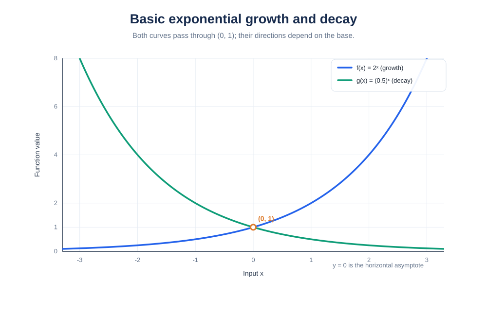
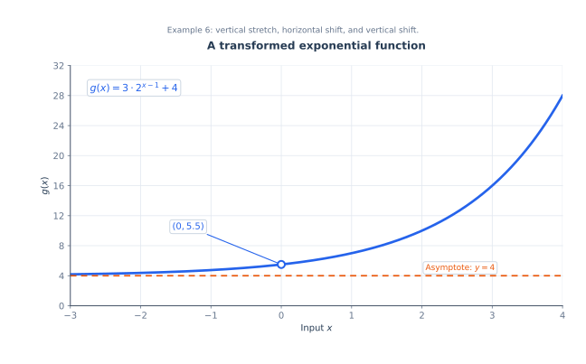
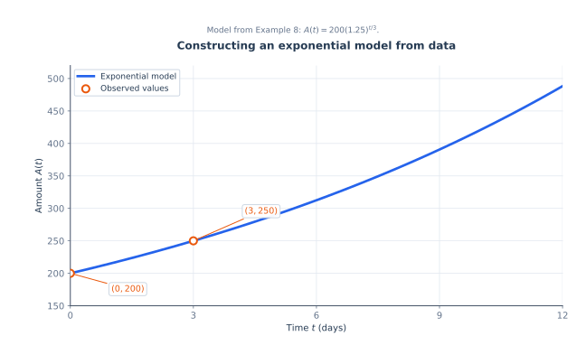
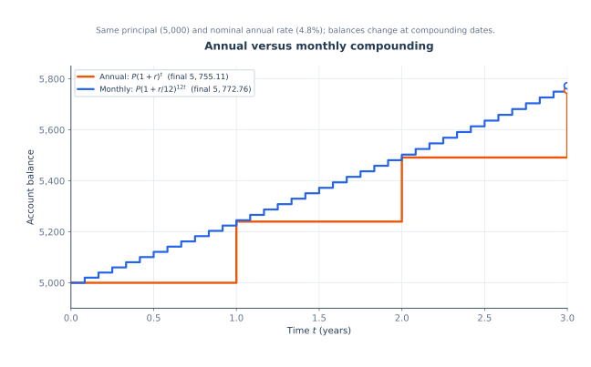
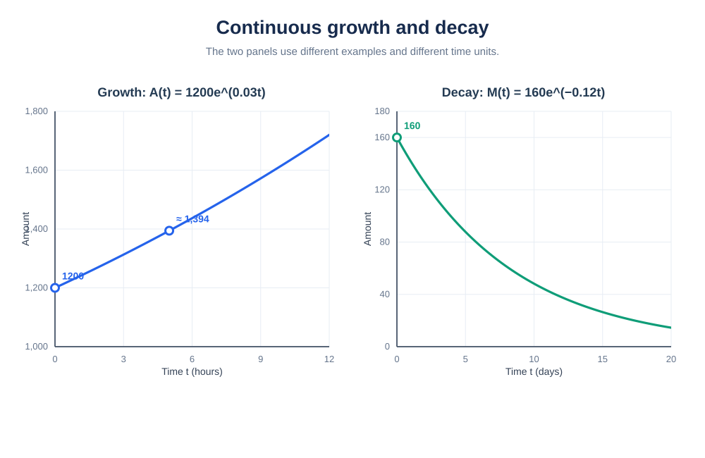
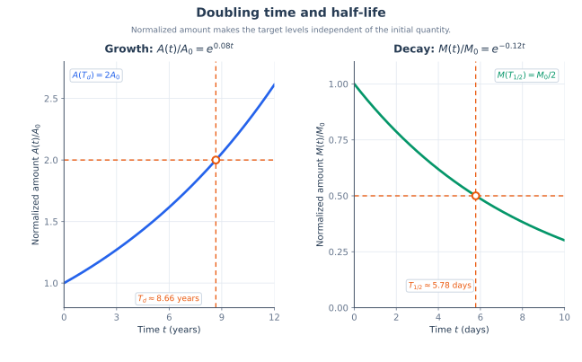

# Algebra 16 — Exponential Functions and Models

## 1. Introduction

An exponential model describes a quantity that changes by a constant **multiplicative factor** over equal steps of time or another input. This is different from a linear model, which changes by a constant additive amount. Exponential models appear in finance, population studies, biology, physics, computing, and many other fields.

Chapters 07 and 12 introduced integer powers and quadratic models. This chapter extends powers to a real-valued input and studies functions of the form $f(x)=ab^x$. It distinguishes discrete repeated change from continuous growth, derives compound-interest and half-life formulas, and solves basic equations in which the unknown appears in an exponent. The inverse-function language needed for logarithms is introduced only as much as required; Chapter 17 develops logarithmic functions and their properties systematically.

### Learning objectives

By the end of this chapter, a learner should be able to:

- Define a real exponential function and state its base restrictions, domain, range, intercept, and horizontal asymptote.
- Distinguish linear change from exponential change using additive and multiplicative ratios.
- Interpret growth and decay factors and convert percentage rates to multipliers.
- Describe transformations of exponential graphs.
- Construct and interpret discrete and continuous exponential models with consistent units.
- Use compound-interest and continuous-compounding formulas while identifying their assumptions.
- Calculate doubling times and half-lives.
- Solve exponential equations using equal bases or logarithms, checking the conditions for each step.
- Solve simple exponential inequalities while accounting for whether the base is increasing or decreasing.
- Use exact rational arithmetic for discrete models and controlled decimal approximations for continuous models.

## 2. Linear change versus exponential change

A linear sequence has a constant **difference** between consecutive terms. An exponential sequence with positive terms has a constant **ratio** between consecutive terms.

For example, the sequence

$$

3,\ 7,\ 11,\ 15,\ 19,\ldots

$$

has common difference $4$. Its term after $n$ steps is $a_n=3+4n$.

The sequence

$$

3,\ 6,\ 12,\ 24,\ 48,\ldots

$$

has common ratio $2$. Its term after $n$ steps is $a_n=3\cdot2^n$.

A constant additive change is appropriate for a linear model; a constant multiplicative change is appropriate for an exponential model. A data set should not be called exponential merely because it increases. The ratio or a suitable exponential fit must support that choice.

### Example 1 — Compare two patterns

A savings jar receives $5$ dollars at the end of each week, starting with no money. Its balance after $n$ weeks is $L_n=5n$, a linear model. A different account begins with $5$ dollars and doubles every week; its balance is $E_n=5\cdot2^n$, an exponential model. The first adds $5$ each week; the second multiplies by $2$ each week.

## 3. The real exponential function

For a real base $b$ satisfying

$$

b>0,\qquad b\ne1,

$$

the expression $b^x$ is defined for every real input $x$. The resulting function

$$

f(x)=b^x

$$

is the **basic exponential function**. Its real-exponent definition is compatible with integer and rational powers and can be expressed using the natural exponential and natural logarithm as $b^x=e^{x\ln b}$. Chapter 17 develops the logarithm in detail.

The restrictions on $b$ matter:

- If $b=1$, then $1^x=1$ is a constant function, not a nonconstant exponential function.
- If $b=0$, negative and many non-integer powers are not real-defined, so it does not define an exponential function on all of $\mathbb R$.
- If $b<0$, a real value is not defined for every real exponent. Negative bases were treated under the rational-exponent convention in Chapter 11, but that does not produce a real-valued function on all real inputs.

For every admissible base $b$, the value $b^x$ is positive. Thus the domain of $f(x)=b^x$ is $\mathbb R$ and its range is $(0,\infty)$.

### 3.1 Basic graph properties

For $f(x)=b^x$:

- Domain: $\mathbb R$.
- Range: $(0,\infty)$.
- $y$-intercept: $(0,1)$, since $b^0=1$.
- There is no $x$-intercept, because $b^x>0$ for all real $x$.
- The horizontal asymptote is $y=0$.
- If $b>1$, the function is strictly increasing.
- If $0<b<1$, the function is strictly decreasing.

The graph approaches, but never reaches, the horizontal asymptote. For $b>1$, it approaches zero as $x\to-\infty$ and grows without bound as $x\to\infty$. For $0<b<1$, these directions are reversed.



*Figure 16.1 — Basic exponential growth and decay.*

### Example 2 — Classify an exponential function

For $f(x)=4^x$, the base is greater than $1$, so the function is increasing. Its domain is $\mathbb R$, range is $(0,\infty)$, $y$-intercept is $(0,1)$, and horizontal asymptote is $y=0$.

For $g(x)=(0.4)^x$, the base lies between $0$ and $1$, so the function is decreasing. Its domain, range, intercept, and asymptote have the same forms as those of $f$.

## 4. Exponential growth and decay

A basic exponential model with positive initial value is

$$

A(t)=A_0b^t,

$$

where $A_0>0$ is the initial amount, $b>0$ is the multiplicative factor per time unit, and $t$ is the number of time units. In a discrete process, $t$ is normally a nonnegative integer. The formula may be extended to real $t$ for a continuous-input mathematical model, but a real-world step process changes only at its specified steps.

- **Exponential growth:** $b>1$.
- **Exponential decay:** $0<b<1$.
- **No change:** $b=1$, which gives the constant function $A(t)=A_0$.

If the percentage growth per period is $r$, written as a decimal, then

$$

b=1+r.

$$

For example, a growth rate of $6\%$ gives $b=1.06$. If a quantity decreases by $d$ per period, where $0<d<1$, then

$$

b=1-d.

$$

A decrease of $6\%$ gives $b=0.94$, not $0.06$.

The multiplier must be applied to the current amount, not repeatedly to the original amount. A sequence of different percentage changes uses the product of its individual factors.

### Example 3 — Convert a percentage rate to a factor

A quantity grows by $4.5\%$ each month. Its monthly factor is

$$

b=1+0.045=1.045.

$$

If it begins at $800$ units, then after $n$ complete months

$$

A_n=800(1.045)^n.

$$

### Example 4 — A percentage decrease

A machine retains $92\%$ of its value each year. Its annual factor is $0.92$, and the model is

$$

V_n=V_0(0.92)^n.

$$

The decrease is $8\%$ per year; $0.92$ is the remaining fraction.

### Example 5 — Successive percentage changes

A price increases by $10\%$ and later decreases by $10\%$. The combined factor is

$$

1.10\times0.90=0.99.

$$

The final price is $99\%$ of the original price, so the net change is a decrease of $1\%$. Equal percentage increase and decrease do not cancel because the second percentage is applied to the changed amount.

## 5. Transformations of exponential functions

A useful transformed form is

$$

g(x)=A b^{x-h}+k,

$$

where $b>0$, $b\ne1$, and $A\ne0$.

- $h$ shifts the graph horizontally: right by $h$ when $h>0$, left when $h<0$.
- $A$ gives a vertical scale factor $|A|$; if $A<0$, the graph is reflected across the horizontal line before the vertical shift.
- $k$ shifts the graph vertically.
- The horizontal asymptote is $y=k$.
- The domain is $\mathbb R$.
- The range is $(k,\infty)$ when $A>0$, and $(-\infty,k)$ when $A<0$.

When $A>0$ and $b>1$, the function is increasing. When $A>0$ and $0<b<1$, it is decreasing. A negative $A$ reverses these monotonicity directions.

### Example 6 — Read a transformation

Let

$$

g(x)=3\cdot2^{x-1}+4.

$$

This is the graph of $2^x$ shifted right by $1$, stretched vertically by a factor of $3$, and shifted up by $4$. Its horizontal asymptote is $y=4$, domain is $\mathbb R$, and range is $(4,\infty)$. Its $y$-intercept is $g(0)=3\cdot2^{-1}+4=5.5$.



*Figure 16.2 — A transformed exponential with horizontal asymptote y = 4.*

### Example 7 — A reflected exponential

For $h(x)=-2(0.5)^x+7$, the horizontal asymptote is $y=7$, the domain is $\mathbb R$, and the range is $(-\infty,7)$. Since the base is between zero and one but the coefficient is negative, the function is increasing.

## 6. Constructing an exponential model from data

A simple exponential model has the form

$$

A(t)=A_0b^t.

$$

The initial amount is $A(0)=A_0$. If two exact data points $(t_1,A_1)$ and $(t_2,A_2)$ are known, with positive outputs and $t_1\ne t_2$, then

$$

\frac{A_2}{A_1}=b^{t_2-t_1}.

$$

Thus

$$

b=\left(\frac{A_2}{A_1}\right)^{1/(t_2-t_1)},
\qquad A_0=\frac{A_1}{b^{t_1}}.

$$

These equations give a model passing through the two points. With more than two observations, a model is usually estimated using a fitting method such as least squares after a suitable logarithmic transformation; measurement error and model assumptions must be considered. Two points determine a candidate exponential curve, but do not prove that a real process remains exponential.

### Example 8 — Build a model from two observations

A culture has $200$ cells at $t=0$ and $250$ cells at $t=3$ days. If an exponential model is appropriate, then

$$

A(t)=200b^t,\qquad 200b^3=250.

$$

Therefore $b^3=1.25$ and

$$

A(t)=200(1.25)^{t/3}.

$$

The factor per three days is exactly $1.25$. The per-day factor is $1.25^{1/3}$, which is generally irrational; it should not be rounded until a numerical estimate is required.



*Figure 16.3 — An exponential model determined by two observations.*

## 7. Discrete repeated growth and decay

For a fixed multiplier $b$, the amount after $n$ complete steps is

$$

A_n=A_0b^n,\qquad n=0,1,2,\ldots

$$

This is a geometric sequence, connecting the sequence work in Chapter 18 with the function model studied here. The ratio of successive terms is $A_{n+1}/A_n=b$ when the terms are nonzero.

If $b>1$, a target $T>A_0$ is reached or exceeded after the smallest integer $n$ satisfying $A_0b^n\ge T$. If $0<b<1$, the sequence decreases toward zero but remains positive when $A_0>0$.

For $b>1$, the real-valued threshold estimate is

$$

n=\frac{\ln(T/A_0)}{\ln b},

$$

provided $T/A_0>0$. If only complete steps are allowed, take the least integer not smaller than this value and verify the inequality using the original model. Chapter 17 develops logarithms and their laws.

### Example 9 — Find the first complete period reaching a target

An account begins with $500$ and grows by $5\%$ per year. The model is $A_n=500(1.05)^n$. To reach at least $700$, solve

$$

500(1.05)^n\ge700.

$$

The real threshold is $n=\ln(1.4)/\ln(1.05)\approx6.90$. Therefore the first complete year is $n=7$. Check: $A_6\approx670.05<700$ and $A_7\approx703.55\ge700$.

## 8. Compound interest

Suppose a principal $P$ earns a nominal annual interest rate $r$, written as a decimal, compounded $m$ times per year. The rate per compounding period is $r/m$. After $n$ compounding periods,

$$

A=P\left(1+\frac rm\right)^n.

$$

For $t$ years with $mt$ complete compounding periods, the compound-interest formula is

$$

A(t)=P\left(1+\frac rm\right)^{mt}.

$$

Here $P\ge0$, $m$ is a positive integer, and $1+r/m>0$. In ordinary positive-interest examples, $r\ge0$. The operational balance changes at compounding dates; conventions for partial periods depend on the financial contract, so do not silently assume that every fractional-year interpretation is used by every institution.

The effective annual rate is the actual one-year multiplier minus one:

$$

r_{\mathrm{eff}}=\left(1+\frac rm\right)^m-1.

$$

It is generally not equal to the nominal annual rate $r$ when compounding occurs more than once per year.

### Example 10 — Monthly compounding

A principal of $5{,}000$ earns a nominal annual rate of $4.8\%$, compounded monthly, for $3$ years. There are $36$ compounding periods, so

$$

A=5000\left(1+\frac{0.048}{12}\right)^{36}
  =5000(1.004)^{36}.

$$

The formula gives approximately $5{,}772.7$ currency units. The exact expression is preferable until a rounding rule is specified.

### Example 11 — Compare annual and monthly compounding

For the same principal and nominal rate, annual compounding gives $P(1+r)^t$, while monthly compounding gives $P(1+r/12)^{12t}$ for complete years. With a positive rate, monthly compounding produces a larger balance because each period's interest begins earning interest sooner. The difference is not a change in the nominal annual rate; it is a change in the compounding frequency.



*Figure 16.4 — Annual and monthly compounding at the same nominal rate.*

## 9. Continuous growth and decay

If the instantaneous relative growth rate is constant and equal to $k$, then the continuous model is

$$

A(t)=A_0e^{kt},

$$

where $A_0>0$, $t$ is measured in the chosen time unit, and $k$ has units of inverse time. The value $e$ is the natural exponential base.

- If $k>0$, the quantity grows continuously.
- If $k<0$, the quantity decays continuously.
- If $k=0$, the quantity remains constant.

The differential equation behind the model is

$$

\frac{dA}{dt}=kA.

$$

It states that the instantaneous rate of change is proportional to the current amount. Separating variables and integrating gives $\ln A=kt+C$ when $A>0$; using $A(0)=A_0$ gives $A(t)=A_0e^{kt}$. This derivation assumes differentiability and a constant proportionality rate.

### Example 12 — Continuous growth

A laboratory sample begins with $1{,}200$ units and follows a continuous growth rate of $3\%$ per hour. Then $k=0.03$ per hour and

$$

A(t)=1200e^{0.03t}.

$$

After $5$ hours,

$$

A(5)=1200e^{0.15}\approx1{,}394.2\text{ units}.

$$

### Example 13 — Continuous decay

A substance begins with $160$ grams and decays continuously at a rate constant of $0.12$ per day. Its model is

$$

M(t)=160e^{-0.12t}.

$$

After $5$ days, $M(5)=160e^{-0.6}\approx87.8$ grams. The exponent is negative because the quantity decays.



*Figure 16.5 — Continuous growth and decay models with their own time units.*

## 10. Doubling time and half-life

For continuous growth $A(t)=A_0e^{kt}$ with $k>0$, the doubling time $T_d$ satisfies

$$

2A_0=A_0e^{kT_d}.

$$

Since $A_0>0$, divide by it and take logarithms:

$$

T_d=\frac{\ln2}{k}.

$$

For continuous decay $A(t)=A_0e^{-kt}$ with $k>0$, the half-life $T_{1/2}$ satisfies

$$

\frac12 A_0=A_0e^{-kT_{1/2}},

$$

so

$$

T_{1/2}=\frac{\ln2}{k}.

$$

The same numerical form appears in both cases, but the parameter is interpreted differently: $k$ is the positive growth constant in the first formula and the positive decay constant in the second. Units of time must match the units used for $k$.

For discrete growth with factor $b>1$, the real doubling-time estimate is $\ln2/\ln b$ periods. For discrete decay with $0<b<1$, the real half-life estimate is $\ln(1/2)/\ln b$ periods. If the process changes only at whole periods, the actual first period crossing half or double is an integer and must be checked in the original sequence.

### Example 14 — Doubling time

A continuously growing population has rate constant $k=0.08$ per year. Its doubling time is

$$

T_d=\frac{\ln2}{0.08}\approx8.66\text{ years}.

$$

This is a model-based time, not a promise that a discrete census will record exactly twice the population at that instant.

### Example 15 — Half-life

A substance has continuous decay constant $k=0.12$ per day. Its half-life is

$$

T_{1/2}=\frac{\ln2}{0.12}\approx5.78\text{ days}.

$$

The initial amount does not affect the half-life when the same constant-rate model remains valid.



*Figure 16.6 — Doubling-time and half-life thresholds in normalized models.*

## 11. Solving exponential equations

An exponential equation has the unknown in an exponent. First isolate the exponential expression. The isolated quantity must be positive before taking a logarithm.

For $b>0$, $b\ne1$, the function $b^x$ is one-to-one. Therefore, if both sides can be written with the same base, equal powers have equal exponents:

$$

b^{u(x)}=b^{v(x)}\quad\Longleftrightarrow\quad u(x)=v(x).

$$

If the bases cannot be made equal conveniently, use the inverse logarithm. For $y>0$,

$$

\log_b y=\frac{\ln y}{\ln b},\qquad b>0,\ b\ne1.

$$

Then

$$

b^{u}=y\quad\Longleftrightarrow\quad u=\log_b y.

$$

The logarithm is defined only for a positive argument. Chapter 17 develops logarithmic functions and their laws in full.

### Example 16 — Solve by rewriting with the same base

Solve $2^{x+1}=16$. Since $16=2^4$ and the base $2$ is positive and not $1$,

$$

2^{x+1}=2^4\Longrightarrow x+1=4\Longrightarrow x=3.

$$

### Example 17 — Solve using logarithms

Solve $5\cdot3^{2x-1}=45$. Divide by $5$:

$$

3^{2x-1}=9=3^2.

$$

Thus $2x-1=2$ and $x=3/2$. Substitution gives $5\cdot3^2=45$, so the solution checks.

### Example 18 — A base that does not give an integer exponent

Solve $2^x=5$. There is no convenient integer exponent. Since the right-hand side is positive,

$$

x=\log_2 5=\frac{\ln5}{\ln2}\approx2.3219.

$$

The decimal is an approximation; the logarithmic expression is exact.

### Example 19 — Check the positivity condition before taking a logarithm

Consider $4\cdot2^x-7=1$. Isolate the exponential term:

$$

4\cdot2^x=8,\qquad 2^x=2.

$$

The right side is positive, so taking a logarithm is valid; $x=1$. In a more general equation $A b^{u(x)}+C=D$, the quantity $(D-C)/A$ must be positive when $A\ne0$ before a real logarithm can be applied.

## 12. Exponential inequalities

The direction of an inequality depends on whether the exponential function is increasing or decreasing.

- If $b>1$, then $b^x$ is strictly increasing, so $b^{u}>b^{v}$ if and only if $u>v$.
- If $0<b<1$, then $b^x$ is strictly decreasing, so $b^{u}>b^{v}$ if and only if $u<v$.

This is the same order-reversal idea encountered in Chapter 04, but here the reversal comes from a decreasing function rather than multiplication by a negative number.

### Example 20 — Increasing base

Solve $3^{2x-1}\le27$. Since $27=3^3$ and the base $3>1$,

$$

2x-1\le3\Longrightarrow x\le2.

$$

### Example 21 — Decreasing base

Solve $(1/2)^{x+1}>1/8$. Since $1/8=(1/2)^3$ and the base is between zero and one, the inequality reverses when exponents are compared:

$$

x+1<3\Longrightarrow x<2.

$$

## 13. Modeling assumptions, units, and limitations

An exponential model is useful only while its assumptions are reasonable.

- **Constant multiplier:** a discrete model assumes the same factor at every step.
- **Constant relative rate:** a continuous model assumes the proportional rate $A'(t)/A(t)$ is constant.
- **Consistent units:** a rate per month must be paired with time in months; a rate per year must be paired with time in years.
- **Positive quantities:** population, mass, and account balances are usually modeled with positive initial values. An algebraic formula can produce values outside the physical interpretation if used beyond its assumptions.
- **No automatic carrying capacity:** unrestricted exponential growth does not model limited resources. A logistic model may be more appropriate when growth slows near a capacity; that model is outside this chapter's scope.
- **Extrapolation risk:** a model that fits observed data may fail outside the observed time interval because rates, rules, or environmental conditions can change.

When residuals are used to evaluate a fitted model, define them consistently as observed minus predicted. A small residual on a few observations does not prove that an exponential mechanism is correct.

## 14. Python computations

The self-contained Python implementation in the example below supports exact discrete calculations with `Fraction`, controlled continuous calculations with `Decimal`, and logarithmic solution of a one-variable exponential equation. It rejects binary floating-point inputs where exact rational input is required, and it does not attempt to infer a model from arbitrary noisy data.

### Example 22 — Exact repeated growth

```python
from __future__ import annotations

# --- Inlined implementation: exp_core ---
"""Small exact/controlled-precision helpers for Math-Atlas Algebra, Chapter 16.

The module is deliberately limited to common exponential models.  It is not
an arbitrary symbolic algebra system or a statistical model-fitting library.
"""


from decimal import Decimal, InvalidOperation
from fractions import Fraction
from typing import Union

RationalInput = Union[int, Fraction]
DecimalInput = Union[str, int, Decimal]


def _fraction(value: RationalInput, name: str) -> Fraction:
    if isinstance(value, bool) or not isinstance(value, (int, Fraction)):
        raise TypeError(f"{name} must be an int or Fraction; float is not accepted")
    return Fraction(value)


def _decimal(value: DecimalInput, name: str) -> Decimal:
    if isinstance(value, bool) or isinstance(value, float):
        raise TypeError(f"{name} must be str, int, or Decimal; float is not accepted")
    try:
        result = value if isinstance(value, Decimal) else Decimal(value)
    except (InvalidOperation, TypeError, ValueError) as exc:
        raise TypeError(f"{name} must be a valid decimal value") from exc
    if not result.is_finite():
        raise ValueError(f"{name} must be finite")
    return result


def _nonnegative_integer(value: int, name: str) -> int:
    if isinstance(value, bool) or not isinstance(value, int):
        raise TypeError(f"{name} must be an integer")
    if value < 0:
        raise ValueError(f"{name} must be nonnegative")
    return value


def classify_base(base: RationalInput) -> str:
    """Classify a positive rational exponential base as growth, decay, or constant."""
    b = _fraction(base, "base")
    if b <= 0:
        raise ValueError("an exponential base must be positive")
    if b == 1:
        return "constant"
    return "growth" if b > 1 else "decay"


def factor_from_rate(rate: RationalInput) -> Fraction:
    """Return 1+r for a per-period percentage rate r (expressed as a fraction)."""
    r = _fraction(rate, "rate")
    factor = Fraction(1) + r
    if factor <= 0:
        raise ValueError("the multiplicative factor 1 + rate must be positive")
    return factor


def discrete_value(initial: RationalInput, factor: RationalInput, periods: int) -> Fraction:
    """Evaluate A_n=A_0*b**n exactly for n complete nonnegative periods."""
    a0 = _fraction(initial, "initial")
    b = _fraction(factor, "factor")
    n = _nonnegative_integer(periods, "periods")
    if a0 < 0:
        raise ValueError("initial amount must be nonnegative")
    if b <= 0:
        raise ValueError("exponential factor must be positive")
    return a0 * b**n


def compound_amount(
    principal: RationalInput,
    annual_rate: RationalInput,
    compounds_per_year: int,
    years: int,
) -> Fraction:
    """Return exact compound interest after complete compounding periods.

    Uses A=P*(1+r/m)**(m*t), with integer years t and positive integer m.
    The periodic factor must be positive.  The function allows negative rates
    only when every compounding factor remains positive.
    """
    p = _fraction(principal, "principal")
    r = _fraction(annual_rate, "annual_rate")
    m = _nonnegative_integer(compounds_per_year, "compounds_per_year")
    t = _nonnegative_integer(years, "years")
    if m == 0:
        raise ValueError("compounds_per_year must be positive")
    if p < 0:
        raise ValueError("principal must be nonnegative")
    periodic_factor = Fraction(1) + r / m
    if periodic_factor <= 0:
        raise ValueError("1 + annual_rate / compounds_per_year must be positive")
    return p * periodic_factor ** (m * t)


def continuous_value(
    initial: DecimalInput,
    rate: DecimalInput,
    time: DecimalInput,
) -> Decimal:
    """Evaluate A(t)=A0*exp(k*t) using Decimal precision from the active context."""
    a0 = _decimal(initial, "initial")
    k = _decimal(rate, "rate")
    t = _decimal(time, "time")
    if a0 < 0:
        raise ValueError("initial amount must be nonnegative")
    if t < 0:
        raise ValueError("time must be nonnegative")
    return a0 * (k * t).exp()


def solve_exponential(
    initial: DecimalInput,
    base: DecimalInput,
    target: DecimalInput,
    coefficient: DecimalInput = Decimal(1),
    offset: DecimalInput = Decimal(0),
) -> Decimal:
    """Solve initial * base**(coefficient*x + offset) = target.

    A real solution requires initial>0, target>0, base>0, base!=1, and a
    nonzero coefficient.  The returned Decimal is rounded according to the
    active Decimal context; it is a numerical logarithmic solution.
    """
    a0 = _decimal(initial, "initial")
    b = _decimal(base, "base")
    y = _decimal(target, "target")
    c = _decimal(coefficient, "coefficient")
    d = _decimal(offset, "offset")
    if a0 <= 0:
        raise ValueError("initial multiplier must be positive")
    if y <= 0:
        raise ValueError("target must be positive before taking a logarithm")
    if b <= 0 or b == 1:
        raise ValueError("base must be positive and different from one")
    if c == 0:
        raise ValueError("coefficient of x must be nonzero")
    exponent = (y / a0).ln() / b.ln()
    return (exponent - d) / c


def continuous_doubling_time(rate: DecimalInput) -> Decimal:
    """Return ln(2)/k for a positive continuous growth constant k."""
    k = _decimal(rate, "rate")
    if k <= 0:
        raise ValueError("continuous growth rate must be positive")
    return Decimal(2).ln() / k


def continuous_half_life(decay_rate: DecimalInput) -> Decimal:
    """Return ln(2)/k for A(t)=A0*exp(-k*t), k>0."""
    k = _decimal(decay_rate, "decay_rate")
    if k <= 0:
        raise ValueError("continuous decay constant must be positive")
    return Decimal(2).ln() / k

# --- Chapter example ---
discrete_value = discrete_value

from fractions import Fraction


# Exact 5% growth for 7 complete periods.
amount = discrete_value(Fraction(500), Fraction(105, 100), 7)
assert amount == Fraction(500) * Fraction(105, 100) ** 7
assert amount > 700
```

### Example 23 — Exact compound interest

```python
from __future__ import annotations

# --- Inlined implementation: exp_core ---
"""Small exact/controlled-precision helpers for Math-Atlas Algebra, Chapter 16.

The module is deliberately limited to common exponential models.  It is not
an arbitrary symbolic algebra system or a statistical model-fitting library.
"""


from decimal import Decimal, InvalidOperation
from fractions import Fraction
from typing import Union

RationalInput = Union[int, Fraction]
DecimalInput = Union[str, int, Decimal]


def _fraction(value: RationalInput, name: str) -> Fraction:
    if isinstance(value, bool) or not isinstance(value, (int, Fraction)):
        raise TypeError(f"{name} must be an int or Fraction; float is not accepted")
    return Fraction(value)


def _decimal(value: DecimalInput, name: str) -> Decimal:
    if isinstance(value, bool) or isinstance(value, float):
        raise TypeError(f"{name} must be str, int, or Decimal; float is not accepted")
    try:
        result = value if isinstance(value, Decimal) else Decimal(value)
    except (InvalidOperation, TypeError, ValueError) as exc:
        raise TypeError(f"{name} must be a valid decimal value") from exc
    if not result.is_finite():
        raise ValueError(f"{name} must be finite")
    return result


def _nonnegative_integer(value: int, name: str) -> int:
    if isinstance(value, bool) or not isinstance(value, int):
        raise TypeError(f"{name} must be an integer")
    if value < 0:
        raise ValueError(f"{name} must be nonnegative")
    return value


def classify_base(base: RationalInput) -> str:
    """Classify a positive rational exponential base as growth, decay, or constant."""
    b = _fraction(base, "base")
    if b <= 0:
        raise ValueError("an exponential base must be positive")
    if b == 1:
        return "constant"
    return "growth" if b > 1 else "decay"


def factor_from_rate(rate: RationalInput) -> Fraction:
    """Return 1+r for a per-period percentage rate r (expressed as a fraction)."""
    r = _fraction(rate, "rate")
    factor = Fraction(1) + r
    if factor <= 0:
        raise ValueError("the multiplicative factor 1 + rate must be positive")
    return factor


def discrete_value(initial: RationalInput, factor: RationalInput, periods: int) -> Fraction:
    """Evaluate A_n=A_0*b**n exactly for n complete nonnegative periods."""
    a0 = _fraction(initial, "initial")
    b = _fraction(factor, "factor")
    n = _nonnegative_integer(periods, "periods")
    if a0 < 0:
        raise ValueError("initial amount must be nonnegative")
    if b <= 0:
        raise ValueError("exponential factor must be positive")
    return a0 * b**n


def compound_amount(
    principal: RationalInput,
    annual_rate: RationalInput,
    compounds_per_year: int,
    years: int,
) -> Fraction:
    """Return exact compound interest after complete compounding periods.

    Uses A=P*(1+r/m)**(m*t), with integer years t and positive integer m.
    The periodic factor must be positive.  The function allows negative rates
    only when every compounding factor remains positive.
    """
    p = _fraction(principal, "principal")
    r = _fraction(annual_rate, "annual_rate")
    m = _nonnegative_integer(compounds_per_year, "compounds_per_year")
    t = _nonnegative_integer(years, "years")
    if m == 0:
        raise ValueError("compounds_per_year must be positive")
    if p < 0:
        raise ValueError("principal must be nonnegative")
    periodic_factor = Fraction(1) + r / m
    if periodic_factor <= 0:
        raise ValueError("1 + annual_rate / compounds_per_year must be positive")
    return p * periodic_factor ** (m * t)


def continuous_value(
    initial: DecimalInput,
    rate: DecimalInput,
    time: DecimalInput,
) -> Decimal:
    """Evaluate A(t)=A0*exp(k*t) using Decimal precision from the active context."""
    a0 = _decimal(initial, "initial")
    k = _decimal(rate, "rate")
    t = _decimal(time, "time")
    if a0 < 0:
        raise ValueError("initial amount must be nonnegative")
    if t < 0:
        raise ValueError("time must be nonnegative")
    return a0 * (k * t).exp()


def solve_exponential(
    initial: DecimalInput,
    base: DecimalInput,
    target: DecimalInput,
    coefficient: DecimalInput = Decimal(1),
    offset: DecimalInput = Decimal(0),
) -> Decimal:
    """Solve initial * base**(coefficient*x + offset) = target.

    A real solution requires initial>0, target>0, base>0, base!=1, and a
    nonzero coefficient.  The returned Decimal is rounded according to the
    active Decimal context; it is a numerical logarithmic solution.
    """
    a0 = _decimal(initial, "initial")
    b = _decimal(base, "base")
    y = _decimal(target, "target")
    c = _decimal(coefficient, "coefficient")
    d = _decimal(offset, "offset")
    if a0 <= 0:
        raise ValueError("initial multiplier must be positive")
    if y <= 0:
        raise ValueError("target must be positive before taking a logarithm")
    if b <= 0 or b == 1:
        raise ValueError("base must be positive and different from one")
    if c == 0:
        raise ValueError("coefficient of x must be nonzero")
    exponent = (y / a0).ln() / b.ln()
    return (exponent - d) / c


def continuous_doubling_time(rate: DecimalInput) -> Decimal:
    """Return ln(2)/k for a positive continuous growth constant k."""
    k = _decimal(rate, "rate")
    if k <= 0:
        raise ValueError("continuous growth rate must be positive")
    return Decimal(2).ln() / k


def continuous_half_life(decay_rate: DecimalInput) -> Decimal:
    """Return ln(2)/k for A(t)=A0*exp(-k*t), k>0."""
    k = _decimal(decay_rate, "decay_rate")
    if k <= 0:
        raise ValueError("continuous decay constant must be positive")
    return Decimal(2).ln() / k

# --- Chapter example ---
compound_amount = compound_amount

from fractions import Fraction


# 4.8% nominal annual rate, compounded monthly, for 3 complete years.
amount = compound_amount(
    principal=Fraction(5000),
    annual_rate=Fraction(48, 1000),
    compounds_per_year=12,
    years=3,
)
assert amount == Fraction(5000) * (1 + Fraction(48, 1000) / 12) ** 36
assert amount > 5000
```

### Example 24 — Continuous compounding with Decimal

```python
from __future__ import annotations

# --- Inlined implementation: exp_core ---
"""Small exact/controlled-precision helpers for Math-Atlas Algebra, Chapter 16.

The module is deliberately limited to common exponential models.  It is not
an arbitrary symbolic algebra system or a statistical model-fitting library.
"""


from decimal import Decimal, InvalidOperation
from fractions import Fraction
from typing import Union

RationalInput = Union[int, Fraction]
DecimalInput = Union[str, int, Decimal]


def _fraction(value: RationalInput, name: str) -> Fraction:
    if isinstance(value, bool) or not isinstance(value, (int, Fraction)):
        raise TypeError(f"{name} must be an int or Fraction; float is not accepted")
    return Fraction(value)


def _decimal(value: DecimalInput, name: str) -> Decimal:
    if isinstance(value, bool) or isinstance(value, float):
        raise TypeError(f"{name} must be str, int, or Decimal; float is not accepted")
    try:
        result = value if isinstance(value, Decimal) else Decimal(value)
    except (InvalidOperation, TypeError, ValueError) as exc:
        raise TypeError(f"{name} must be a valid decimal value") from exc
    if not result.is_finite():
        raise ValueError(f"{name} must be finite")
    return result


def _nonnegative_integer(value: int, name: str) -> int:
    if isinstance(value, bool) or not isinstance(value, int):
        raise TypeError(f"{name} must be an integer")
    if value < 0:
        raise ValueError(f"{name} must be nonnegative")
    return value


def classify_base(base: RationalInput) -> str:
    """Classify a positive rational exponential base as growth, decay, or constant."""
    b = _fraction(base, "base")
    if b <= 0:
        raise ValueError("an exponential base must be positive")
    if b == 1:
        return "constant"
    return "growth" if b > 1 else "decay"


def factor_from_rate(rate: RationalInput) -> Fraction:
    """Return 1+r for a per-period percentage rate r (expressed as a fraction)."""
    r = _fraction(rate, "rate")
    factor = Fraction(1) + r
    if factor <= 0:
        raise ValueError("the multiplicative factor 1 + rate must be positive")
    return factor


def discrete_value(initial: RationalInput, factor: RationalInput, periods: int) -> Fraction:
    """Evaluate A_n=A_0*b**n exactly for n complete nonnegative periods."""
    a0 = _fraction(initial, "initial")
    b = _fraction(factor, "factor")
    n = _nonnegative_integer(periods, "periods")
    if a0 < 0:
        raise ValueError("initial amount must be nonnegative")
    if b <= 0:
        raise ValueError("exponential factor must be positive")
    return a0 * b**n


def compound_amount(
    principal: RationalInput,
    annual_rate: RationalInput,
    compounds_per_year: int,
    years: int,
) -> Fraction:
    """Return exact compound interest after complete compounding periods.

    Uses A=P*(1+r/m)**(m*t), with integer years t and positive integer m.
    The periodic factor must be positive.  The function allows negative rates
    only when every compounding factor remains positive.
    """
    p = _fraction(principal, "principal")
    r = _fraction(annual_rate, "annual_rate")
    m = _nonnegative_integer(compounds_per_year, "compounds_per_year")
    t = _nonnegative_integer(years, "years")
    if m == 0:
        raise ValueError("compounds_per_year must be positive")
    if p < 0:
        raise ValueError("principal must be nonnegative")
    periodic_factor = Fraction(1) + r / m
    if periodic_factor <= 0:
        raise ValueError("1 + annual_rate / compounds_per_year must be positive")
    return p * periodic_factor ** (m * t)


def continuous_value(
    initial: DecimalInput,
    rate: DecimalInput,
    time: DecimalInput,
) -> Decimal:
    """Evaluate A(t)=A0*exp(k*t) using Decimal precision from the active context."""
    a0 = _decimal(initial, "initial")
    k = _decimal(rate, "rate")
    t = _decimal(time, "time")
    if a0 < 0:
        raise ValueError("initial amount must be nonnegative")
    if t < 0:
        raise ValueError("time must be nonnegative")
    return a0 * (k * t).exp()


def solve_exponential(
    initial: DecimalInput,
    base: DecimalInput,
    target: DecimalInput,
    coefficient: DecimalInput = Decimal(1),
    offset: DecimalInput = Decimal(0),
) -> Decimal:
    """Solve initial * base**(coefficient*x + offset) = target.

    A real solution requires initial>0, target>0, base>0, base!=1, and a
    nonzero coefficient.  The returned Decimal is rounded according to the
    active Decimal context; it is a numerical logarithmic solution.
    """
    a0 = _decimal(initial, "initial")
    b = _decimal(base, "base")
    y = _decimal(target, "target")
    c = _decimal(coefficient, "coefficient")
    d = _decimal(offset, "offset")
    if a0 <= 0:
        raise ValueError("initial multiplier must be positive")
    if y <= 0:
        raise ValueError("target must be positive before taking a logarithm")
    if b <= 0 or b == 1:
        raise ValueError("base must be positive and different from one")
    if c == 0:
        raise ValueError("coefficient of x must be nonzero")
    exponent = (y / a0).ln() / b.ln()
    return (exponent - d) / c


def continuous_doubling_time(rate: DecimalInput) -> Decimal:
    """Return ln(2)/k for a positive continuous growth constant k."""
    k = _decimal(rate, "rate")
    if k <= 0:
        raise ValueError("continuous growth rate must be positive")
    return Decimal(2).ln() / k


def continuous_half_life(decay_rate: DecimalInput) -> Decimal:
    """Return ln(2)/k for A(t)=A0*exp(-k*t), k>0."""
    k = _decimal(decay_rate, "decay_rate")
    if k <= 0:
        raise ValueError("continuous decay constant must be positive")
    return Decimal(2).ln() / k

# --- Chapter example ---
continuous_value = continuous_value

from decimal import Decimal


amount = continuous_value(Decimal("2000"), Decimal("0.035"), Decimal("8"))
assert amount > Decimal("2640")
assert amount < Decimal("2650")
```

### Example 25 — Solve an exponential equation numerically

```python
from __future__ import annotations

# --- Inlined implementation: exp_core ---
"""Small exact/controlled-precision helpers for Math-Atlas Algebra, Chapter 16.

The module is deliberately limited to common exponential models.  It is not
an arbitrary symbolic algebra system or a statistical model-fitting library.
"""


from decimal import Decimal, InvalidOperation
from fractions import Fraction
from typing import Union

RationalInput = Union[int, Fraction]
DecimalInput = Union[str, int, Decimal]


def _fraction(value: RationalInput, name: str) -> Fraction:
    if isinstance(value, bool) or not isinstance(value, (int, Fraction)):
        raise TypeError(f"{name} must be an int or Fraction; float is not accepted")
    return Fraction(value)


def _decimal(value: DecimalInput, name: str) -> Decimal:
    if isinstance(value, bool) or isinstance(value, float):
        raise TypeError(f"{name} must be str, int, or Decimal; float is not accepted")
    try:
        result = value if isinstance(value, Decimal) else Decimal(value)
    except (InvalidOperation, TypeError, ValueError) as exc:
        raise TypeError(f"{name} must be a valid decimal value") from exc
    if not result.is_finite():
        raise ValueError(f"{name} must be finite")
    return result


def _nonnegative_integer(value: int, name: str) -> int:
    if isinstance(value, bool) or not isinstance(value, int):
        raise TypeError(f"{name} must be an integer")
    if value < 0:
        raise ValueError(f"{name} must be nonnegative")
    return value


def classify_base(base: RationalInput) -> str:
    """Classify a positive rational exponential base as growth, decay, or constant."""
    b = _fraction(base, "base")
    if b <= 0:
        raise ValueError("an exponential base must be positive")
    if b == 1:
        return "constant"
    return "growth" if b > 1 else "decay"


def factor_from_rate(rate: RationalInput) -> Fraction:
    """Return 1+r for a per-period percentage rate r (expressed as a fraction)."""
    r = _fraction(rate, "rate")
    factor = Fraction(1) + r
    if factor <= 0:
        raise ValueError("the multiplicative factor 1 + rate must be positive")
    return factor


def discrete_value(initial: RationalInput, factor: RationalInput, periods: int) -> Fraction:
    """Evaluate A_n=A_0*b**n exactly for n complete nonnegative periods."""
    a0 = _fraction(initial, "initial")
    b = _fraction(factor, "factor")
    n = _nonnegative_integer(periods, "periods")
    if a0 < 0:
        raise ValueError("initial amount must be nonnegative")
    if b <= 0:
        raise ValueError("exponential factor must be positive")
    return a0 * b**n


def compound_amount(
    principal: RationalInput,
    annual_rate: RationalInput,
    compounds_per_year: int,
    years: int,
) -> Fraction:
    """Return exact compound interest after complete compounding periods.

    Uses A=P*(1+r/m)**(m*t), with integer years t and positive integer m.
    The periodic factor must be positive.  The function allows negative rates
    only when every compounding factor remains positive.
    """
    p = _fraction(principal, "principal")
    r = _fraction(annual_rate, "annual_rate")
    m = _nonnegative_integer(compounds_per_year, "compounds_per_year")
    t = _nonnegative_integer(years, "years")
    if m == 0:
        raise ValueError("compounds_per_year must be positive")
    if p < 0:
        raise ValueError("principal must be nonnegative")
    periodic_factor = Fraction(1) + r / m
    if periodic_factor <= 0:
        raise ValueError("1 + annual_rate / compounds_per_year must be positive")
    return p * periodic_factor ** (m * t)


def continuous_value(
    initial: DecimalInput,
    rate: DecimalInput,
    time: DecimalInput,
) -> Decimal:
    """Evaluate A(t)=A0*exp(k*t) using Decimal precision from the active context."""
    a0 = _decimal(initial, "initial")
    k = _decimal(rate, "rate")
    t = _decimal(time, "time")
    if a0 < 0:
        raise ValueError("initial amount must be nonnegative")
    if t < 0:
        raise ValueError("time must be nonnegative")
    return a0 * (k * t).exp()


def solve_exponential(
    initial: DecimalInput,
    base: DecimalInput,
    target: DecimalInput,
    coefficient: DecimalInput = Decimal(1),
    offset: DecimalInput = Decimal(0),
) -> Decimal:
    """Solve initial * base**(coefficient*x + offset) = target.

    A real solution requires initial>0, target>0, base>0, base!=1, and a
    nonzero coefficient.  The returned Decimal is rounded according to the
    active Decimal context; it is a numerical logarithmic solution.
    """
    a0 = _decimal(initial, "initial")
    b = _decimal(base, "base")
    y = _decimal(target, "target")
    c = _decimal(coefficient, "coefficient")
    d = _decimal(offset, "offset")
    if a0 <= 0:
        raise ValueError("initial multiplier must be positive")
    if y <= 0:
        raise ValueError("target must be positive before taking a logarithm")
    if b <= 0 or b == 1:
        raise ValueError("base must be positive and different from one")
    if c == 0:
        raise ValueError("coefficient of x must be nonzero")
    exponent = (y / a0).ln() / b.ln()
    return (exponent - d) / c


def continuous_doubling_time(rate: DecimalInput) -> Decimal:
    """Return ln(2)/k for a positive continuous growth constant k."""
    k = _decimal(rate, "rate")
    if k <= 0:
        raise ValueError("continuous growth rate must be positive")
    return Decimal(2).ln() / k


def continuous_half_life(decay_rate: DecimalInput) -> Decimal:
    """Return ln(2)/k for A(t)=A0*exp(-k*t), k>0."""
    k = _decimal(decay_rate, "decay_rate")
    if k <= 0:
        raise ValueError("continuous decay constant must be positive")
    return Decimal(2).ln() / k

# --- Chapter example ---
solve_exponential = solve_exponential

from decimal import Decimal


# Solve 5 * 3**(2*x - 1) = 45.
x = solve_exponential(
    initial=Decimal("5"),
    base=Decimal("3"),
    target=Decimal("45"),
    coefficient=Decimal("2"),
    offset=Decimal("-1"),
)
assert abs(x - Decimal("1.5")) < Decimal("1e-25")
```

### Example 26 — Continuous doubling time

```python
from __future__ import annotations

# --- Inlined implementation: exp_core ---
"""Small exact/controlled-precision helpers for Math-Atlas Algebra, Chapter 16.

The module is deliberately limited to common exponential models.  It is not
an arbitrary symbolic algebra system or a statistical model-fitting library.
"""


from decimal import Decimal, InvalidOperation
from fractions import Fraction
from typing import Union

RationalInput = Union[int, Fraction]
DecimalInput = Union[str, int, Decimal]


def _fraction(value: RationalInput, name: str) -> Fraction:
    if isinstance(value, bool) or not isinstance(value, (int, Fraction)):
        raise TypeError(f"{name} must be an int or Fraction; float is not accepted")
    return Fraction(value)


def _decimal(value: DecimalInput, name: str) -> Decimal:
    if isinstance(value, bool) or isinstance(value, float):
        raise TypeError(f"{name} must be str, int, or Decimal; float is not accepted")
    try:
        result = value if isinstance(value, Decimal) else Decimal(value)
    except (InvalidOperation, TypeError, ValueError) as exc:
        raise TypeError(f"{name} must be a valid decimal value") from exc
    if not result.is_finite():
        raise ValueError(f"{name} must be finite")
    return result


def _nonnegative_integer(value: int, name: str) -> int:
    if isinstance(value, bool) or not isinstance(value, int):
        raise TypeError(f"{name} must be an integer")
    if value < 0:
        raise ValueError(f"{name} must be nonnegative")
    return value


def classify_base(base: RationalInput) -> str:
    """Classify a positive rational exponential base as growth, decay, or constant."""
    b = _fraction(base, "base")
    if b <= 0:
        raise ValueError("an exponential base must be positive")
    if b == 1:
        return "constant"
    return "growth" if b > 1 else "decay"


def factor_from_rate(rate: RationalInput) -> Fraction:
    """Return 1+r for a per-period percentage rate r (expressed as a fraction)."""
    r = _fraction(rate, "rate")
    factor = Fraction(1) + r
    if factor <= 0:
        raise ValueError("the multiplicative factor 1 + rate must be positive")
    return factor


def discrete_value(initial: RationalInput, factor: RationalInput, periods: int) -> Fraction:
    """Evaluate A_n=A_0*b**n exactly for n complete nonnegative periods."""
    a0 = _fraction(initial, "initial")
    b = _fraction(factor, "factor")
    n = _nonnegative_integer(periods, "periods")
    if a0 < 0:
        raise ValueError("initial amount must be nonnegative")
    if b <= 0:
        raise ValueError("exponential factor must be positive")
    return a0 * b**n


def compound_amount(
    principal: RationalInput,
    annual_rate: RationalInput,
    compounds_per_year: int,
    years: int,
) -> Fraction:
    """Return exact compound interest after complete compounding periods.

    Uses A=P*(1+r/m)**(m*t), with integer years t and positive integer m.
    The periodic factor must be positive.  The function allows negative rates
    only when every compounding factor remains positive.
    """
    p = _fraction(principal, "principal")
    r = _fraction(annual_rate, "annual_rate")
    m = _nonnegative_integer(compounds_per_year, "compounds_per_year")
    t = _nonnegative_integer(years, "years")
    if m == 0:
        raise ValueError("compounds_per_year must be positive")
    if p < 0:
        raise ValueError("principal must be nonnegative")
    periodic_factor = Fraction(1) + r / m
    if periodic_factor <= 0:
        raise ValueError("1 + annual_rate / compounds_per_year must be positive")
    return p * periodic_factor ** (m * t)


def continuous_value(
    initial: DecimalInput,
    rate: DecimalInput,
    time: DecimalInput,
) -> Decimal:
    """Evaluate A(t)=A0*exp(k*t) using Decimal precision from the active context."""
    a0 = _decimal(initial, "initial")
    k = _decimal(rate, "rate")
    t = _decimal(time, "time")
    if a0 < 0:
        raise ValueError("initial amount must be nonnegative")
    if t < 0:
        raise ValueError("time must be nonnegative")
    return a0 * (k * t).exp()


def solve_exponential(
    initial: DecimalInput,
    base: DecimalInput,
    target: DecimalInput,
    coefficient: DecimalInput = Decimal(1),
    offset: DecimalInput = Decimal(0),
) -> Decimal:
    """Solve initial * base**(coefficient*x + offset) = target.

    A real solution requires initial>0, target>0, base>0, base!=1, and a
    nonzero coefficient.  The returned Decimal is rounded according to the
    active Decimal context; it is a numerical logarithmic solution.
    """
    a0 = _decimal(initial, "initial")
    b = _decimal(base, "base")
    y = _decimal(target, "target")
    c = _decimal(coefficient, "coefficient")
    d = _decimal(offset, "offset")
    if a0 <= 0:
        raise ValueError("initial multiplier must be positive")
    if y <= 0:
        raise ValueError("target must be positive before taking a logarithm")
    if b <= 0 or b == 1:
        raise ValueError("base must be positive and different from one")
    if c == 0:
        raise ValueError("coefficient of x must be nonzero")
    exponent = (y / a0).ln() / b.ln()
    return (exponent - d) / c


def continuous_doubling_time(rate: DecimalInput) -> Decimal:
    """Return ln(2)/k for a positive continuous growth constant k."""
    k = _decimal(rate, "rate")
    if k <= 0:
        raise ValueError("continuous growth rate must be positive")
    return Decimal(2).ln() / k


def continuous_half_life(decay_rate: DecimalInput) -> Decimal:
    """Return ln(2)/k for A(t)=A0*exp(-k*t), k>0."""
    k = _decimal(decay_rate, "decay_rate")
    if k <= 0:
        raise ValueError("continuous decay constant must be positive")
    return Decimal(2).ln() / k

# --- Chapter example ---
continuous_doubling_time = continuous_doubling_time

from decimal import Decimal


# Rate constant is 0.08 per year; answer is in years.
time = continuous_doubling_time(Decimal("0.08"))
assert Decimal("8.66") < time < Decimal("8.67")
```

## 15. Common errors and checks

- **Using a negative base for arbitrary real exponents:** a negative base does not define a real-valued exponential function on all of $\mathbb R$.
- **Confusing rate and factor:** a $7\%$ increase uses factor $1.07$; a $7\%$ decrease uses factor $0.93$.
- **Adding equal percentage changes:** successive rates multiply their factors; a $10\%$ increase followed by a $10\%$ decrease is a net $1\%$ decrease.
- **Mixing time units:** if $k$ is per month, use time in months.
- **Mixing nominal and effective interest rates:** state compounding frequency and do not treat the nominal rate as the effective annual rate.
- **Applying a real logarithm to a nonpositive number:** isolate the exponential term and verify positivity first.
- **Forgetting monotonicity in inequalities:** a base between $0$ and $1$ gives a decreasing exponential and reverses exponent comparisons.
- **Rounding too early:** retain exact expressions or sufficient precision through intermediate calculations.
- **Treating a fit as a law:** a model fitted to data is conditional on assumptions and should not be extrapolated without justification.

## 16. Exercises

### A. Classification and graph properties

1. For each function, state whether it is increasing or decreasing: (a) $f(x)=7(1.3)^x$, (b) $g(x)=4(0.7)^x$, (c) $h(x)=-2(1.4)^x$.
2. State the domain, range, $y$-intercept, and horizontal asymptote of $f(x)=5(2)^x-3$.
3. Find the horizontal asymptote and range of $g(x)=-4(0.25)^{x+2}+6$.
4. Explain why $(-2)^x$ does not define a real-valued exponential function for every real $x$.
5. Decide whether the sequence $12,18,27,40.5,\ldots$ is linear or exponential, and identify its factor.

### B. Growth, decay, and data models

6. A quantity begins at $350$ and grows by $2.5\%$ per month. Write a model and find the amount after $12$ complete months.
7. A device retains $84\%$ of its value each year. Write a decay model and find the fraction retained after $5$ years.
8. A price rises by $8\%$ and later falls by $8\%$. Find the net percentage change.
9. An exponential model passes through $(0,80)$ and $(2,125)$. Find an exact model of the form $A(t)=A_0b^t$.
10. A population grows from $4{,}000$ to $4{,}500$ over two years. Assuming exponential growth, find the two-year factor and the annual factor.

### C. Finance and continuous models

11. Find the amount on a principal of $2{,}400$ at a nominal annual rate of $3.6\%$, compounded quarterly, after $4$ complete years.
12. Find the effective annual rate for a nominal rate of $6\%$ compounded monthly.
13. A principal of $1{,}500$ earns continuous interest at $4\%$ per year. Write the model and estimate the amount after $6$ years.
14. A population follows $P(t)=900e^{0.025t}$. Identify the continuous relative growth rate and its units if $t$ is measured in days.
15. A radioactive sample follows $M(t)=72e^{-0.18t}$, with $t$ in hours. Find its half-life.
16. A culture doubles every $9$ hours. Find its continuous growth constant per hour.

### D. Equations and inequalities

17. Solve $5^{x-2}=125$.
18. Solve $4\cdot2^{3x}=32$.
19. Solve $7(0.5)^{x+1}=28$.
20. Solve $3^{2x-1}\ge81$.
21. Solve $(1/3)^{2x+1}<1/27$.
22. Solve $6e^{0.4t}=30$ for $t$, giving an exact logarithmic expression and a decimal approximation.

### E. Reasoning and computation

23. Explain why $b^x$ is increasing for $b>1$ and decreasing for $0<b<1$. Relate the conclusion to the monotonicity of the natural logarithm or exponential function.
24. Explain why a constant absolute increase per year does not support an exponential model, while a constant percentage increase does.
25. Use the self-contained Python implementation in this chapter to calculate exactly the value of $750$ after $10$ periods with multiplier $1.03$. State why a decimal approximation is not needed for the exact result.
26. A model $A(t)=A_0b^t$ is fitted to observations. Give two reasons why it may be unreliable far outside the observed interval.

## 17. Selected answers

1. (a) increasing; (b) decreasing; (c) decreasing because its coefficient is negative.
2. Domain $\mathbb R$; range $(-3,\infty)$; $y$-intercept $(0,2)$; horizontal asymptote $y=-3$.
3. Horizontal asymptote $y=6$; range $(-\infty,6)$.
4. Some real exponents, such as $1/2$, would require a real square root of a negative number; hence the expression is not real-defined for every real exponent.
5. Exponential, with common ratio $1.5$.
6. $A_n=350(1.025)^n$; after 12 months approximately $470.8$.
7. $V_n=V_0(0.84)^n$; fraction retained after 5 years is $0.84^5\approx0.4182$.
8. Factor $1.08\cdot0.92=0.9936$; net decrease $0.64\%$.
9. $A(t)=80(25/16)^{t/2}$, equivalently $80(5/4)^t$.
10. Two-year factor $4500/4000=1.125$; annual factor $\sqrt{1.125}$.
11. $2400(1+0.036/4)^{16}$, approximately $2{,}769.9$.
12. $(1+0.06/12)^{12}-1\approx0.061678$, or about $6.1678\%$.
13. $A(t)=1500e^{0.04t}$; $A(6)\approx1{,}906.9$.
14. $2.5\%$ per day, with continuous relative rate $0.025\text{ day}^{-1}$.
15. $T_{1/2}=\ln2/0.18\approx3.85$ hours.
16. $k=\ln2/9\approx0.0770\text{ hour}^{-1}$.
17. $x-2=3$, so $x=5$.
18. $2^{3x+2}=2^5$, so $x=1$.
19. Divide by $7$: $(0.5)^{x+1}=4=(0.5)^{-2}$, so $x=-3$.
20. $2x-1\ge4$, so $x\ge5/2$.
21. Since the base $1/3$ is decreasing, $2x+1>3$, so $x>1$.
22. $e^{0.4t}=5$, so $t=\ln5/0.4\approx4.0236$.
23. $b^x=e^{x\ln b}$. The derivative is $(\ln b)b^x$, whose sign is positive if $b>1$ and negative if $0<b<1$.
24. A constant absolute increase gives a constant difference; a constant percentage increase gives a constant ratio between successive values.
25. Exact value $750(103/100)^{10}$; keep this rational expression or its exact `Fraction` value until approximation is requested.
26. The growth rate may change; resources, policies, environment, or external conditions may impose limits or alter the process.

## 18. Chapter summary

A real exponential function has a positive base different from $1$. Its input domain is all real numbers, and its values are positive before transformations. Growth and decay are governed by a constant multiplier in discrete models or a constant proportional rate in continuous models. Compound interest is a discrete compounding model; continuous compounding uses $e^{rt}$. Transformations shift and reflect the graph while changing its horizontal asymptote and range. Exponential equations require an isolated positive exponential expression before logarithms are used. Exponential inequalities depend on whether the base is greater than $1$ or between $0$ and $1$. Every model must state its units, assumptions, and limits.
## References and further reading

- Math-Atlas Foundations, Chapter 03 — Relations and Functions.
- Math-Atlas Foundations, Chapter 05 — Mathematical Proof Techniques.
- Math-Atlas Algebra, Chapter 07 — Exponents and Scientific Notation.
- Math-Atlas Algebra, Chapter 12 — Quadratic Equations and Quadratic Models.
- OpenStax, *College Algebra 2e*, sections on exponential functions, exponential and logarithmic equations, and exponential models.

**Next chapter:** Chapter 17 — Logarithmic Functions and Equations.
