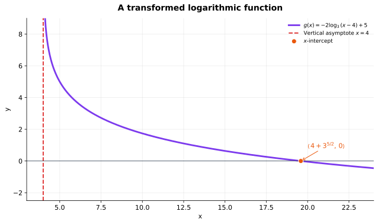
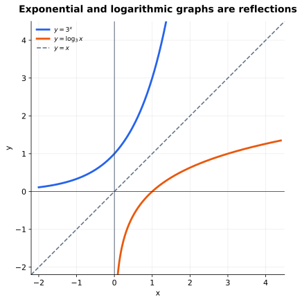
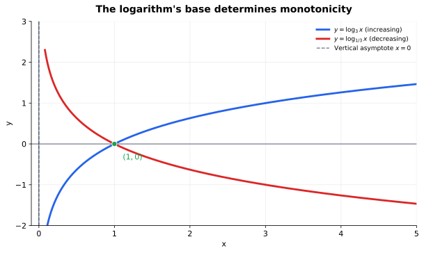
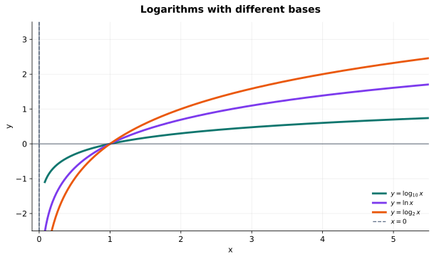
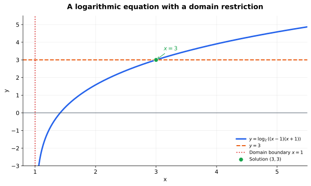
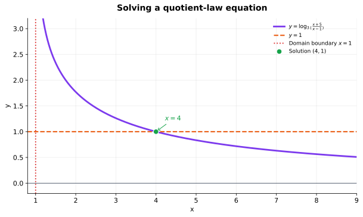

# Algebra 17 — Logarithmic Functions and Equations

## 1. Introduction

A logarithm answers an inverse question about exponentiation: **to what exponent must a base be raised to produce a given positive number?** Logarithms therefore turn unknown exponents into quantities that can be solved for. They also provide a natural language for scales in which equal multiplicative changes correspond to equal additive changes.

Chapter 16 introduced exponential functions and used logarithms only as a tool for solving selected exponential equations. This chapter develops logarithms as functions in their own right. It defines their real domains, derives the logarithm laws, explains common and natural logarithms, develops change of base, and solves logarithmic equations and inequalities while preserving domain restrictions.

### Learning objectives

By the end of this chapter, a learner should be able to:

- Define a real logarithm using the equivalent exponential statement.
- State and use the domain and range of a logarithmic function.
- Explain why the base must be positive and different from one, and why the argument must be positive.
- Describe logarithmic graphs and their transformations.
- Use inverse relationships between exponential and logarithmic functions.
- Derive and apply the product, quotient, and power laws for logarithms.
- Convert logarithms between bases and distinguish common logarithms from natural logarithms.
- Solve logarithmic equations and inequalities, stating the domain before applying transformations.
- Check candidate solutions in the original equation and reject extraneous values.
- Use controlled-precision numerical computation without confusing an approximation with an exact value.

## 2. Definition of a real logarithm

Let the base $b$ satisfy

$$
b>0,\qquad b\ne1.
$$

For a positive real number $x$, the logarithm of $x$ to base $b$ is the unique real number $y$ such that

$$
\log_b x=y\quad\Longleftrightarrow\quad b^y=x.
$$

The number $x$ is called the **argument**, $b$ is the **base**, and $y$ is the **logarithm** or **exponent**.

The conditions are essential:

- A real exponential base must be positive to define $b^y$ for every real exponent $y$.
- The base cannot be $1$, because $1^y=1$ for every real $y$ and therefore cannot produce a unique exponent for arbitrary positive $x$.
- The argument must be positive, because $b^y>0$ for every real $y$ when $b>0$.

Thus, a real logarithm is defined only when $b>0$, $b\ne1$, and $x>0$.

### Example 1 — Read a logarithm as an exponent

Since $2^5=32$,

$$
\log_2 32=5.
$$

Since $3^{-3}=1/27$,

$$
\log_3\left(\frac{1}{27}\right)=-3.
$$

Since $7^0=1$, we have $\log_7 1=0$. Since $b^1=b$, we have $\log_b b=1$ for every admissible base $b$.

### 2.1 Domain, range, and monotonicity

For the basic logarithmic function

$$
f(x)=\log_b x,
$$

- Domain: $(0,\infty)$.
- Range: $\mathbb R$.
- $x$-intercept: $(1,0)$, since $\log_b1=0$.
- There is no $y$-intercept because $x=0$ is outside the domain.
- Vertical asymptote: $x=0$.
- If $b>1$, the function is strictly increasing.
- If $0<b<1$, the function is strictly decreasing.

These monotonicity properties follow because $b^y$ is increasing when $b>1$ and decreasing when $0<b<1$, and a logarithm is its inverse. More formally, $\log_b x=\ln x/\ln b$; the derivative is $1/(x\ln b)$, whose sign is positive for $b>1$ and negative for $0<b<1$.

### Example 2 — Determine a logarithm's domain and behavior

For $f(x)=\log_{1/4}x$, the domain is $(0,\infty)$, the range is $\mathbb R$, the $x$-intercept is $(1,0)$, and the vertical asymptote is $x=0$. Because $0<1/4<1$, the function is strictly decreasing.

## 3. Logarithmic functions and graph transformations

A transformed logarithmic function can be written as

$$
g(x)=A\log_b(x-h)+k,
$$

where $b>0$, $b\ne1$, and $A\ne0$.

- The input must satisfy $x-h>0$, so the domain is $(h,\infty)$.
- The range is $\mathbb R$.
- The vertical asymptote is $x=h$.
- $h$ shifts the graph horizontally and $k$ shifts it vertically.
- $\lvert A\rvert$ gives a vertical scale factor; a negative $A$ reflects the graph across the horizontal line $y=k$ relative to the unreflected transformed graph.
- If $b>1$, the basic logarithm is increasing; if $0<b<1$, it is decreasing. Multiplication by a negative $A$ reverses the direction.

### Example 3 — Analyze a transformed graph

Let

$g(x)=-2\log_3(x-4)+5$.

The domain is $(4,\infty)$, the range is $\mathbb R$, and the vertical asymptote is $x=4$. The graph is shifted right by $4$, reflected vertically by the negative coefficient, stretched by a factor of $2$, and shifted up by $5$. Since $\log_3 x$ is increasing and the coefficient is negative, $g$ is decreasing.

The $x$-intercept can be found by solving

$-2\log_3(x-4)+5=0$.
Therefore $\log_3(x-4)=5/2$, so $x-4=3^{5/2}$ and $x=4+3^{5/2}$. The $y$-intercept does not exist because $x=0$ is outside the domain.




*Figure 17.1 — A transformed logarithmic function, its vertical asymptote, and its x-intercept.*

## 4. Logarithms and exponential functions are inverses

For every admissible base $b$ and every real number $y$,

$$
\log_b(b^y)=y.
$$

For every positive real number $x$,

$$
b^{\log_b x}=x.
$$

These identities express the inverse relationship. The order and domain matter: $\log_b(b^y)$ is defined for every real $y$, while $b^{\log_b x}$ requires $x>0$ because the logarithm must first be defined.

The graphs $y=b^x$ and $y=\log_bx$ are reflections of one another across the line $y=x$. Their domains and ranges are interchanged.




*Figure 17.2 — Exponential and logarithmic functions are reflections across the line y = x.*

### Example 4 — Simplify inverse compositions

For $b=5$,

$$
\log_5(5^{2x-1})=2x-1
$$

for every real $x$. In contrast,

$$
5^{\log_5(x-3)}=x-3
$$

only for $x-3>0$, or $x>3$.




*Figure 17.3 — Increasing and decreasing logarithmic functions for bases above and below one.*

## 5. The logarithm laws

Let $b>0$, $b\ne1$, and let $M,N>0$. The following laws hold:

### Product law

$$
\log_b(MN)=\log_bM+\log_bN.
$$

**Reason.** Write $u=\log_bM$ and $v=\log_bN$. Then $M=b^u$ and $N=b^v$, so $MN=b^ub^v=b^{u+v}$. By the definition of logarithm, $\log_b(MN)=u+v$.

### Quotient law

$$
\log_b\left(\frac{M}{N}\right)=\log_bM-\log_bN.
$$

**Reason.** With $M=b^u$ and $N=b^v$, the quotient is $b^u/b^v=b^{u-v}$.

### Power law

For any real exponent $r$ and $M>0$,

$$
\log_b(M^r)=r\log_bM.
$$

**Reason.** If $u=\log_bM$, then $M=b^u$. Hence $M^r=(b^u)^r=b^{ru}$, which gives the result.

The positivity conditions are not optional. In real logarithms, the arguments $M$, $N$, $MN$, and $M/N$ must be positive. In particular, the power law as stated uses $M>0$. For example, one must not replace $\log_b(x^2)$ with $2\log_bx$ for every nonzero real $x$; the expression on the right is undefined when $x<0$. The correct identity for real $x\ne0$ is

$$
\log_b(x^2)=2\log_b\lvert x\rvert.
$$

### Example 5 — Expand a logarithmic expression

For $x>0$ and $y>0$,

$$
\log_2\left(\frac{8x^3}{y^2}\right)
=\log_2 8+\log_2x^3-\log_2y^2
=3+3\log_2x-2\log_2y.
$$

The conditions $x>0$ and $y>0$ ensure that all logarithms in the expanded form are real-defined.

### Example 6 — Condense a sum of logarithms

For $x>0$ and $y>0$,

$$
2\ln x+\frac12\ln y-\ln 7
=\ln\left(\frac{x^2\sqrt y}{7}\right).
$$

The positive-argument conditions are retained after combining the logarithms.

### 5.1 What logarithm laws do not say

There is no general law that converts a logarithm of a sum into a sum of logarithms. In general,

$$
\log_b(M+N)\ne\log_bM+\log_bN.
$$

For example, $\log_{10}(10+10)=\log_{10}20$, while $\log_{10}10+\log_{10}10=2$. These values are not equal. The product law applies to multiplication inside the argument, not addition.

## 6. Common logarithms, natural logarithms, and change of base

The **common logarithm** has base $10$ and is written

$$
\log x=\log_{10}x.
$$

The **natural logarithm** has base $e$, where $e\approx2.71828$, and is written

$$
\ln x=\log_e x.
$$

Both require $x>0$. The natural logarithm is especially useful in continuous growth and decay, since Chapter 16 uses $e^{kt}$.

### Change-of-base formula

For $x>0$, $b>0$, $b\ne1$, and any new base $c>0$, $c\ne1$,

$$
\log_bx=\frac{\log_cx}{\log_cb}.
$$

In particular,

$$
\log_bx=\frac{\ln x}{\ln b}=\frac{\log x}{\log b}.
$$

**Derivation.** Let $y=\log_bx$, so $b^y=x$. Take the logarithm to base $c$ of both sides: $\log_c(b^y)=\log_cx$. By the power law, $y\log_cb=\log_cx$. Since $b\ne1$, $\log_cb\ne0$, so division gives the formula.

### Example 7 — Use change of base

To estimate $\log_7 20$, use

$$
\log_7 20=\frac{\ln20}{\ln7}\approx1.5395.
$$

The exact value is the quotient of logarithms; the decimal is an approximation.




*Figure 17.4 — Common, natural, and base-two logarithms on the same axes.*

### Example 8 — Evaluate common and natural logarithms

Since $10^3=1000$, $\log 1000=3$. Since $e^0=1$, $\ln1=0$. Since $e^1=e$, $\ln e=1$.

## 7. Solving basic logarithmic equations

The safest first step is to write the **domain restrictions**: every logarithmic argument must be positive. Then use the definition of logarithm or a valid logarithm law.

If $b>0$, $b\ne1$, and $F(x)>0$, then

$$
\log_b(F(x))=c
\quad\Longleftrightarrow\quad
F(x)=b^c.
$$

If $F(x)>0$ and $G(x)>0$, then

$$
\log_b(F(x))=\log_b(G(x))
\quad\Longleftrightarrow\quad
F(x)=G(x),
$$

because a logarithmic function is one-to-one on its domain.

After solving the resulting algebraic equation, every candidate must be checked against the original logarithmic equation and its domain.

### Example 9 — A single logarithm

Solve $\log_3(2x-1)=2$.

The domain condition is $2x-1>0$, so $x>1/2$. By the definition,

$$
2x-1=3^2=9,
$$

which gives $x=5$. This satisfies the domain and the original equation, so it is the solution.

### Example 10 — Equal logarithms

Solve $\log_5(x+4)=\log_5(2x-1)$.

The domain requires $x+4>0$ and $2x-1>0$, so $x>1/2$. Since the logarithms have the same admissible base, set the positive arguments equal: $x+4=2x-1$. Thus $x=5$, which satisfies the domain.

## 8. Equations that use the product and quotient laws

When logarithms are combined, the positivity of every original argument remains part of the problem. Combining logarithms does not erase the restrictions that made the original expressions meaningful.

### Example 11 — Product law and an extraneous candidate

Solve

$$
\log_2(x-1)+\log_2(x+1)=3.
$$

The original domain requires $x-1>0$ and $x+1>0$, hence $x>1$. By the product law,

$$
\log_2((x-1)(x+1))=3.
$$

Therefore $x^2-1=2^3=8$, so $x^2=9$ and the algebraic candidates are $x=3$ and $x=-3$. Only $x=3$ satisfies the original domain. Substitution confirms that it solves the original equation; $x=-3$ is extraneous.




*Figure 17.5 — The combined logarithm is defined for x < -1 and x > 1; x = -3 is extraneous for the original equation, while x = 3 is valid.*

### Example 12 — Quotient law

Solve

$\log_3(x+5)-\log_3(x-1)=1$.

The domain is $x>1$. The quotient law gives

$\log_3\left(\frac{x+5}{x-1}\right)=1$,
so $(x+5)/(x-1)=3$. Then $x+5=3x-3$, giving $x=4$. It is in the domain and is the solution.




*Figure 17.6 — The quotient-law equation intersects y = 1 at x = 4, within the domain x > 1.*

### Example 13 — A logarithmic equation with a quadratic

Solve $\log_2x+\log_2(x-2)=3$.

The domain is $x>2$. Combining the logarithms gives $\log_2(x(x-2))=3$, so

$$
x^2-2x=8.
$$

The quadratic equation has candidates $x=4$ and $x=-2$. Only $x=4$ lies in the original domain, so it is the unique solution.

### Example 14 — Do not split a logarithm of a sum

The equation $\log_2(x+3)=\log_2x+\log_23$ is not a valid consequence of the product law. The right side equals $\log_2(3x)$ for $x>0$, not $\log_2(x+3)$. The equation must be solved using the actual expressions and their domains; logarithm laws do not distribute over addition.

## 9. Logarithmic inequalities

The direction of a logarithmic inequality depends on whether the logarithmic function is increasing or decreasing.

- If $b>1$, then $\log_bx$ is increasing. Applying it to, or undoing it in, an inequality preserves order.
- If $0<b<1$, then $\log_bx$ is decreasing. Comparing logarithms or converting to exponents reverses the inequality direction.

All logarithmic arguments must remain positive.

### Example 15 — Increasing logarithm

Solve $\log_2(x-1)>3$.

The domain is $x>1$. Since the base is greater than $1$, the inequality direction is preserved:

$$
x-1>2^3=8,
$$

so $x>9$.

### Example 16 — Decreasing logarithm

Solve $\log_{1/3}(x+2)\le-2$.

The domain is $x>-2$. Since $0<1/3<1$, the logarithmic function is decreasing, so converting to exponential form reverses the direction:

$$
x+2\ge\left(\frac13\right)^{-2}=9.
$$

Thus $x\ge7$.

### Example 17 — A compound restriction

Solve $\log_5(2x-1)\ge0$.

The domain is $2x-1>0$, or $x>1/2$. Since base $5$ is greater than $1$, $2x-1\ge5^0=1$. Hence $x\ge1$, which already satisfies the domain.

## 10. Logarithmic models and applications

Logarithms appear when a quantity is measured on a scale based on ratios or when an unknown time or exponent must be isolated. The model formula and its units must be stated; a logarithm is dimensionless, so a physical quantity inside a logarithm is understood relative to a specified reference quantity.

### Example 18 — Solve for time in a continuous model

A population follows $P(t)=1200e^{0.035t}$, where $t$ is measured in years. Find the time when the population reaches $2000$.

Set $1200e^{0.035t}=2000$. Divide by $1200$ and take natural logarithms:

$$
e^{0.035t}=\frac53,
\qquad 0.035t=\ln\left(\frac53\right).
$$

Therefore

$$
t=\frac{\ln(5/3)}{0.035}\approx14.60\text{ years}.
$$

The model's assumptions must remain reasonable over that time interval.

### Example 19 — A logarithmic measurement scale

A pH value is defined by $\mathrm{pH}=-\log_{10}(H)$, where $H$ is the numerical hydrogen-ion concentration expressed relative to the specified standard concentration. If the pH is $5$, then $H=10^{-5}$ in that normalized convention. A change of one pH unit corresponds to a factor of $10$ in the normalized concentration, not an additive change of one concentration unit.

## 11. A careful checklist for logarithmic equations

Before accepting a solution:

1. State the admissible base: $b>0$ and $b\ne1$.
2. Require every original logarithmic argument to be positive.
3. Apply logarithm laws only to products, quotients, and powers with their required conditions.
4. If the equation is converted to exponential form, verify that the isolated target is positive.
5. Solve the resulting algebraic equation.
6. Check every candidate in the original equation and reject candidates outside the original domain.
7. Keep exact logarithmic expressions until a decimal approximation is requested.

A logarithmic equation can have no real solution, one solution, or several solutions. The one-to-one property applies to equal logarithms with the **same base** and positive arguments; it does not justify equating arbitrary expressions that merely contain logarithms.

## 12. Python computations

The self-contained Python implementation in the example below provides controlled-precision logarithms with Python's `Decimal` and a small exact checker for integer logarithms of rational numbers. It does not use `eval`, does not solve arbitrary symbolic logarithmic equations, and does not claim to return exact values for irrational logarithms.

### Example 20 — Compute a logarithm with Decimal

```python
from __future__ import annotations

# --- Inlined implementation: log_core ---
"""Small, validated logarithm helpers for Math-Atlas Algebra, Chapter 17.

The module offers Decimal approximations for real logarithms and an exact
integer-exponent recognizer for positive rational inputs. It is not a symbolic
algebra system and never evaluates learner-provided expressions as Python.
"""


from decimal import Decimal, InvalidOperation, localcontext
from fractions import Fraction
from typing import TypeAlias

ExactRational: TypeAlias = int | Fraction


def _check_precision(precision: int) -> None:
    if isinstance(precision, bool) or not isinstance(precision, int):
        raise TypeError("precision must be an integer")
    if precision < 2:
        raise ValueError("precision must be at least 2 significant digits")


def _check_decimal(value: Decimal, name: str) -> None:
    if not isinstance(value, Decimal):
        raise TypeError(f"{name} must be a Decimal")
    if not value.is_finite():
        raise ValueError(f"{name} must be finite")
    if value <= 0:
        raise ValueError(f"{name} must be positive")


def _rounded(value: Decimal, precision: int) -> Decimal:
    with localcontext() as context:
        context.prec = precision
        return +value


def ln_decimal(value: Decimal, *, precision: int = 28) -> Decimal:
    """Return ln(value) rounded to ``precision`` significant digits."""
    _check_precision(precision)
    _check_decimal(value, "value")
    try:
        with localcontext() as context:
            context.prec = precision + 10
            result = value.ln()
    except InvalidOperation as exc:
        raise ValueError("natural logarithm is undefined for this value") from exc
    return _rounded(result, precision)


def log10_decimal(value: Decimal, *, precision: int = 28) -> Decimal:
    """Return log base 10 of a positive finite Decimal."""
    _check_precision(precision)
    _check_decimal(value, "value")
    try:
        with localcontext() as context:
            context.prec = precision + 10
            result = value.log10()
    except InvalidOperation as exc:
        raise ValueError("common logarithm is undefined for this value") from exc
    return _rounded(result, precision)


def log_decimal(
    value: Decimal,
    base: Decimal = Decimal("10"),
    *,
    precision: int = 28,
) -> Decimal:
    """Return log_base(value) as a controlled-precision Decimal approximation.

    The argument and base must be positive and finite, and the base must not
    equal one. ``precision`` is the number of significant output digits.
    """
    _check_precision(precision)
    _check_decimal(value, "value")
    _check_decimal(base, "base")
    if base == Decimal(1):
        raise ValueError("base must not equal 1")
    try:
        with localcontext() as context:
            context.prec = precision + 12
            result = value.ln() / base.ln()
    except (InvalidOperation, ZeroDivisionError) as exc:
        raise ValueError("logarithm is undefined for these arguments") from exc
    return _rounded(result, precision)


def change_of_base(
    value: Decimal,
    new_base: Decimal,
    *,
    precision: int = 28,
) -> Decimal:
    """Evaluate log_new_base(value) by the change-of-base identity."""
    return log_decimal(value, new_base, precision=precision)


def _as_fraction(value: ExactRational, name: str) -> Fraction:
    if isinstance(value, bool) or not isinstance(value, (int, Fraction)):
        raise TypeError(f"{name} must be an int or Fraction; floats are not accepted")
    return Fraction(value)


def exact_integer_log(
    value: ExactRational,
    base: ExactRational,
    *,
    max_abs_exponent: int = 1000,
) -> int | None:
    """Return n when base**n == value for an integer n within the search bound.

    Inputs are exact positive integers or Fractions. Return ``None`` when no
    matching integer exponent is found with |n| <= ``max_abs_exponent``. A
    ``None`` result is bounded-search information; it does not prove that the
    logarithm is irrational or that no larger integer exponent could match.
    """
    value_q = _as_fraction(value, "value")
    base_q = _as_fraction(base, "base")
    if isinstance(max_abs_exponent, bool) or not isinstance(max_abs_exponent, int):
        raise TypeError("max_abs_exponent must be an integer")
    if max_abs_exponent < 0:
        raise ValueError("max_abs_exponent must be nonnegative")
    if value_q <= 0:
        raise ValueError("value must be positive")
    if base_q <= 0 or base_q == 1:
        raise ValueError("base must be positive and different from 1")
    if value_q == 1:
        return 0

    # Normalize to a base greater than one, keeping track of inversion.
    if base_q < 1:
        base_q = 1 / base_q
        value_q = 1 / value_q

    sign = 1
    target = value_q
    if target < 1:
        sign = -1
        target = 1 / target

    power = Fraction(1)
    for exponent in range(1, max_abs_exponent + 1):
        power *= base_q
        if power == target:
            return sign * exponent
        if power > target:
            return None
    return None

# --- Chapter example ---
log_decimal = log_decimal

from decimal import Decimal


# log base 7 of 20; the result is an approximation.
value = log_decimal(Decimal("20"), Decimal("7"), precision=30)
assert Decimal("1.538") < value < Decimal("1.540")
print(value)
```

### Example 21 — Natural and common logarithms

```python
from __future__ import annotations

# --- Inlined implementation: log_core ---
"""Small, validated logarithm helpers for Math-Atlas Algebra, Chapter 17.

The module offers Decimal approximations for real logarithms and an exact
integer-exponent recognizer for positive rational inputs. It is not a symbolic
algebra system and never evaluates learner-provided expressions as Python.
"""


from decimal import Decimal, InvalidOperation, localcontext
from fractions import Fraction
from typing import TypeAlias

ExactRational: TypeAlias = int | Fraction


def _check_precision(precision: int) -> None:
    if isinstance(precision, bool) or not isinstance(precision, int):
        raise TypeError("precision must be an integer")
    if precision < 2:
        raise ValueError("precision must be at least 2 significant digits")


def _check_decimal(value: Decimal, name: str) -> None:
    if not isinstance(value, Decimal):
        raise TypeError(f"{name} must be a Decimal")
    if not value.is_finite():
        raise ValueError(f"{name} must be finite")
    if value <= 0:
        raise ValueError(f"{name} must be positive")


def _rounded(value: Decimal, precision: int) -> Decimal:
    with localcontext() as context:
        context.prec = precision
        return +value


def ln_decimal(value: Decimal, *, precision: int = 28) -> Decimal:
    """Return ln(value) rounded to ``precision`` significant digits."""
    _check_precision(precision)
    _check_decimal(value, "value")
    try:
        with localcontext() as context:
            context.prec = precision + 10
            result = value.ln()
    except InvalidOperation as exc:
        raise ValueError("natural logarithm is undefined for this value") from exc
    return _rounded(result, precision)


def log10_decimal(value: Decimal, *, precision: int = 28) -> Decimal:
    """Return log base 10 of a positive finite Decimal."""
    _check_precision(precision)
    _check_decimal(value, "value")
    try:
        with localcontext() as context:
            context.prec = precision + 10
            result = value.log10()
    except InvalidOperation as exc:
        raise ValueError("common logarithm is undefined for this value") from exc
    return _rounded(result, precision)


def log_decimal(
    value: Decimal,
    base: Decimal = Decimal("10"),
    *,
    precision: int = 28,
) -> Decimal:
    """Return log_base(value) as a controlled-precision Decimal approximation.

    The argument and base must be positive and finite, and the base must not
    equal one. ``precision`` is the number of significant output digits.
    """
    _check_precision(precision)
    _check_decimal(value, "value")
    _check_decimal(base, "base")
    if base == Decimal(1):
        raise ValueError("base must not equal 1")
    try:
        with localcontext() as context:
            context.prec = precision + 12
            result = value.ln() / base.ln()
    except (InvalidOperation, ZeroDivisionError) as exc:
        raise ValueError("logarithm is undefined for these arguments") from exc
    return _rounded(result, precision)


def change_of_base(
    value: Decimal,
    new_base: Decimal,
    *,
    precision: int = 28,
) -> Decimal:
    """Evaluate log_new_base(value) by the change-of-base identity."""
    return log_decimal(value, new_base, precision=precision)


def _as_fraction(value: ExactRational, name: str) -> Fraction:
    if isinstance(value, bool) or not isinstance(value, (int, Fraction)):
        raise TypeError(f"{name} must be an int or Fraction; floats are not accepted")
    return Fraction(value)


def exact_integer_log(
    value: ExactRational,
    base: ExactRational,
    *,
    max_abs_exponent: int = 1000,
) -> int | None:
    """Return n when base**n == value for an integer n within the search bound.

    Inputs are exact positive integers or Fractions. Return ``None`` when no
    matching integer exponent is found with |n| <= ``max_abs_exponent``. A
    ``None`` result is bounded-search information; it does not prove that the
    logarithm is irrational or that no larger integer exponent could match.
    """
    value_q = _as_fraction(value, "value")
    base_q = _as_fraction(base, "base")
    if isinstance(max_abs_exponent, bool) or not isinstance(max_abs_exponent, int):
        raise TypeError("max_abs_exponent must be an integer")
    if max_abs_exponent < 0:
        raise ValueError("max_abs_exponent must be nonnegative")
    if value_q <= 0:
        raise ValueError("value must be positive")
    if base_q <= 0 or base_q == 1:
        raise ValueError("base must be positive and different from 1")
    if value_q == 1:
        return 0

    # Normalize to a base greater than one, keeping track of inversion.
    if base_q < 1:
        base_q = 1 / base_q
        value_q = 1 / value_q

    sign = 1
    target = value_q
    if target < 1:
        sign = -1
        target = 1 / target

    power = Fraction(1)
    for exponent in range(1, max_abs_exponent + 1):
        power *= base_q
        if power == target:
            return sign * exponent
        if power > target:
            return None
    return None

# --- Chapter example ---
ln_decimal = ln_decimal
log10_decimal = log10_decimal

from decimal import Decimal


natural = ln_decimal(Decimal("5"), precision=28)
common = log10_decimal(Decimal("1000"), precision=28)
assert Decimal("1.609") < natural < Decimal("1.610")
assert common == Decimal("3")
```

### Example 22 — Find an exact integer logarithm

```python
from __future__ import annotations

# --- Inlined implementation: log_core ---
"""Small, validated logarithm helpers for Math-Atlas Algebra, Chapter 17.

The module offers Decimal approximations for real logarithms and an exact
integer-exponent recognizer for positive rational inputs. It is not a symbolic
algebra system and never evaluates learner-provided expressions as Python.
"""


from decimal import Decimal, InvalidOperation, localcontext
from fractions import Fraction
from typing import TypeAlias

ExactRational: TypeAlias = int | Fraction


def _check_precision(precision: int) -> None:
    if isinstance(precision, bool) or not isinstance(precision, int):
        raise TypeError("precision must be an integer")
    if precision < 2:
        raise ValueError("precision must be at least 2 significant digits")


def _check_decimal(value: Decimal, name: str) -> None:
    if not isinstance(value, Decimal):
        raise TypeError(f"{name} must be a Decimal")
    if not value.is_finite():
        raise ValueError(f"{name} must be finite")
    if value <= 0:
        raise ValueError(f"{name} must be positive")


def _rounded(value: Decimal, precision: int) -> Decimal:
    with localcontext() as context:
        context.prec = precision
        return +value


def ln_decimal(value: Decimal, *, precision: int = 28) -> Decimal:
    """Return ln(value) rounded to ``precision`` significant digits."""
    _check_precision(precision)
    _check_decimal(value, "value")
    try:
        with localcontext() as context:
            context.prec = precision + 10
            result = value.ln()
    except InvalidOperation as exc:
        raise ValueError("natural logarithm is undefined for this value") from exc
    return _rounded(result, precision)


def log10_decimal(value: Decimal, *, precision: int = 28) -> Decimal:
    """Return log base 10 of a positive finite Decimal."""
    _check_precision(precision)
    _check_decimal(value, "value")
    try:
        with localcontext() as context:
            context.prec = precision + 10
            result = value.log10()
    except InvalidOperation as exc:
        raise ValueError("common logarithm is undefined for this value") from exc
    return _rounded(result, precision)


def log_decimal(
    value: Decimal,
    base: Decimal = Decimal("10"),
    *,
    precision: int = 28,
) -> Decimal:
    """Return log_base(value) as a controlled-precision Decimal approximation.

    The argument and base must be positive and finite, and the base must not
    equal one. ``precision`` is the number of significant output digits.
    """
    _check_precision(precision)
    _check_decimal(value, "value")
    _check_decimal(base, "base")
    if base == Decimal(1):
        raise ValueError("base must not equal 1")
    try:
        with localcontext() as context:
            context.prec = precision + 12
            result = value.ln() / base.ln()
    except (InvalidOperation, ZeroDivisionError) as exc:
        raise ValueError("logarithm is undefined for these arguments") from exc
    return _rounded(result, precision)


def change_of_base(
    value: Decimal,
    new_base: Decimal,
    *,
    precision: int = 28,
) -> Decimal:
    """Evaluate log_new_base(value) by the change-of-base identity."""
    return log_decimal(value, new_base, precision=precision)


def _as_fraction(value: ExactRational, name: str) -> Fraction:
    if isinstance(value, bool) or not isinstance(value, (int, Fraction)):
        raise TypeError(f"{name} must be an int or Fraction; floats are not accepted")
    return Fraction(value)


def exact_integer_log(
    value: ExactRational,
    base: ExactRational,
    *,
    max_abs_exponent: int = 1000,
) -> int | None:
    """Return n when base**n == value for an integer n within the search bound.

    Inputs are exact positive integers or Fractions. Return ``None`` when no
    matching integer exponent is found with |n| <= ``max_abs_exponent``. A
    ``None`` result is bounded-search information; it does not prove that the
    logarithm is irrational or that no larger integer exponent could match.
    """
    value_q = _as_fraction(value, "value")
    base_q = _as_fraction(base, "base")
    if isinstance(max_abs_exponent, bool) or not isinstance(max_abs_exponent, int):
        raise TypeError("max_abs_exponent must be an integer")
    if max_abs_exponent < 0:
        raise ValueError("max_abs_exponent must be nonnegative")
    if value_q <= 0:
        raise ValueError("value must be positive")
    if base_q <= 0 or base_q == 1:
        raise ValueError("base must be positive and different from 1")
    if value_q == 1:
        return 0

    # Normalize to a base greater than one, keeping track of inversion.
    if base_q < 1:
        base_q = 1 / base_q
        value_q = 1 / value_q

    sign = 1
    target = value_q
    if target < 1:
        sign = -1
        target = 1 / target

    power = Fraction(1)
    for exponent in range(1, max_abs_exponent + 1):
        power *= base_q
        if power == target:
            return sign * exponent
        if power > target:
            return None
    return None

# --- Chapter example ---
exact_integer_log = exact_integer_log

from fractions import Fraction


assert exact_integer_log(Fraction(1, 81), Fraction(3)) == -4
assert exact_integer_log(Fraction(256), Fraction(2)) == 8
assert exact_integer_log(Fraction(20), Fraction(2)) is None
```

### Example 23 — Change of base

```python
from __future__ import annotations

# --- Inlined implementation: log_core ---
"""Small, validated logarithm helpers for Math-Atlas Algebra, Chapter 17.

The module offers Decimal approximations for real logarithms and an exact
integer-exponent recognizer for positive rational inputs. It is not a symbolic
algebra system and never evaluates learner-provided expressions as Python.
"""


from decimal import Decimal, InvalidOperation, localcontext
from fractions import Fraction
from typing import TypeAlias

ExactRational: TypeAlias = int | Fraction


def _check_precision(precision: int) -> None:
    if isinstance(precision, bool) or not isinstance(precision, int):
        raise TypeError("precision must be an integer")
    if precision < 2:
        raise ValueError("precision must be at least 2 significant digits")


def _check_decimal(value: Decimal, name: str) -> None:
    if not isinstance(value, Decimal):
        raise TypeError(f"{name} must be a Decimal")
    if not value.is_finite():
        raise ValueError(f"{name} must be finite")
    if value <= 0:
        raise ValueError(f"{name} must be positive")


def _rounded(value: Decimal, precision: int) -> Decimal:
    with localcontext() as context:
        context.prec = precision
        return +value


def ln_decimal(value: Decimal, *, precision: int = 28) -> Decimal:
    """Return ln(value) rounded to ``precision`` significant digits."""
    _check_precision(precision)
    _check_decimal(value, "value")
    try:
        with localcontext() as context:
            context.prec = precision + 10
            result = value.ln()
    except InvalidOperation as exc:
        raise ValueError("natural logarithm is undefined for this value") from exc
    return _rounded(result, precision)


def log10_decimal(value: Decimal, *, precision: int = 28) -> Decimal:
    """Return log base 10 of a positive finite Decimal."""
    _check_precision(precision)
    _check_decimal(value, "value")
    try:
        with localcontext() as context:
            context.prec = precision + 10
            result = value.log10()
    except InvalidOperation as exc:
        raise ValueError("common logarithm is undefined for this value") from exc
    return _rounded(result, precision)


def log_decimal(
    value: Decimal,
    base: Decimal = Decimal("10"),
    *,
    precision: int = 28,
) -> Decimal:
    """Return log_base(value) as a controlled-precision Decimal approximation.

    The argument and base must be positive and finite, and the base must not
    equal one. ``precision`` is the number of significant output digits.
    """
    _check_precision(precision)
    _check_decimal(value, "value")
    _check_decimal(base, "base")
    if base == Decimal(1):
        raise ValueError("base must not equal 1")
    try:
        with localcontext() as context:
            context.prec = precision + 12
            result = value.ln() / base.ln()
    except (InvalidOperation, ZeroDivisionError) as exc:
        raise ValueError("logarithm is undefined for these arguments") from exc
    return _rounded(result, precision)


def change_of_base(
    value: Decimal,
    new_base: Decimal,
    *,
    precision: int = 28,
) -> Decimal:
    """Evaluate log_new_base(value) by the change-of-base identity."""
    return log_decimal(value, new_base, precision=precision)


def _as_fraction(value: ExactRational, name: str) -> Fraction:
    if isinstance(value, bool) or not isinstance(value, (int, Fraction)):
        raise TypeError(f"{name} must be an int or Fraction; floats are not accepted")
    return Fraction(value)


def exact_integer_log(
    value: ExactRational,
    base: ExactRational,
    *,
    max_abs_exponent: int = 1000,
) -> int | None:
    """Return n when base**n == value for an integer n within the search bound.

    Inputs are exact positive integers or Fractions. Return ``None`` when no
    matching integer exponent is found with |n| <= ``max_abs_exponent``. A
    ``None`` result is bounded-search information; it does not prove that the
    logarithm is irrational or that no larger integer exponent could match.
    """
    value_q = _as_fraction(value, "value")
    base_q = _as_fraction(base, "base")
    if isinstance(max_abs_exponent, bool) or not isinstance(max_abs_exponent, int):
        raise TypeError("max_abs_exponent must be an integer")
    if max_abs_exponent < 0:
        raise ValueError("max_abs_exponent must be nonnegative")
    if value_q <= 0:
        raise ValueError("value must be positive")
    if base_q <= 0 or base_q == 1:
        raise ValueError("base must be positive and different from 1")
    if value_q == 1:
        return 0

    # Normalize to a base greater than one, keeping track of inversion.
    if base_q < 1:
        base_q = 1 / base_q
        value_q = 1 / value_q

    sign = 1
    target = value_q
    if target < 1:
        sign = -1
        target = 1 / target

    power = Fraction(1)
    for exponent in range(1, max_abs_exponent + 1):
        power *= base_q
        if power == target:
            return sign * exponent
        if power > target:
            return None
    return None

# --- Chapter example ---
change_of_base = change_of_base

from decimal import Decimal


# Change base 7 to the natural logarithm.
value = change_of_base(Decimal("20"), Decimal("7"), precision=25)
assert Decimal("1.538") < value < Decimal("1.540")
```

## 13. Common errors and checks

- **Taking the logarithm of a nonpositive argument:** in real algebra, $\log_bx$ requires $x>0$.
- **Using base $1$ or a negative base:** a real logarithmic function requires $b>0$ and $b\ne1$.
- **Forgetting a domain restriction:** list the positivity of every original argument before combining logarithms.
- **Splitting a logarithm over addition:** there is no identity $\log_b(M+N)=\log_bM+\log_bN$.
- **Using the power law for a negative argument:** $\log_b(x^2)=2\log_bx$ is not valid for negative $x$; use $2\log_b\lvert x\rvert$ when $x\ne0$.
- **Ignoring a decreasing base:** when $0<b<1$, logarithmic inequalities reverse direction.
- **Treating inverse identities without checking domains:** $b^{\log_bx}=x$ requires $x>0$.
- **Accepting every algebraic candidate:** transformations may produce extraneous candidates; check the original equation.
- **Rounding too early:** keep exact expressions such as $\ln(5/3)/0.035$ until an approximation is needed.
- **Confusing common and natural logarithms:** $\log x$ means base $10$ in this volume; $\ln x$ means base $e$.

## 14. Exercises

### A. Definition, domain, and graph behavior

1. Evaluate (a) $\log_2 64$, (b) $\log_5(1/125)$, and (c) $\log_9 1$.
2. State the domain and monotonicity of $f(x)=\log_{1/5}x$.
3. Find the domain, range, and vertical asymptote of $g(x)=2\log_3(x+2)-4$.
4. Find the $x$-intercept of $h(x)=\log_2(x-3)+1$ and state its domain.
5. Explain why $\log_{-2}8$ is not a real logarithm under this chapter's definition.

### B. Logarithm laws and change of base

6. Expand $\log_3\left(\frac{27x^2}{y^4}\right)$, stating the restrictions on $x$ and $y$ required by the expanded expression.
7. Condense $2\ln x-\frac12\ln y+\ln 5$ into one logarithm and state its domain conditions.
8. Explain why $\log_2(4+4)$ is not equal to $\log_2 4+\log_2 4$.
9. Express $\log_6 13$ using natural logarithms.
10. Evaluate exactly $\log_4 64$ and approximate $\log_7 20$ to four decimal places.
11. Simplify $\log_b(b^{3x+2})$ for admissible $b$ and real $x$.
12. Simplify $b^{\log_b(2x-1)}$ and state the restriction on $x$.

### C. Logarithmic equations

13. Solve $\log_4(3x-2)=2$.
14. Solve $\log_7(x+6)=\log_7(3x-2)$.
15. Solve $\log_2(x-1)+\log_2(x+1)=3$, checking all candidates.
16. Solve $\log_3(x+5)-\log_3(x-1)=1$.
17. Solve $\log_2x+\log_2(x-2)=3$.
18. Solve $\ln(5x)=2$ and give an exact answer.
19. Solve $\log_5(x^2)=2$. State why both real roots are admissible.
20. Determine whether $\log_2(x-1)+\log_2(x+1)=\log_2(3)$ has a real solution.

### D. Logarithmic inequalities and applications

21. Solve $\log_3(x-2)>2$.
22. Solve $\log_{1/4}(x+1)\ge-1$.
23. A continuous model is $A(t)=500e^{0.06t}$. Find the exact time when $A(t)=900$ and give an approximation to two decimal places.
24. A normalized concentration has pH $6.4$. Express the normalized concentration as an exact power of $10$; explain what a one-unit decrease in pH does to the concentration.

## 15. Selected answers

1. (a) $6$; (b) $-3$; (c) $0$.
2. Domain $(0,\infty)$; decreasing because $0<1/5<1$.
3. Domain $(-2,\infty)$; range $\mathbb R$; vertical asymptote $x=-2$.
4. $x-3=1/2$, so $x=7/2$; domain $x>3$.
5. The base must be positive and different from $1$.
6. $3+2\log_3\lvert x\rvert-4\log_3\lvert y\rvert$ for the original argument to be positive with $x\ne0$ and $y\ne0$; the expanded logarithms require nonzero absolute-value arguments.
7. $\ln\left(\frac{5x^2}{\sqrt y}\right)$, with $x>0$ and $y>0$.
8. The product law applies to multiplication, not addition; the left side is $\log_2 8=3$, while the right side is $2+2=4$.
9. $\ln13/\ln6$.
10. $3$; approximately $1.5395$.
11. $3x+2$ for all real $x$.
12. $2x-1$, provided $2x-1>0$, or $x>1/2$.
13. $3x-2=16$, so $x=6$.
14. $x+6=3x-2$, so $x=4$; domain $x>2/3$ confirms it.
15. Candidates $x=3,-3$; the domain is $x>1$, so only $x=3$.
16. $x=4$, with domain $x>1$.
17. Candidates $x=4,-2$; domain $x>2$, so $x=4$.
18. $5x=e^2$, hence $x=e^2/5$.
19. $x^2=25$, so $x=\pm5$; both are valid because the original argument is $x^2>0$ for each candidate.
20. The domain is $x>1$. Combining gives $x^2-1=3$, so $x=\pm2$; only $x=2$ is in the domain. Thus there is one real solution.
21. $x-2>9$, so $x>11$.
22. The base is decreasing, so $x+1\le(1/4)^{-1}=4$; combine with $x+1>0$ to obtain $-1<x\le3$.
23. $500e^{0.06t}=900$, so $t=\ln(1.8)/0.06\approx9.80$ time units.
24. $H=10^{-6.4}$ in the normalized convention. A one-unit decrease in pH multiplies the normalized concentration by $10$.

## 16. Chapter summary

A real logarithm is defined by $\log_bx=y$ if and only if $b^y=x$, with $b>0$, $b\ne1$, and $x>0$. The logarithmic function is the inverse of the exponential function with the same base. Its domain is $(0,\infty)$ and its range is $\mathbb R$. It is increasing for bases greater than $1$ and decreasing for bases between $0$ and $1$. Product, quotient, and power laws follow from exponent laws and require positive arguments. Common logarithms use base $10$, natural logarithms use base $e$, and change of base permits evaluation with a convenient logarithm. Logarithmic equations and inequalities must preserve argument positivity, account for monotonicity, and check candidate solutions in the original statement. Decimal logarithms are generally approximations unless a special exact value is known.
## References and further reading

- Math-Atlas Foundations, Chapter 03 — Relations and Functions.
- Math-Atlas Foundations, Chapter 05 — Mathematical Proof Techniques.
- Math-Atlas Algebra, Chapter 07 — Exponents and Scientific Notation.
- Math-Atlas Algebra, Chapter 16 — Exponential Functions and Models.
- OpenStax, *College Algebra 2e*, sections on logarithmic functions, logarithm properties, and logarithmic equations.

**Next chapter:** Chapter 18 — Sequences, Series, and Binomial Expansion.
